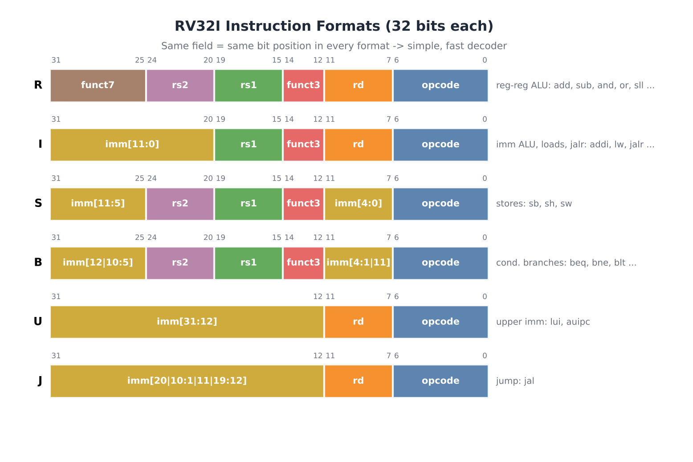

# RV32I Quick Reference Cheat-sheet

## Registers

| x# | ABI | Role | Saved by | | x# | ABI | Role | Saved by |
|---|---|---|---|---|---|---|---|---|
| x0 | zero | always 0 | — | | x10–11 | a0–a1 | args / return | caller |
| x1 | ra | return address | caller | | x12–17 | a2–a7 | args | caller |
| x2 | sp | stack pointer | callee | | x18–27 | s2–s11 | saved | callee |
| x3 | gp | global pointer | — | | x28–31 | t3–t6 | temporaries | caller |
| x4 | tp | thread pointer | — | | | | | |
| x5–7 | t0–t2 | temporaries | caller | | | | | |
| x8 | s0/fp | saved / frame ptr | callee | | | | | |
| x9 | s1 | saved | callee | | | | | |

## Formats



## All 40 instructions with encoding fields

| Instr | Fmt | opcode | funct3 | funct7 / imm | Operation |
|---|---|---|---|---|---|
| lui | U | 0110111 | – | – | rd = imm<<12 |
| auipc | U | 0010111 | – | – | rd = PC + (imm<<12) |
| jal | J | 1101111 | – | – | rd = PC+4; PC += imm |
| jalr | I | 1100111 | 000 | – | rd = PC+4; PC = (rs1+imm)&~1 |
| beq | B | 1100011 | 000 | – | if rs1==rs2 PC += imm |
| bne | B | 1100011 | 001 | – | if rs1!=rs2 |
| blt | B | 1100011 | 100 | – | if rs1<rs2 (signed) |
| bge | B | 1100011 | 101 | – | if rs1>=rs2 (signed) |
| bltu | B | 1100011 | 110 | – | if rs1<rs2 (unsigned) |
| bgeu | B | 1100011 | 111 | – | if rs1>=rs2 (unsigned) |
| lb | I | 0000011 | 000 | – | rd = sext(M8[rs1+imm]) |
| lh | I | 0000011 | 001 | – | rd = sext(M16[…]) |
| lw | I | 0000011 | 010 | – | rd = M32[…] |
| lbu | I | 0000011 | 100 | – | rd = zext(M8[…]) |
| lhu | I | 0000011 | 101 | – | rd = zext(M16[…]) |
| sb | S | 0100011 | 000 | – | M8[rs1+imm] = rs2[7:0] |
| sh | S | 0100011 | 001 | – | M16[…] = rs2[15:0] |
| sw | S | 0100011 | 010 | – | M32[…] = rs2 |
| addi | I | 0010011 | 000 | – | rd = rs1 + imm |
| slti | I | 0010011 | 010 | – | rd = rs1 < imm (signed) |
| sltiu | I | 0010011 | 011 | – | rd = rs1 < imm (unsigned) |
| xori | I | 0010011 | 100 | – | rd = rs1 ^ imm |
| ori | I | 0010011 | 110 | – | rd = rs1 \| imm |
| andi | I | 0010011 | 111 | – | rd = rs1 & imm |
| slli | I | 0010011 | 001 | 0000000 | rd = rs1 << shamt |
| srli | I | 0010011 | 101 | 0000000 | rd = rs1 >>u shamt |
| srai | I | 0010011 | 101 | 0100000 | rd = rs1 >>s shamt |
| add | R | 0110011 | 000 | 0000000 | rd = rs1 + rs2 |
| sub | R | 0110011 | 000 | 0100000 | rd = rs1 − rs2 |
| sll | R | 0110011 | 001 | 0000000 | rd = rs1 << rs2[4:0] |
| slt | R | 0110011 | 010 | 0000000 | rd = rs1 < rs2 (signed) |
| sltu | R | 0110011 | 011 | 0000000 | rd = rs1 < rs2 (unsigned) |
| xor | R | 0110011 | 100 | 0000000 | rd = rs1 ^ rs2 |
| srl | R | 0110011 | 101 | 0000000 | rd = rs1 >>u rs2 |
| sra | R | 0110011 | 101 | 0100000 | rd = rs1 >>s rs2 |
| or | R | 0110011 | 110 | 0000000 | rd = rs1 \| rs2 |
| and | R | 0110011 | 111 | 0000000 | rd = rs1 & rs2 |
| fence | I | 0001111 | 000 | – | memory/IO ordering |
| ecall | I | 1110011 | 000 | imm=0 | environment call |
| ebreak | I | 1110011 | 000 | imm=1 | breakpoint |

## Immediate ranges

| Format | Bits | Range |
|---|---|---|
| I, S | 12 | −2048 … +2047 |
| B | 13 (even) | −4096 … +4094 bytes |
| U | 20 (upper) | any upper 20 bits |
| J | 21 (even) | ±1 MiB |

## Common pseudo-instructions

`nop` · `li` · `la` · `mv` · `not` · `neg` · `seqz` · `snez` · `sltz` · `sgtz` · `beqz` · `bnez` · `blez` · `bgez` · `bltz` · `bgtz` · `bgt` · `ble` · `bgtu` · `bleu` · `j` · `jr` · `ret` · `call` · `tail` · `csrr` · `csrw` · `csrs` · `csrc`

## Function template

```asm
func:   addi sp, sp, -16
        sw   ra, 12(sp)
        sw   s0,  8(sp)
        # body
        lw   s0,  8(sp)
        lw   ra, 12(sp)
        addi sp, sp, 16
        ret
```

## Trap CSRs

| CSR | Use |
|---|---|
| mstatus | MIE (3), MPIE (7), MPP (12:11) |
| mie / mip | enable / pending: MSI 3, MTI 7, MEI 11 |
| mtvec | handler base, MODE[1:0] |
| mepc | return PC |
| mcause | [31]=interrupt, code |
| mtval | bad address / instruction |

**mcause codes:** exceptions 0 instr-misaligned · 1 instr-fault · 2 illegal · 3 breakpoint · 4 load-misaligned · 5 load-fault · 6 store-misaligned · 7 store-fault · 8/9/11 ecall U/S/M — interrupts 3 software · 7 timer · 11 external.

---
[⬅ Index](../README.md)
