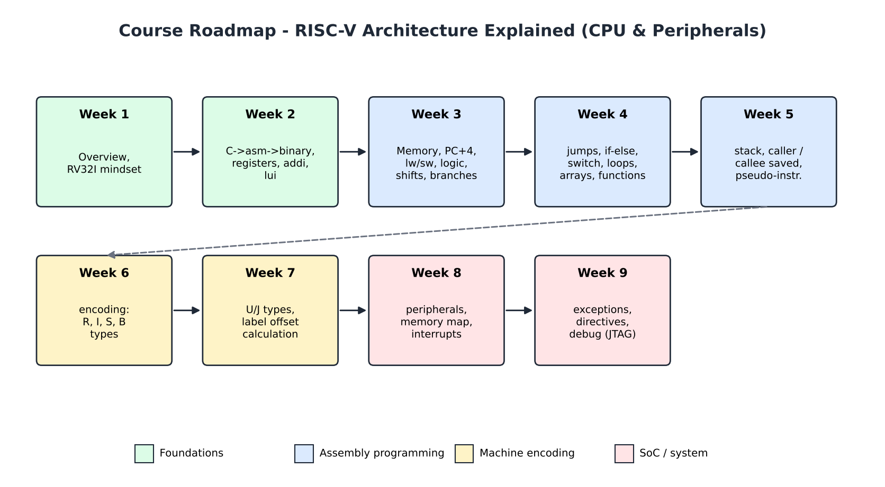
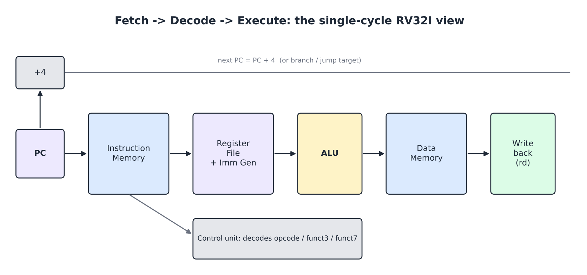

# Day 01 — Overview of the Training

> **Course:** Week 1, Video 1 &nbsp;|&nbsp; **Playlist #1** &nbsp;|&nbsp; [Chip Design with Rashid — RISC-V Architecture Explained](https://www.youtube.com/playlist?list=PL0-xus8sJBCRzZtmL_fLWaohRKuc4j5aH)  
> **Notes source:** video topic + Rashid's weekly notes + standard RV32I material

## What is an ISA?

An **Instruction Set Architecture (ISA)** is the *contract* between software and hardware. It defines:

| The ISA specifies… | Example in RISC-V |
|---|---|
| Which instructions exist | `add`, `lw`, `beq`, `jal` … |
| How many registers there are and how wide | 32 registers × 32 bits (RV32) |
| How instructions are encoded in binary | 32-bit words, 6 formats (R/I/S/B/U/J) |
| How memory is addressed | byte-addressable, little-endian |
| What happens on errors / interrupts | traps, CSRs, privilege modes |

The ISA does **not** say *how* the hardware is built. A tiny microcontroller and a big out-of-order server CPU can implement the same ISA — that is the separation between **architecture** (what) and **micro-architecture** (how).

```
   Software (C, Python, OS, compiler)
 ───────────────────────────────────────  ← ISA = the contract
   Hardware (pipelines, caches, ALUs, gates, transistors)
```

## RISC vs CISC

| | RISC (e.g. RISC-V, ARM) | CISC (e.g. x86) |
|---|---|---|
| Instruction size | fixed (32-bit in RV32I) | variable (1–15 bytes on x86) |
| Instruction work | one simple operation each | can be complex (memory + ALU in one) |
| Memory access | **only** loads/stores | many instructions can touch memory |
| Registers | many general-purpose (32) | fewer |
| Decoder | simple, fast | complex |
| Code size | larger | smaller |

RISC = **R**educed **I**nstruction **S**et **C**omputer. "Reduced" means *simple instructions*, not *few features*.

## Why RISC-V?

1. **Open and free** — anyone can design a RISC-V chip without paying licence fees (unlike ARM/x86).
2. **Clean and modern** — designed in 2010 at UC Berkeley without decades of backward-compatibility baggage.
3. **Modular** — a small mandatory base + optional extensions.
4. **Huge ecosystem** — GCC/LLVM, Linux, simulators, open-source cores and open-source chip tools.
5. Ideal for **learning** — the whole base ISA fits on one page.

## Base ISA + extensions (naming)

| Letter | Meaning |
|---|---|
| **I** | Base integer (mandatory) — **this course** |
| E | Embedded: base with only 16 registers |
| M | Integer multiply / divide |
| A | Atomic memory operations |
| F / D | Single / double precision floating point |
| C | Compressed 16-bit instructions |
| Zicsr | Control & Status Register instructions (needed for interrupts, Week 8) |
| G | Shorthand for IMAFD + Zicsr + Zifencei |

Examples: `RV32I` (32-bit, base only), `RV32IMC` (typical microcontroller), `RV64GC` (Linux-class processor).

## What the course builds up to



The course climbs a ladder:

1. **Assembly programming** (Weeks 2–5): registers, arithmetic, memory, branches, loops, arrays, functions, stack.
2. **Machine encoding** (Weeks 6–7): how each instruction becomes 32 bits — this is what the hardware decoder sees.
3. **System level** (Weeks 8–9): how the CPU talks to peripherals, interrupts, exceptions, and debugging a real SoC.

Understanding all three levels is exactly what a **digital IC / RTL designer** needs before writing the Verilog for a RISC-V core.

## The CPU at a glance



Every instruction goes through the same basic steps:

1. **Fetch** — read the 32-bit instruction from memory at address `PC`.
2. **Decode** — the control unit looks at `opcode`, `funct3`, `funct7`; read source registers; build the immediate.
3. **Execute** — the ALU computes (add, compare, address calculation…).
4. **Memory** — loads/stores access data memory.
5. **Write-back** — result written into the destination register `rd`.
6. **Next PC** — `PC + 4`, or a branch/jump target.

## Tools you can use to practise

| Tool | Purpose |
|---|---|
| **RARS** / **Venus** / **Ripes** | Graphical RISC-V simulators — write assembly, single-step, watch registers & memory (Ripes also shows the pipeline) |
| `riscv64-unknown-elf-gcc` | GNU cross-compiler (`-march=rv32i -mabi=ilp32`) |
| `objdump -d` | Disassemble and see the machine code next to the assembly |
| Spike / QEMU | Instruction-set simulators |
| Verilator / Icarus + GTKWave | Simulate a RISC-V core written in Verilog |

> 💡 **Tip:** Compile a tiny C function with `-O1 -S` and read the generated assembly — it is the fastest way to learn what the compiler does.

<!-- rashid-notes -->
## 📒 From Rashid's Week 1,2 notes

> Extra points and worked examples from Rashid's members-only weekly notes ([RISCV_Arch folder](https://drive.google.com/drive/folders/1sIX-rAanGWWkZocAbXNmvW80JbdAEg6P), members only). Written here in my own words; most of his examples come from the reference book *Digital Design and Computer Architecture, RISC-V Edition* (Harris & Harris), chapters 6–7.

**The 4-stage plan he draws on the first page** — design, implement, verify, then physical design of a low-cost, low-power RV32I core using only free/open-source tools:

| Stage | What happens | Time he planned |
|---|---|---|
| 1 | RISC-V **architecture** + a **Python model** of the CPU | ~2 months |
| 2 | **SystemVerilog** implementation + SV verification | ~2 months |
| 3 | **UVM** validation of the core | 2–3 months |
| 4 | **Physical design** with open-source tools | 2–3 months |

**Reference book:** *Digital Design and Computer Architecture, RISC-V Edition* by Sarah L. Harris & David Money Harris — **Chapter 6** (architecture) and **Chapter 7** (microarchitecture). Most of the code examples in these notes (6.4, 6.18, 6.24, 6.27 …) are from that book.

**Membership extras:** "just-in-time fundamentals" (he teaches the digital-logic basics exactly when they are needed), a **weekly quiz** (Google Form) and **weekly notes** (PDF).

**Our blueprint = the RISC-V ISA, RV32I** → a **32-bit machine**: 32-bit address bus, 32-bit data bus, so the CPU can address 0 … 2³² − 1 memory locations. The system is just **CPU ↔ Memory ↔ I/Os** (I/Os are how the chip talks to the real world).

---
[Index](../README.md) | [Day 02 ➡](../Day-02-RV32I-Just-in-Time-Approach/README.md)
