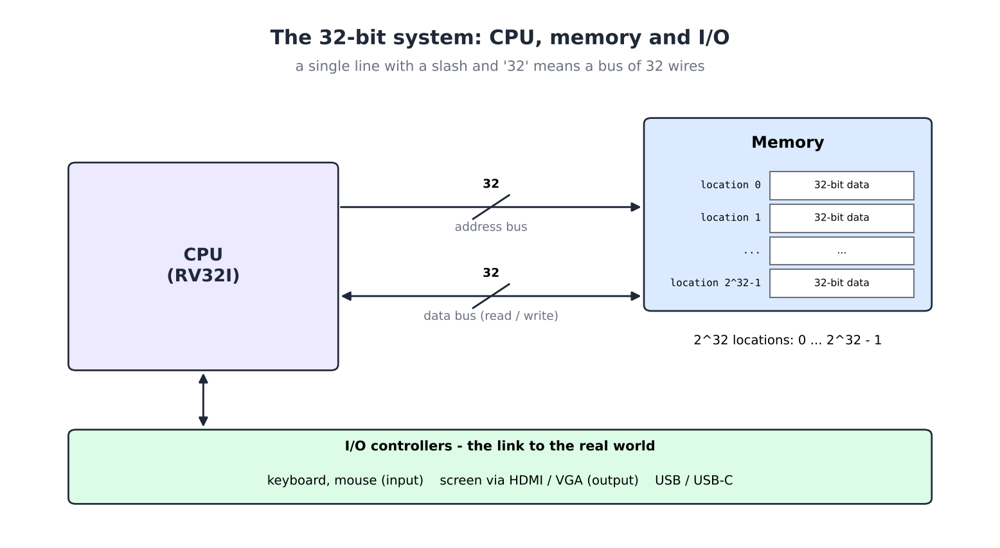
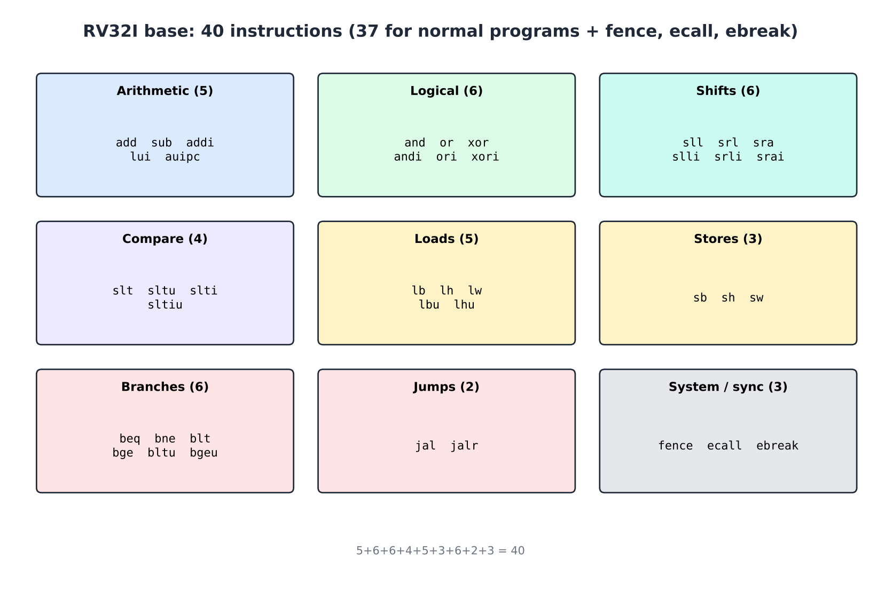

# Day 02 — Starting with 32-bit RV32I, the 'Just in Time' Fundamental Approach

> **Course:** Week 1, Video 2 &nbsp;|&nbsp; **Playlist #2** &nbsp;|&nbsp; [Chip Design with Rashid — RISC-V Architecture Explained](https://www.youtube.com/playlist?list=PL0-xus8sJBCRzZtmL_fLWaohRKuc4j5aH)  
> **Notes source:** lecture transcript

> ✍️ *This section is written from the lecture transcript.*

## The goal of the whole training

Rashid states the aim clearly: **design, implement, verify and do the physical design of a 32-bit RISC-V processor** — the complete chip-design journey, not just theory. The deeper goal is to learn **how to create hardware that solves a particular problem**; the processor is the vehicle for that.

He teaches it with his son Shazel sitting in as a student, so the videos include small question-and-answer moments (like the 2-bit example below).

## Why RISC-V?

- **Open-source ISA — no licence needed.** The RISC-V specification tells us what instructions the processor must follow; we can build our own hardware for it, create our **own IP**, use it in our products and even **sell** that IP.
- Compared with other ISAs: Intel's **x86**, **ARM** (both licensed), and **MIPS** (which he studied earlier, but which is fading away). RISC-V has a large set of **open-source tools**, so it was the natural choice.
- **Free tools for every stage**: the design, verification and physical-design steps will all use open-source / free tools — good for students anywhere.

## The "just in time" fundamentals approach

The traditional way is: teach all the fundamentals first (gates, combinational logic, binary, …) and only then build something. Students often struggle to connect that theory to a real application.

This course goes the other way:

```
Start at the PROCESSOR level
        │
        ├── need a fundamental concept?  ──►  dive in "just in time"
        │                                      (point to an earlier
        │                                       logic-design video, or
        │                                       explain it right there)
        ▼
continue building the processor
```

The fundamentals are still covered — they are "super important" — but each one appears **when the design needs it**, so it always has a purpose.

## Reference book

The course follows a well-written textbook that Rashid shows on screen (the title isn't read out; it matches Harris & Harris, *Digital Design and Computer Architecture*, which has a RISC-V edition and whose Chapter 6 is "Architecture"). He strongly recommends getting a copy — it builds digital design step by step and he has used it as the reference for his logic-design videos too.
The course **does not start at Chapter 1** — it starts at **Chapter 6, "Architecture"** — and refers back to his earlier logic-design videos for fundamentals.

## RV32I — the base we study

- RISC-V has several variants and **extensions** (e.g. floating point).
- We study the most basic one: **RV32I — RISC-V, 32-bit, Integer**.
- The official **specifications** are on the RISC-V website; the course will discuss what the spec defines and what it leaves open.

## What does "32-bit machine" mean?



| Bus | Width | Meaning |
|---|---|---|
| **Address bus** (CPU → memory) | 32 bits | which memory location to access |
| **Data bus** (CPU ⇄ memory) | 32 bits | the value written to / read from that location |

**Drawing convention:** instead of drawing 32 separate wires, draw **one line with a small slanted dash and write "32"** next to it.

## How many locations can 32 address bits reach?

Each wire is 0 or 1, so *n* wires give **2ⁿ unique combinations**, numbered **0 … 2ⁿ − 1**.

The 2-bit example from the lecture:

| b1 b0 | Value |
|---|---|
| 0 0 | 0 |
| 0 1 | 1 |
| 1 0 | 2 |
| 1 1 | **3** |

→ **4 combinations** (2²), numbered **0 to 3** (= 2² − 1). Shazel first answered "four" for the last number — the count is 4 but the **highest number is 3**, because counting starts at 0.

For 32 bits:

```
number of locations = 2^32            (= 4,294,967,296)
first address       = 0               = 0x0000_0000
last address        = 2^32 - 1        = 0xFFFF_FFFF   (all 32 bits = 1)
```

In the lecture's simplified picture each memory location holds **32 bits of data**. *(Later — Week 3 — we will see that RISC-V actually gives every **byte** its own address, which is why the next instruction is at PC + 4.)*

## Hexadecimal notation

Writing 32 ones and zeros is too long, so we use **hex**: each hex digit = 4 bits.

| Hex | Binary |
|---|---|
| `0` | 0000 |
| `9` | 1001 |
| `A` | 1010 |
| `F` | 1111 (all ones) |

`0xFFFFFFFF` = 32 ones = the highest 32-bit address.

## Homework given in the lecture

Watch Rashid's **Logic Design series, Topic 8 (binary number system)** and **Topic 9** (addition, subtraction, 2's complement). He promised to ask questions on it next time — and 2's complement is exactly what Week 2 needs for `ADDI`.

## The overall system: CPU + memory + I/O

1. Memory holds **instructions**; the CPU executes a **sequence of instructions**.
2. The CPU can **read** 32-bit data from memory and **write** 32-bit results back.
3. The CPU can also send and receive signals through **I/O** — the link between the CPU and the real world.

| I/O example | Direction |
|---|---|
| Keyboard, mouse | input |
| Screen | output |
| Ports: HDMI, VGA, USB, USB-C | connect devices |

The hardware blocks that talk to these devices are called **controllers** (USB controller, display controller, …).
The target chip covers **all three: CPU, memory and I/O**, with the heaviest focus on the CPU.

## What comes next

The next video introduces the **compiler**, the **assembler** and **instruction formats**, then the course follows Chapter 6 topic by topic.

## Extra (beyond this lecture): quick RV32I facts for reference

- 32 general-purpose registers `x0 … x31`, 32 bits each (`x0` is always 0) + the **PC**.
- Every instruction is exactly 32 bits; only **loads/stores** access memory.
- The whole base ISA is just **40 instructions**:



---

## Week 1 Key Takeaways

- The ISA is the hardware/software contract; RISC-V is an **open, modular, RISC** ISA.
- Course goal: design, implement, verify and physically design a 32-bit RISC-V CPU with free/open-source tools.
- "Just in time" fundamentals: start at the processor, dive into basics only when needed.
- **RV32I** = 32-bit address and data buses, 2³² locations (0 … 2³²−1), 32 registers, 40 instructions.
- Memory is touched only by loads/stores.
- The course goes: assembly → encoding → system (peripherals, interrupts, debug).

## Practice Questions

1. What is the difference between an ISA and a micro-architecture? Give one example of each.
2. Expand `RV32IMC` and explain each letter.
3. Why can an RV32I CPU address at most 4 GiB of memory?
4. List three differences between RISC and CISC.
5. With 32 address bits, what are the first and last addresses in hex? How many locations is that?

<details><summary>Answers</summary>

1. ISA = what the programmer sees (instructions, registers). Micro-architecture = how it is built (5-stage pipeline, caches). Two different micro-architectures can run the same RV32I binary.
2. RV = RISC-V, 32 = 32-bit XLEN, I = base integer, M = multiply/divide, C = compressed 16-bit instructions.
3. Addresses are 32 bits → 2³² byte addresses = 4 GiB.
4. Fixed vs variable length; load/store only vs memory operands; simpler decoder / more registers.
5. `0x00000000` to `0xFFFFFFFF`; 2³² = 4,294,967,296 locations.
</details>

---
[⬅ Day 01](../Day-01-Overview-of-the-Training/README.md) | [Index](../README.md) | [Day 03 ➡](../Day-03-C-to-Assembly-to-Machine-Language/README.md)
