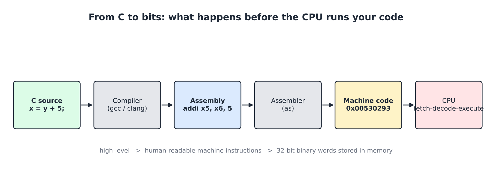
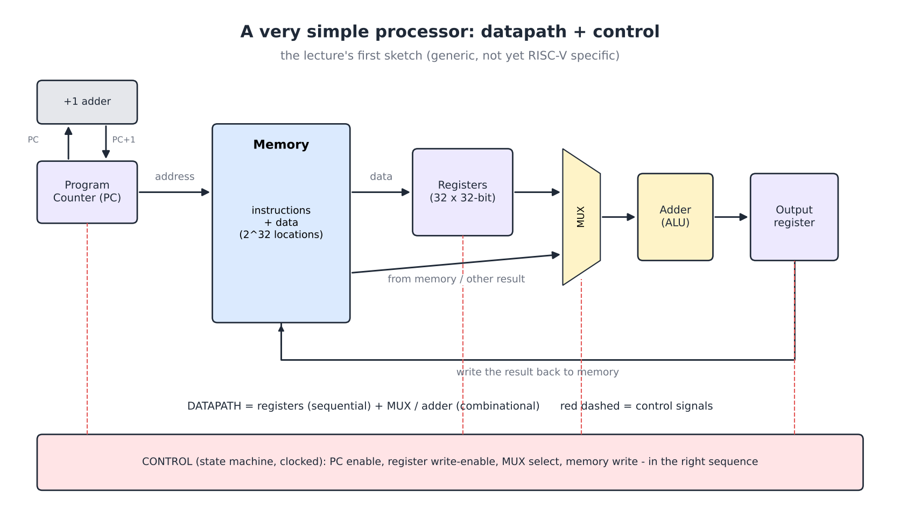

# Day 03 — C Language to Assembly to Machine Language

> **Course:** Week 2, Video 1 &nbsp;|&nbsp; **Playlist #3** &nbsp;|&nbsp; [Chip Design with Rashid — RISC-V Architecture Explained](https://www.youtube.com/playlist?list=PL0-xus8sJBCRzZtmL_fLWaohRKuc4j5aH)  
> **Notes source:** lecture transcript

Week 2 starts here. Week 1 was short (only two videos); this week has many more, building up gradually. Rashid's tip: if a basic part is already familiar, **increase the playback speed** and slow down again when something new comes up.

## 1. The computer only understands 0s and 1s

We write software in **high-level languages** such as **Python** or **C/C++**, for example:

```
a = b + c        # define variables b and c, add them, put the result in the destination a
```

The computer **cannot understand this text**. A computer only understands **binary — zeros and ones**. So the program must be **converted into 0s and 1s and placed in memory**.

## 2. What the CPU does with memory

From Day 02: the 32-bit RISC-V CPU drives a **32-bit address**, so it can reach **2³² memory locations**, and it can **write** data to memory and **read** data from it.

Assume (for now — *how* it gets there comes later) that the binary program has been put into memory. The CPU then simply **reads the memory locations one by one** and does what each 32-bit pattern tells it to.

## 3. From high-level code to bits: compiler and assembler



```
Python / C code  ──compiler──►  Assembly language  ──assembler──►  32-bit binary instructions  ──►  memory
(if-else, +, -, …)              (lw, add, sw, …)                  (0101… one per location)
```

### The compiler → assembly language

The **compiler** converts high-level code (if-else, addition, subtraction, assignments …) into **assembly language** — a different language that is **much closer to the hardware**. Rashid's example for `a = b + c`:

```asm
lw   t0, 0(x0)      # load word from memory address 0 into register t0   (b)
lw   t1, 4(x0)      # load word from memory address 4 into register t1   (c)
add  t2, t0, t1     # t2 = t0 + t1
sw   t2, 8(x0)      # store register t2 into memory address 8             (a)
```

*(In the video the syntax is written loosely — "load word from address 0 into t0", "store t2 into 8"; the lines above are the exact RV32I form. Registers are explained on Day 04.)*

Key point: **one high-level line becomes several assembly instructions**.

### Who writes assembly by hand?

- Writing whole programs in assembly is hard, so normally **nobody does** — it is an intermediate step.
- Exceptions: people programming **small microcontrollers** (Rashid mentions the **Intel 8051**, used inside hardware systems) sometimes wrote assembly to get **very optimised code** ("this data comes here, put it in a register, then do this …"). He did this at university too.
- You can only realistically write **small pieces** of code this way.
- In this course we will use a **simulator** to write **small assembly programs** — not to become assembly programmers, but to **understand how the CPU moves and processes data**.

### The assembler → machine code

The **assembler** converts assembly into **binary**: each instruction becomes one **32-bit pattern**, and these are written into **different memory locations**.

For the example above (checked with a real assembler):

| Assembly | 32-bit machine code (hex) |
|---|---|
| `lw  t0, 0(x0)` | `0x00002283` |
| `lw  t1, 4(x0)` | `0x00402303` |
| `add t2, t0, t1` | `0x006283B3` |
| `sw  t2, 8(x0)` | `0x00702423` |

(How these bit patterns are built is covered on Days 26–32.)

## 4. Fetch → Decode → Execute

The CPU's job is to take these 32-bit instructions **one by one**:

| Step | What happens |
|---|---|
| **Fetch** | read the 32-bit instruction from the memory location the PC points to |
| **Decode** | the 32 bits are just `0101…` — dedicated **decode hardware** works out *what* it is: an add? a load? a store? |
| **Determine operands** | find the **source operands** (the values the operation works on) and the **destination operand** (where the result goes) |
| **Execute** | send the operands through the right hardware (e.g. the adder) and store the result |

For `add t2, t0, t1`: `t0` and `t1` are the **source operands**, `t2` is the **destination operand**.

## 5. A very simple processor (first sketch)



Rashid draws a first, deliberately **generic** architecture (not yet RISC-V specific — the real details come gradually):

- **Program Counter (PC)** — a **register** holding a **32-bit address**, connected directly to the memory's address input. In this sketch an adder adds **1** to the PC every time (0, 1, 2, 3 …); its old value is fed back, incremented, and stored as the new value. *(In RISC-V it is actually +4 — Day 09.)*
- Data read from memory goes into **registers** — the CPU has **32 registers, each 32 bits**.
- A **multiplexer (MUX)** selects the adder's input: from a register, directly from memory, or from some other calculated result.
- The **adder** adds its two inputs; the result goes into an **output register**, and from there it can be **written back to memory** at an address we provide.

"I don't expect you to understand everything at this stage" — the purpose is just to see the shape of a processor.

## 6. Registers, the clock and sequencing

- A **register is a storage element** — it *remembers* a value.
- It stores a new value **only when it is enabled** (an **enable** signal).
- In **synchronous design**, remembering is always done **with respect to a clock**.

**Why a clock?** A clock is used for **timing**. Data is always flowing through the wires, but to get **useful work** we must **sequence** it: bring the inputs at the right time, wait for the operation to finish, save the outputs at the right time, then write them to memory. A *sequence of operations* is what solves a problem.

## 7. Datapath and control

| Part | What it is | Built from |
|---|---|---|
| **Datapath** | the pieces connected together that the data flows through — PC, registers, MUX, adder, memory | **Combinational** circuits (MUX, adder) + **sequential** circuits (registers) |
| **Control** | decides **when** each signal happens: which input the MUX selects, when a register is enabled, whether the PC increments, when to write memory | a **state machine / proper sequence**; at its core it is a **sequential** storage element (with some combinational logic) |

So processor design = **create the datapath**, then **control the flow of data with the clock and enable/select signals**.

This is why logic-design courses start with gates → combinational → sequential logic: those are the building blocks (multiplexers, registers …) you need at this stage. This course instead explains them **when they are needed** (the "just in time" approach from Day 02).

## 8. Why the RISC-V specification matters

Students often get confused here: we are **not** designing a generic CPU where we can add as many registers as we like.

- The **RISC-V architecture specifies** exactly what the hardware must have — e.g. **exactly 32 registers, not fewer and not more**, each 32 bits wide, and **what each register is used for**. All of this is written in the RISC-V specification document.
- The compiler/assembler **targets RISC-V**: it generates RISC-V instructions *knowing* there are only 32 registers of 32 bits each.
- So our hardware **must follow the specification**; otherwise code produced by the RISC-V tools will **not work** on it.

## 9. Homework from this lecture

1. **Number conversion** — everything is binary, but we write numbers in **decimal** or **hexadecimal** (one hex character = 4 bits, which shortens long binary strings). Practise:
   - decimal → binary (start with 3-, 4-, 5-bit numbers, then 32-bit);
   - a binary (e.g. 32-bit) number → decimal and hex.
   - (Addition is not needed yet.) Quizzes will come on Fridays/weekends.
2. **Watch Rashid's Sequential Logic Design videos** before the next lecture:
   - SR latch,
   - latch and register,
   - latch vs flip-flop.

   Key idea to remember: a register is a **storage element**.

### Quick practice: number conversion

| Decimal | 5-bit binary | Hex |
|---|---|---|
| 5 | 00101 | 0x05 |
| 10 | 01010 | 0x0A |
| 19 | 10011 | 0x13 |
| 31 | 11111 | 0x1F |

32-bit example: `0000 0000 0000 0000 0000 0000 0010 1010` = `0x0000002A` = **42**.

## What comes next

Day 04: **what a register is**, why it is used and what it is made of — then multiplexers and adders when we reach them.

---

## Extra (beyond this lecture): the real toolchain

| Stage | Tool | Input → Output |
|---|---|---|
| Compile | `gcc` / `clang` | `.c` → `.s` (assembly) |
| Assemble | `as` | `.s` → `.o` (object file, machine code) |
| Link | `ld` | many `.o` + libraries → executable (`.elf`), resolves addresses |
| Load / run | loader / boot ROM | executable → memory; CPU starts fetching |

```bash
riscv64-unknown-elf-gcc -march=rv32i -mabi=ilp32 -O1 -S add.c     # C -> assembly (add.s)
riscv64-unknown-elf-gcc -march=rv32i -mabi=ilp32 -O1 -c add.c     # -> object file (add.o)
riscv64-unknown-elf-objdump -d add.o                               # assembly + hex side by side
```

## Practice Questions

1. Why can't the CPU run Python or C code directly?
2. What does the compiler produce, and what does the assembler produce?
3. In `add t2, t0, t1`, which are the source operands and which is the destination?
4. What is the difference between the datapath and the control?
5. Why must our CPU have exactly 32 registers?
6. Convert 25 to 5-bit binary and to hex.

**Answers**

1. The CPU only understands binary (0s and 1s); code must be translated into binary instructions in memory.
2. Compiler → assembly language; assembler → 32-bit binary machine instructions.
3. Sources: `t0`, `t1`; destination: `t2`.
4. Datapath = the connected hardware the data flows through (registers, MUX, adder, memory); control = the sequenced enable/select signals that decide when things happen.
5. The RISC-V specification requires it, and the compiler/assembler generate code assuming exactly 32 × 32-bit registers.
6. 25 = `11001` = `0x19`.

---
[⬅ Day 02](../Day-02-RV32I-Just-in-Time-Approach/README.md) | [Index](../README.md) | [Day 04 ➡](../Day-04-What-is-a-Register/README.md)
