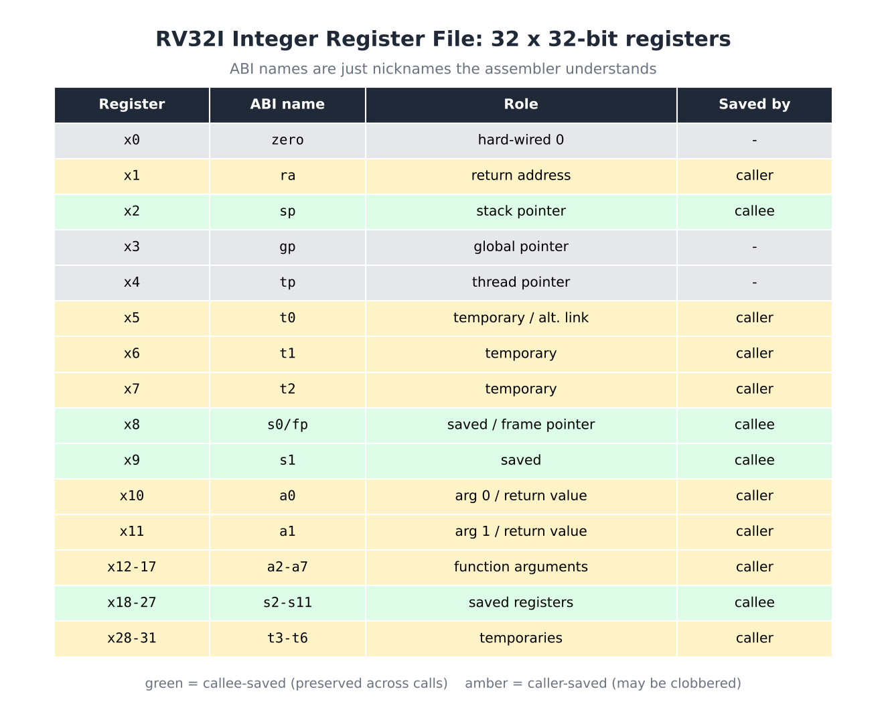
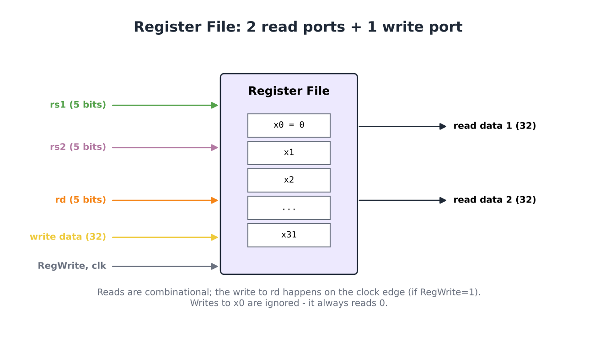

# Day 05 — Register File, Instruction Examples with Registers

> **Course:** Week 2, Video 3 &nbsp;|&nbsp; **Playlist #5** &nbsp;|&nbsp; [Chip Design with Rashid — RISC-V Architecture Explained](https://www.youtube.com/playlist?list=PL0-xus8sJBCRzZtmL_fLWaohRKuc4j5aH)  
> **Notes source:** video topic + standard RV32I material (to be updated from the transcript)



The **register file** is the block that holds all 32 registers. In RV32I it has **2 read ports and 1 write port**, because the most common instructions read two sources and write one destination.



- `rs1`, `rs2` (5 bits each) choose which registers to read → `read data 1`, `read data 2`.
- `rd` (5 bits) chooses which register is written with `write data` on the clock edge, if `RegWrite = 1`.

## ABI names

The **ABI** (Application Binary Interface) gives each register a nickname that tells you its software role. The assembler accepts both forms — `x10` and `a0` are the same register.

| Group | ABI names | Purpose |
|---|---|---|
| zero | `zero` (x0) | constant 0 |
| return address | `ra` (x1) | where a function returns to |
| stack pointer | `sp` (x2) | top of the stack |
| temporaries | `t0–t6` | scratch values |
| saved | `s0–s11` | values that must survive a function call |
| arguments | `a0–a7` | function arguments; `a0/a1` also return values |

## Register-to-register (R-type) examples

```asm
add  t0, t1, t2     # t0 = t1 + t2
sub  t0, t1, t2     # t0 = t1 - t2
add  a0, a0, a0     # a0 = 2 * a0
sub  t0, x0, t1     # t0 = -t1     (pseudo: neg t0, t1)
```

## Worked example — evaluate `f = (g + h) - (i + j)`

Assume `g, h, i, j` are in `s1, s2, s3, s4` and `f` goes in `s0`.

```asm
add  t0, s1, s2     # t0 = g + h
add  t1, s3, s4     # t1 = i + j
sub  s0, t0, t1     # f  = t0 - t1
```

The compiler breaks a complex expression into simple 3-operand steps, using temporaries.

---
[⬅ Day 04](../Day-04-What-is-a-Register/README.md) | [Index](../README.md) | [Day 06 ➡](../Day-06-ADDI-2s-Complement-Sign-Extension/README.md)
