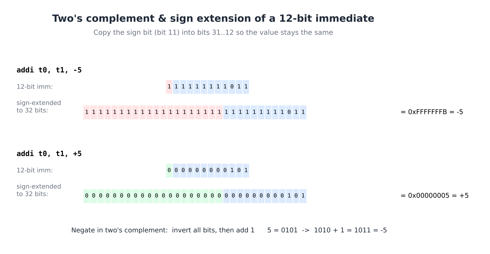

# Day 06 — Why Assembly? ADDI Instruction, 2's Complement, Sign Extension

> **Course:** Week 2, Video 4 &nbsp;|&nbsp; **Playlist #6** &nbsp;|&nbsp; [Chip Design with Rashid — RISC-V Architecture Explained](https://www.youtube.com/playlist?list=PL0-xus8sJBCRzZtmL_fLWaohRKuc4j5aH)  
> **Notes source:** video topic + Rashid's weekly notes + standard RV32I material

## Why learn assembly at all?

- To understand **what the hardware actually executes** — essential for designing CPUs.
- Debugging (crash dumps, disassembly), performance tuning, boot code, interrupt handlers, drivers.
- Writing the **startup code** of an SoC (set `sp`, clear `.bss`, jump to `main`) — this is always assembly.

## ADDI — add immediate

```asm
addi rd, rs1, imm      # rd = rs1 + sign_extend(imm[11:0])
```

- `imm` is a **12-bit signed** constant inside the instruction.
- Range: **−2048 … +2047**.
- There is **no `subi`** — just use a negative immediate: `addi t0, t0, -1`.

## 2's complement in 30 seconds

For an *n*-bit number, the MSB has weight **−2ⁿ⁻¹**; the rest are positive.

```
4-bit:  1011 = -8 + 0 + 2 + 1 = -5
Range of n bits: -2^(n-1) ... +2^(n-1) - 1
12 bits: -2048 ... +2047        32 bits: -2,147,483,648 ... +2,147,483,647
```

**To negate:** invert all bits, add 1. `5 = 0101 → 1010 + 1 = 1011 = −5`.

## Sign extension

The ALU works on 32 bits, but the immediate has only 12. The hardware **copies bit 11 (the sign bit) into bits 31…12**. This keeps the *value* unchanged.



| 12-bit imm | Sign-extended 32-bit | Value |
|---|---|---|
| `0x005` | `0x00000005` | +5 |
| `0xFFB` | `0xFFFFFFFB` | −5 |
| `0x7FF` | `0x000007FF` | +2047 |
| `0x800` | `0xFFFFF800` | −2048 |

## Useful pseudo-instructions built on ADDI

| Pseudo | Real instruction |
|---|---|
| `li rd, imm` (small) | `addi rd, x0, imm` |
| `mv rd, rs` | `addi rd, rs, 0` |
| `nop` | `addi x0, x0, 0` |

<!-- rashid-notes -->
## 📒 From Rashid's Week 1,2 notes

> Extra points and worked examples from Rashid's members-only weekly notes ([RISCV_Arch folder](https://drive.google.com/drive/folders/1sIX-rAanGWWkZocAbXNmvW80JbdAEg6P), members only). Written here in my own words; most of his examples come from the reference book *Digital Design and Computer Architecture, RISC-V Edition* (Harris & Harris), chapters 6–7.

**Immediates:** `addi` carries a **12-bit immediate** that can be **positive or negative** (two's complement).

**Book examples:**

```asm
# Code Example 6.6 — immediate operands  (s0=a, s1=b)
addi s0, s0, 4        # a = a + 4
addi s1, s0, -12      # b = a - 12

# Code Example 6.7 — initialising values (s4=i, s5=x, s6=y)
addi s4, zero, 0      # i = 0
addi s5, zero, 2032   # x = 2032
addi s6, zero, -78    # y = -78
```

**Two's complement on 4 bits** (weights −8, 4, 2, 1):

| Bits | Value |
|---|---|
| 0111 | +7 (largest) |
| 1000 | −8 (smallest) |
| 1111 | −1 |

Range for n bits = **−2ⁿ⁻¹ … +(2ⁿ⁻¹ − 1)**. For the 12-bit immediate: **−2048 … +2047**.

**Sign extension worked example:** 5-bit `10111` = −16 + 0 + 4 + 2 + 1 = **−9**. Copy the sign bit to make it 8 bits: `1111 0111` = −128 + 64 + 32 + 16 + 0 + 4 + 2 + 1 = −128 + 119 = **−9** ✔. Same value, more bits — that is exactly what the CPU does to the 12-bit immediate before adding it to a 32-bit register.

He also shows a **Raspberry Pi** board with its ARM Cortex-A7 chip, to remind you that a CPU like ours is just one block on a real board.

---
[⬅ Day 05](../Day-05-Register-File/README.md) | [Index](../README.md) | [Day 07 ➡](../Day-07-LUI-and-ADDI/README.md)
