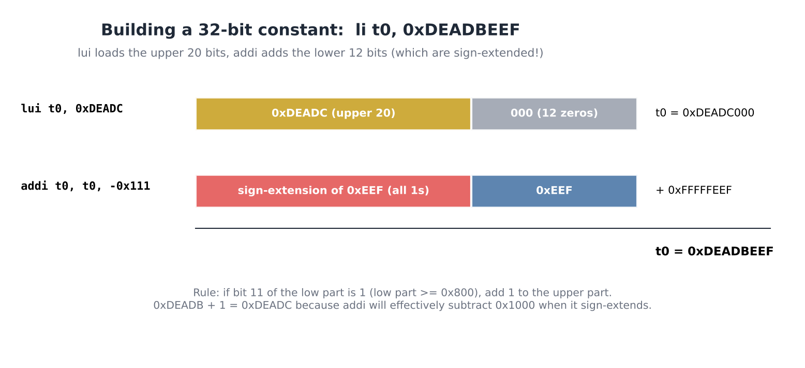
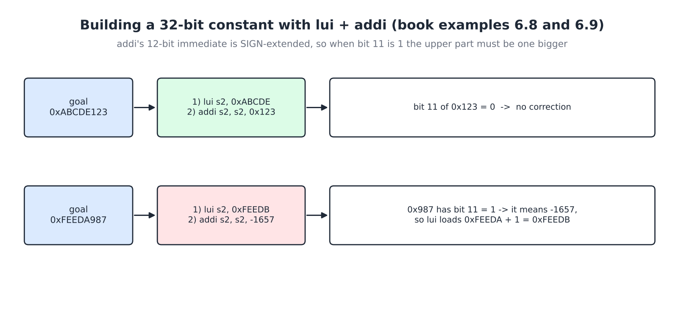

# Day 07 — Assigning a Register a 32-bit Value with LUI and ADDI

> **Course:** Week 2, Video 5 &nbsp;|&nbsp; **Playlist #7** &nbsp;|&nbsp; [Chip Design with Rashid — RISC-V Architecture Explained](https://www.youtube.com/playlist?list=PL0-xus8sJBCRzZtmL_fLWaohRKuc4j5aH)  
> **Notes source:** video topic + Rashid's weekly notes + standard RV32I material

Problem: an instruction is only 32 bits, so it cannot hold a 32-bit constant *plus* an opcode and a register number. Solution: build it in **two** instructions.

## LUI — Load Upper Immediate

```asm
lui rd, imm20       # rd = imm20 << 12      (lower 12 bits become 0)
```

## Recipe for `li rd, 0xHHHHHLLL`

1. Split the constant into **upper 20 bits** (`H`) and **lower 12 bits** (`L`).
2. `lui rd, H`
3. `addi rd, rd, L`
4. ⚠️ **Correction:** `addi` *sign-extends* `L`. If bit 11 of `L` is 1 (i.e. `L ≥ 0x800`), `addi` effectively subtracts `0x1000`. To compensate, **use `H + 1`** in the `lui`.

## Example 1 — `0x12345678` (no correction needed)

```asm
lui  t0, 0x12345     # t0 = 0x12345000
addi t0, t0, 0x678   # t0 = 0x12345678     (0x678 < 0x800, positive)
```

## Example 2 — `0xDEADBEEF` (correction needed)



```
lower 12 bits = 0xEEF  → bit 11 = 1 → as signed 12-bit = 0xEEF - 0x1000 = -0x111 (-273)
upper 20 bits = 0xDEADB → add 1 → 0xDEADC
```

```asm
lui  t0, 0xDEADC         # t0 = 0xDEADC000
addi t0, t0, -0x111      # t0 = 0xDEADC000 - 0x111 = 0xDEADBEEF ✓
```

The assembler's `li t0, 0xDEADBEEF` pseudo-instruction does exactly this automatically. In GNU assembly you can also write `lui t0, %hi(0xDEADBEEF)` / `addi t0, t0, %lo(0xDEADBEEF)` and it applies the correction for you.

## AUIPC (preview)

`auipc rd, imm20` → `rd = PC + (imm20 << 12)`. Same idea as LUI but relative to the PC — used for position-independent addresses (see Week 7).

<!-- rashid-notes -->
## 📒 From Rashid's Week 1,2 notes

> Extra points and worked examples from Rashid's members-only weekly notes ([RISCV_Arch folder](https://drive.google.com/drive/folders/1sIX-rAanGWWkZocAbXNmvW80JbdAEg6P), members only). Written here in my own words; most of his examples come from the reference book *Digital Design and Computer Architecture, RISC-V Edition* (Harris & Harris), chapters 6–7.



**Code Example 6.8 — `int a = 0xABCDE123;`**

```asm
lui  s2, 0xABCDE      # s2 = 0xABCDE000
addi s2, s2, 0x123    # s2 = 0xABCDE123
```

**Code Example 6.9 — `int a = 0xFEEDA987;` (a one in bit 11)**

```asm
lui  s2, 0xFEEDB      # s2 = 0xFEEDB000   ← one MORE than FEEDA
addi s2, s2, -1657    # s2 = 0xFEEDA987
```

**Why 0xFEEDB?** The low 12 bits are `0x987 = 1001 1000 0111`. Bit 11 is **1**, so as a 12-bit two's-complement number it means −2048 + 391 = **−1657**. `addi` will *subtract* 1657, so `lui` must load one more in the upper part: 0xFEEDB000 − 1657 = **0xFEEDA987** ✔.

Rashid also shows the long binary addition:

```
  1111 1110 1110 1101 1011 0000 0000 0000   (0xFEEDB000)
+ 1111 1111 1111 1111 1111 1001 1000 0111   (−1657 sign-extended)
= 1111 1110 1110 1101 1010 1001 1000 0111   (0xFEEDA987)
```

Hex helper on his page: 0000=0 … 1001=9, 1010=A, 1011=B, 1100=C, 1101=D, 1110=E, 1111=F; 2¹⁰ = 1K, 2²⁰ = 1M, 2³⁰ = 1G, 2³² = 4G.

---
[⬅ Day 06](../Day-06-ADDI-2s-Complement-Sign-Extension/README.md) | [Index](../README.md) | [Day 08 ➡](../Day-08-Week-1-2-Recap/README.md)
