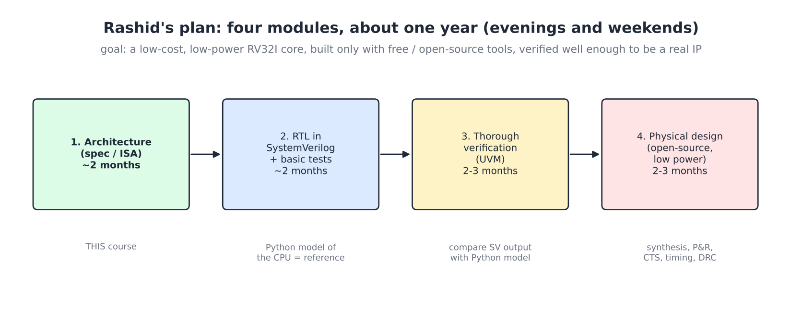
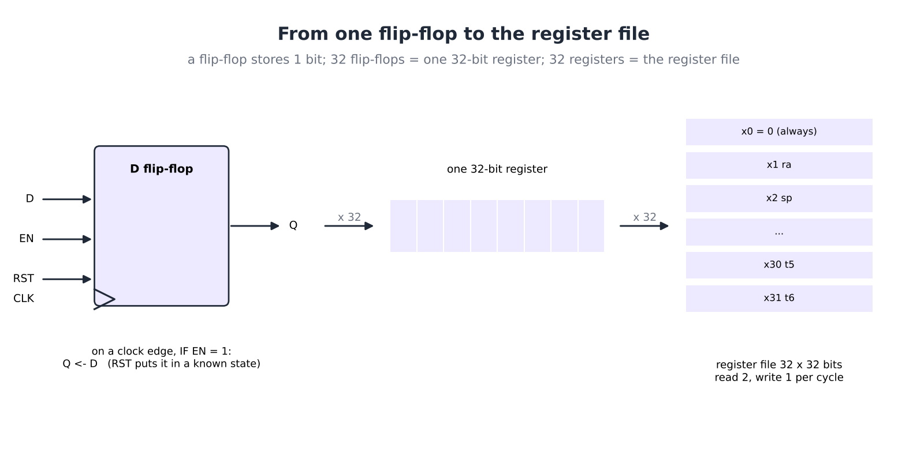

# Day 08 — Week 1 & 2 Recap

> **Course:** Week 2, Recap &nbsp;|&nbsp; **Playlist #8** &nbsp;|&nbsp; [Chip Design with Rashid — RISC-V Architecture Explained](https://www.youtube.com/playlist?list=PL0-xus8sJBCRzZtmL_fLWaohRKuc4j5aH)  
> **Notes source:** lecture transcript

This video is a quick recap of the first two weeks. It starts with the **plan for the whole series**, then goes through every topic covered so far.

## 1. The plan: what we are going to build



| Step | What happens |
|---|---|
| **Understand** | the RV32I architecture — its instruction set (ISA) |
| **Design & implement** | the processor in **SystemVerilog** |
| **Verify** | thoroughly, in SystemVerilog (and some **UVM**) |
| **Physical design** | pick a technology; synthesis, place & route, clock tree synthesis, timing, DRC — everything |

**The goal is an IP that is thoroughly verified — "not just a student project".** The target audience: undergrad and master's students and fresh engineers who want a practical foundation before starting a job.

### Only free / open-source tools

Many colleges and students don't have access to Synopsys or Cadence tools, so the course uses only free and open-source tools. Rashid's view (he has used Synopsys for most of his career and now Cadence):

> If your foundation is strong — you know the goal of each stage and the concepts behind it — then **the tool is just a tool**. Switching tools doesn't take long.

### Other plans mentioned

- **Python** may be used to **model the processor** while learning the ISA.
- **Just-in-time fundamentals:** basics are explained when they are needed (or he points to his older videos).
- Before physical design: **CMOS** — how gates are made, and **PPA** trade-offs (power, performance, area).
- **Weekly quizzes** (a Google Form shared in a channel post; you see the right answers at the end).
- **Weekly notes** for members, shared as a **channel post** (members only).
- Book: Harris & Harris, *Digital Design and Computer Architecture, RISC-V Edition* — the course started at **Chapter 6 (Architecture)**, and will most likely do **Chapter 7** too.

## 2. The big picture: our processor on a board

Eventually the processor will be the **central brain of a board**, with **general-purpose I/Os** and other I/Os. Users of that board write code in **C, Python** etc.; it ends up in memory and is executed.

To design the hardware, **you must understand every instruction the processor executes** — that's why we study assembly so carefully. "If you don't understand the specs, how can you create correct hardware for it?"

**RV32I is a 32-bit architecture:**

- the address bus to memory is 32 bits,
- the data lines are 32 bits,
- there are 32 registers, each 32 bits wide.

## 3. From C to the CPU (Days 03)

```
C / Python  ──compiler──►  assembly  ──assembler──►  machine code (in memory)
                                                          │
                       CPU:  fetch → decode → execute → write back
```

- Assembly is easier to read than `0101…`, but still close to the hardware.
- RISC-V is a **load/store** architecture: only loads and stores touch memory; all other instructions work on **registers**.

### Datapath and controller

- **Datapath:** the parts that are fixed and always connected — we know which path the data takes.
- **Controller:** the logic that generates the **write enables** and **MUX select lines**; these depend on **which instruction** is running.
- Overall the CPU is **combinational + sequential logic**.

## 4. Why digital?

Everything in real life is analog. **Digital is a higher abstraction:** by thinking only in **0 and 1** we can build complex things without worrying about the analog details underneath. So you must be comfortable with the **binary system** (decimal ↔ binary, 2's complement, addition, subtraction) — he pointed to two videos in his Logic Design series for this.

## 5. Registers (Day 04)



| Cell type | Examples | Stores data? |
|---|---|---|
| **Combinational** | NAND, inverter | no — output depends only on the current inputs |
| **Sequential** | latch, flip-flop | **yes** — storage elements |

**Why "sequential"?** Through them we can give a **sequence** to operations. If everything happened at the same time, we couldn't do useful work. The **clock** brings the notion of time: it is just 0-1-0-1, but because we know its **cycle time** we know its **frequency**.

A **flip-flop (1-bit register)** has:

- **D** (data in), **Q** (data out),
- **clock**: on every clock edge, data moves from D to Q,
- **enable**: extra control — data moves only when enable is on *and* the clock edge comes,
- **reset**: puts it into a **known state** (computers must start from a known state).

32 flip-flops → one **32-bit register**. RISC-V has **32 of them: x0 … x31**, also given **names** (ra, sp, t0, s0, a0 …) for their roles.

**x0 is special:** you cannot write into it — it **always contains 0**, even if you try. Having a zero register is very useful.

## 6. add and sub (Day 05)

The book example `a = b + c` → assembly `add a, b, c` (with registers). Add and sub take **two source registers** and **one destination register**. For longer expressions, intermediate results (e.g. the part in brackets) are also put in registers first.

Here we **assume** the registers already hold the values — how they come from memory is covered later (load/store).

## 7. The register file (Day 05)

Since we **always** access registers, they are put together in one **structured block** instead of being spread around the chip — this is better for **timing**. 32 registers × 32 bits = a small 32 × 32 memory = the **register file**.

At any time an instruction needs to:

- **read two** registers (address 1 → read data 1, address 2 → read data 2),
- **write one** register.

*(In the video he says "write into two registers" — it is one write port.)*

## 8. addi and immediates (Day 06)

`addi` is used for two things:

1. adding a constant to a register,
2. **assigning a value** to a variable, e.g. `i = 0`, `x = 2047`, `y = -78`:

```asm
addi s0, zero, 0       # i = 0
addi s1, zero, 2047    # x = 2047 (largest positive 12-bit value)
addi s2, zero, -78     # y = -78
```

The number inside the instruction is called the **immediate**. It is **12 bits** and can be negative — **2's complement**, range **−2048 … +2047**.

### How big is 2ⁿ? (a trick from the video)

Each bit has a weight 1, 2, 4, 8 … Adding them up:

| Bits | Count | Approx. |
|---|---|---|
| 10 | 2¹⁰ = 1,024 | **1 K** |
| 20 | 2²⁰ | **1 M** (1 K × 1 K) |
| 30 | 2³⁰ | **1 G** |
| 32 | 2³² | **4 G** — the number of locations a 32-bit address can reach |

### Sign extension

A 5-bit negative number on an 8-bit line: **copy the sign bit** into the new bits, and the value stays the same.

```
5-bit:  1 0110  = -10
8-bit:  111 1 0110 = -10   (three copies of the sign bit 1)
```

## 9. lui + addi: a 32-bit constant (Day 07)

`addi` only has 12 bits. **`lui`** puts a value in the **upper 20 bits**; then `addi` adds the **lower 12 bits** → any 32-bit number.

**The tricky part:** if the lower 12 bits look *negative* (bit 11 = 1), `addi` sign-extends them — which is like subtracting 1 from the upper part (all those 1s are "−1"). So the **assembler adds 1 to the upper 20 bits** to compensate.

```asm
# t0 = 0xDEADBEEF
lui  t0, 0xDEADC        # 0xDEADB + 1, because 0xEEF has bit 11 = 1
addi t0, t0, -0x111     # 0xEEF as a signed 12-bit number = -0x111
```

## Week 1–2 Key Takeaways

- Plan: architecture → SystemVerilog RTL → verification → physical design, open-source tools only; the result should be a real IP.
- C → compiler → assembly → assembler → machine code; CPU: fetch → decode → execute → write back.
- Datapath = fixed connections; controller = enables and selects that depend on the instruction.
- Flip-flops (D, enable, reset, clock) → 32-bit registers → 32 × 32 register file (2 reads, 1 write); x0 is always 0.
- `addi`: 12-bit 2's complement immediate (−2048 … 2047). Sign extension copies the sign bit.
- `lui` + `addi` builds any 32-bit constant; add 1 to the upper part when the low part's bit 11 is 1.

## Practice Questions

1. Why does the course use only open-source tools, and why is that not a big problem?
2. What is the difference between the datapath and the controller?
3. Why do flip-flops have an enable and a reset?
4. How many locations can a 20-bit address reach (approximately)?
5. Sign-extend the 4-bit number `1011` to 8 bits. What is its value?
6. Write two instructions for `t1 = 0x12345FFF`.

**Answers**

1. Many students have no access to Synopsys/Cadence. If you understand each stage's goal and concepts, "the tool is just a tool".
2. Datapath: the fixed connections the data flows through. Controller: generates the enables/selects that depend on the instruction.
3. Enable: move data D → Q only when wanted. Reset: start from a known state.
4. About 1 M (2²⁰).
5. `1111 1011` = −5.
6. Low part `0xFFF` has bit 11 = 1 → `lui t1, 0x12346` ; `addi t1, t1, -1`.

---
[⬅ Day 07](../Day-07-LUI-and-ADDI/README.md) | [Index](../README.md) | [Day 09 ➡](../Day-09-Memory-Architecture-PC-plus-4/README.md)
