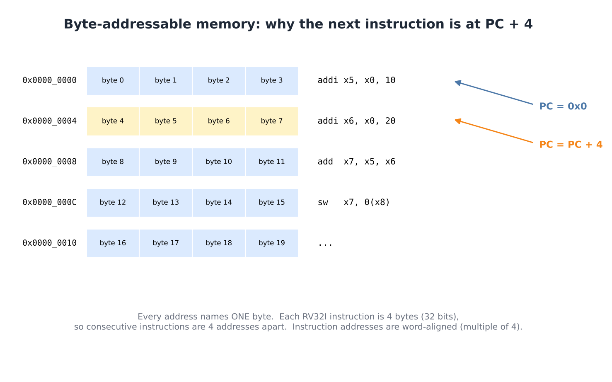

# Day 09 — Memory Architecture - Why PC+4 Has the Next Word

> **Course:** Week 3, Video 1 &nbsp;|&nbsp; **Playlist #9** &nbsp;|&nbsp; [Chip Design with Rashid — RISC-V Architecture Explained](https://www.youtube.com/playlist?list=PL0-xus8sJBCRzZtmL_fLWaohRKuc4j5aH)  
> **Notes source:** video topic + standard RV32I material (to be updated from the transcript)



## Key facts

- **Byte-addressable**: every address points to **one byte** (8 bits).
- A **word** is 4 bytes (32 bits). An RV32I instruction is one word.
- So consecutive instructions are at `0x0, 0x4, 0x8, 0xC …` → the next instruction is at **PC + 4**.
- Words are normally **aligned**: their address is a multiple of 4 (the two lowest address bits are `00`).

## The Program Counter (PC)

The PC holds the address of the instruction being executed. Every cycle:

```
instruction = Memory[PC]
if (branch taken or jump)  PC = target
else                       PC = PC + 4
```

The PC is **not** one of `x0–x31`; you cannot write it with `addi`. It changes only through branches and jumps (and traps).

## Memory organisation

| Architecture | Instruction & data memory | Notes |
|---|---|---|
| **Von Neumann** | one shared memory and bus | simpler, but fetch and data access compete |
| **Harvard** | separate instruction and data memories | fetch and load/store in the same cycle — used by most simple RISC-V cores and microcontrollers |

From the programmer's view, RISC-V has a single 32-bit address space (2³² bytes = 4 GiB); code, data, stack and peripherals are just different **regions** of it (more in Week 8).

## Typical program memory layout

```
 high addresses  ┌──────────────┐
                 │    Stack     │  ← sp starts here, grows DOWN
                 │      ↓       │
                 │      ↑       │
                 │    Heap      │  (malloc) grows UP
                 ├──────────────┤
                 │ .bss         │  uninitialised globals (zeroed at start-up)
                 │ .data        │  initialised globals
                 ├──────────────┤
                 │ .text        │  program code (instructions)
 low addresses   └──────────────┘
```

---
[⬅ Day 08](../Day-08-Week-1-2-Recap/README.md) | [Index](../README.md) | [Day 10 ➡](../Day-10-Load-Word-Store-Word/README.md)
