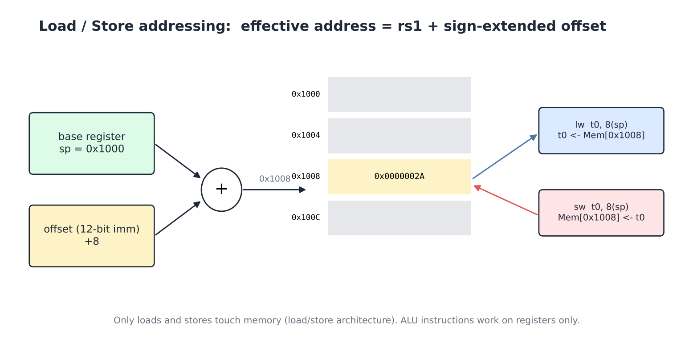

# Day 10 — Load Word and Store Word Instructions

> **Course:** Week 3, Video 2 &nbsp;|&nbsp; **Playlist #10** &nbsp;|&nbsp; [Chip Design with Rashid — RISC-V Architecture Explained](https://www.youtube.com/playlist?list=PL0-xus8sJBCRzZtmL_fLWaohRKuc4j5aH)  
> **Notes source:** video topic + standard RV32I material (to be updated from the transcript)

```asm
lw  rd,  offset(rs1)     # rd          = Memory32[rs1 + sign_ext(offset)]
sw  rs2, offset(rs1)     # Memory32[rs1 + sign_ext(offset)] = rs2
```



- **Effective address = base register + 12-bit signed offset** (−2048 … +2047).
- `lw` is an **I-type** instruction; `sw` is **S-type** (it has no `rd` — it writes memory, not a register).
- RISC-V is a **load/store architecture**: to add two numbers in memory you must load both, add, then store.

## Example — `A[3] = A[1] + h`

`A` is an array of 32-bit ints whose base address is in `s0`; `h` is in `s1`.
Element `i` is at byte offset `4 × i`.

```asm
lw   t0, 4(s0)       # t0 = A[1]          (offset 1*4)
add  t0, t0, s1      # t0 = A[1] + h
sw   t0, 12(s0)      # A[3] = t0          (offset 3*4)
```

## Example — swap two memory words

```asm
# swap(*p, *q); p in a0, q in a1
lw   t0, 0(a0)
lw   t1, 0(a1)
sw   t1, 0(a0)
sw   t0, 0(a1)
```

> ⚠️ **Common mistake:** using index `i` directly as the offset. For words, the byte offset is `i × 4` (`slli t0, i, 2`).

---
[⬅ Day 09](../Day-09-Memory-Architecture-PC-plus-4/README.md) | [Index](../README.md) | [Day 11 ➡](../Day-11-Logical-AND-OR-XOR/README.md)
