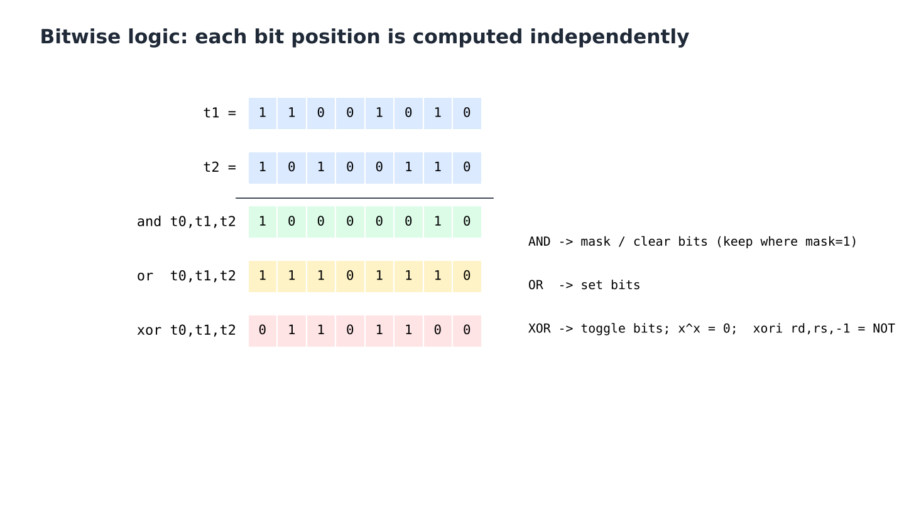

# Day 11 — Logical AND, OR, XOR - All Register Based

> **Course:** Week 3, Video 3 &nbsp;|&nbsp; **Playlist #11** &nbsp;|&nbsp; [Chip Design with Rashid — RISC-V Architecture Explained](https://www.youtube.com/playlist?list=PL0-xus8sJBCRzZtmL_fLWaohRKuc4j5aH)  
> **Notes source:** video topic + standard RV32I material (to be updated from the transcript)

```asm
and rd, rs1, rs2     # rd = rs1 & rs2
or  rd, rs1, rs2     # rd = rs1 | rs2
xor rd, rs1, rs2     # rd = rs1 ^ rs2
```



## Truth table (per bit)

| a | b | AND | OR | XOR |
|---|---|---|---|---|
| 0 | 0 | 0 | 0 | 0 |
| 0 | 1 | 0 | 1 | 1 |
| 1 | 0 | 0 | 1 | 1 |
| 1 | 1 | 1 | 1 | 0 |

## Why they matter

| Operation | Use |
|---|---|
| **AND** with a mask | *clear* / *extract* bits — `x & 0x0F` keeps the low 4 bits |
| **OR** with a mask | *set* bits — turn an LED bit on in a GPIO register |
| **XOR** with a mask | *toggle* bits — blink an LED; `x ^ x = 0`; compare two values for equality |

## NOT (there is no NOT instruction)

```asm
xori rd, rs, -1      # -1 = all ones → flips every bit   (pseudo: not rd, rs)
```

## Set-less-than (also register based)

```asm
slt  rd, rs1, rs2    # rd = (rs1 < rs2) ? 1 : 0   signed
sltu rd, rs1, rs2    # same, unsigned
```

`sltu rd, x0, rs` → `rd = (rs != 0)` (pseudo `snez`).

---
[⬅ Day 10](../Day-10-Load-Word-Store-Word/README.md) | [Index](../README.md) | [Day 12 ➡](../Day-12-Logical-Immediate-Instructions/README.md)
