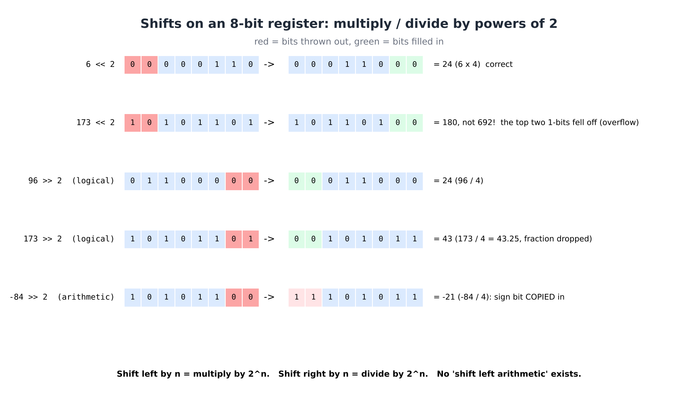

# Day 13 — Shift Instructions

> **Course:** Week 3, Video 5 &nbsp;|&nbsp; **Playlist #13** &nbsp;|&nbsp; [Chip Design with Rashid — RISC-V Architecture Explained](https://www.youtube.com/playlist?list=PL0-xus8sJBCRzZtmL_fLWaohRKuc4j5aH)  
> **Notes source:** lecture transcript + Rashid's weekly notes

## Why we learn every instruction (the bigger plan)

Rashid goes through the RV32I instructions one by one. Once all are learnt, they will be combined into a **Python model of the RV32I processor**. That model has two jobs:

1. **reinforce learning** — practise the instructions;
2. become the **reference for verification** — later, the same instructions are given to the **SystemVerilog** design and to the **Python model**, and their outputs are **compared**.

The first processor will be **not pipelined** — a simple, power-efficient implementation. In physical design, every open-source technique will be used to get the best **frequency and power**. It targets **embedded applications**, where the main concerns are **power and cost**, not top speed.

## Shifts: simple, but two ideas matter

Drawing 32 bits is hard, so the examples use an **8-bit register** — the same ideas apply to 32 bits.



### Shift left logical (sll)

All bits move **left**. Shifting by 2: the top 2 bits are **thrown out**, and **0s** come in on the right. (Putting 1s in would change the value.)

### Shift right logical (srl)

All bits move **right**. The bottom bits are thrown out; **0s** come in on the left.

### Shift right arithmetic (sra) — for signed numbers

For a **2's complement** (signed) number, the **MSB is the sign bit** with a **negative weight** (for 8 bits: −128).

If we shift a negative number right and fill with 0s, we **flip the sign** — a negative number becomes positive. So for signed numbers we **copy (duplicate) the sign bit** into the new positions. That is **shift right arithmetic**.

- If the sign bit is 0, it's the same as filling with 0s.
- If the sign bit is 1, 1s are filled in.
- **There is no "shift left arithmetic"** — on the left side the bits are just thrown out, and 0s come in from the right in both cases.

## Idea 2: shifting = multiplying or dividing by powers of 2

Each place to the left doubles a bit's weight.

```
6   = 0000 0110      (bits with weights 4 and 2)
6 << 2 = 0001 1000   (weights 16 and 8) = 24 = 6 × 4
```

| Shift | Same as |
|---|---|
| left by 1 | × 2 |
| left by 2 | × 4 |
| left by 3 | × 8 |
| right by 2 | ÷ 4 (integer: the fraction is dropped) |

Examples from the video:

- `96 >> 2 = 24` (96 ÷ 4).
- `173 >> 2 = 43` — 173 ÷ 4 = 43.25, but only the **integer** is kept (the best approximation).
- `-84 >>arith 2 = -21` — the sign bit is copied, so the result stays negative: −84 ÷ 4.

### Rashid's homework question: why does 173 << 2 give 180?

173 × 4 should be **692**. But in an **8-bit** register:

```
173      = 1010 1101
173 << 2 = 1011 0100  = 180
```

**Answer:** **overflow**. 692 needs 10 bits; the two top bits (`10`, worth 512) were **thrown out**. 692 − 512 = **180**. A shift left only equals × 2ⁿ if no 1-bits fall off the top.

### Why this matters in RV32I

The base RV32I has **no multiply or divide** instructions. With shifts we can still **multiply and divide by powers of 2** (and with shifts + adds, by other numbers too, e.g. ×10 = ×8 + ×2).

## The instructions

| Instruction | Meaning | Source of shift amount |
|---|---|---|
| `sll rd, rs1, rs2` | shift left logical | register rs2 |
| `srl rd, rs1, rs2` | shift right logical | register rs2 |
| `sra rd, rs1, rs2` | shift right arithmetic | register rs2 |
| `slli rd, rs1, shamt` | shift left logical immediate | number in the instruction |
| `srli rd, rs1, shamt` | shift right logical immediate | number in the instruction |
| `srai rd, rs1, shamt` | shift right arithmetic immediate | number in the instruction |

- **Register version:** three registers — two sources, one destination (like `add`).
- **Immediate version (`…i`):** one source register, one destination register, and a number.
- The shift amount is a **5-bit** immediate (not 12-bit): a 32-bit register can only be shifted **0 … 31** places, and that fits in 5 bits. (We never shift by a negative amount.)

### The book's examples

```asm
slli t0, s5, 7      # t0 = s5 << 7   (seven 0s come in on the right)
srli s1, s5, 17     # s1 = s5 >> 17  (seventeen 0s come in on the left)
srai t2, s5, 3      # t2 = s5 >> 3   (the sign bit is copied 3 times)
```

With `s5 = 0xF000_0F0F` (a value chosen for these notes):

| Instruction | Result | Machine code |
|---|---|---|
| `slli t0, s5, 7` | `0x0007_8780` (top bits lost) | `0x007A9293` |
| `srli s1, s5, 17` | `0x0000_7800` | `0x011AD493` |
| `srai t2, s5, 3` | `0xFE00_01E1` (sign 1 copied) | `0x403AD393` |

## Key points

- Logical shifts fill with **0**; **arithmetic right** shift copies the **sign bit**. No arithmetic left shift.
- Shift left by n = × 2ⁿ; shift right by n = ÷ 2ⁿ (integer). Watch for **overflow** on left shifts.
- Register forms: `sll srl sra`; immediate forms: `slli srli srai` with a **5-bit** shift amount (0–31).
- RV32I has no mul/div, so shifts are how we multiply/divide by powers of 2.

## Practice Questions

1. What is `0000 0101 << 3` in decimal?
2. `1111 0000` is −16 (8-bit signed). What do `srl` and `sra` by 2 give?
3. Why is the shift amount only 5 bits?
4. In 8 bits, what is `200 << 1`? Why?
5. Write one instruction for `t0 = a0 × 16`.

**Answers**

1. `0010 1000` = 40 (5 × 8).
2. `srl`: `0011 1100` = 60 (wrong for signed). `sra`: `1111 1100` = −4 (−16 ÷ 4).
3. A 32-bit register can only be shifted 0–31 places, which fits in 5 bits.
4. 400 needs 9 bits; the top bit falls off → 400 − 256 = 144.
5. `slli t0, a0, 4`.

<!-- rashid-notes -->
## 📒 From Rashid's Week 3 notes

> Extra points and worked examples from Rashid's members-only weekly notes ([RISCV_Arch folder](https://drive.google.com/drive/folders/1sIX-rAanGWWkZocAbXNmvW80JbdAEg6P), members only). Written here in my own words; most of his examples come from the reference book *Digital Design and Computer Architecture, RISC-V Edition* (Harris & Harris), chapters 6–7.

**Book Figure 6.3 — shift with an immediate amount**, s5 = `0xFF1C10E7` (`1111 1111 0001 1100 0001 0000 1110 0111`):

| Instruction | Result | Why |
|---|---|---|
| `slli t0, s5, 7` | **0x8E087380** | 7 zeros come in from the right |
| `srli s1, s5, 17` | **0x00007F8E** | 17 zeros come in from the left |
| `srai t2, s5, 3` | **0xFFE3821C** | sign bit (1) is copied 3 times |

(Checked with Python.)

- **`sll`, `srl`, `sra`** take the shift amount from a **register**: `sll t0, s5, s2` → both source operands are registers.
- **`slli`, `srli`, `srai`** take a **5-bit unsigned** immediate (0 … 31), because you can never usefully shift a 32-bit value by more than 31.

His 8-bit check: 6 = `0000 0110`; shift left 2 → `0001 1000` = 24 (×4); shift left 2 again → `0110 0000` = 96 (×4).

---
[⬅ Day 12](../Day-12-Logical-Immediate-Instructions/README.md) | [Index](../README.md) | [Day 14 ➡](../Day-14-Conditional-Branches/README.md)
