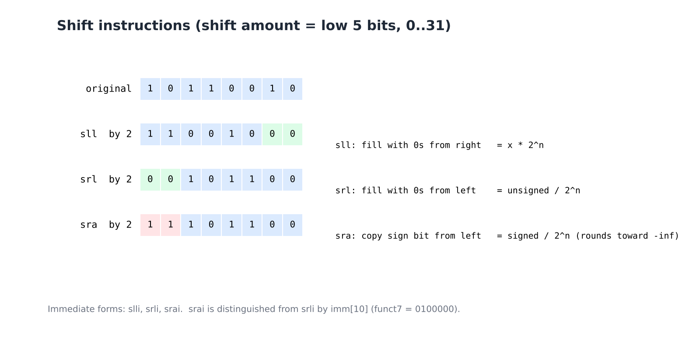

# Day 13 — Shift Instructions

> **Course:** Week 3, Video 5 &nbsp;|&nbsp; **Playlist #13** &nbsp;|&nbsp; [Chip Design with Rashid — RISC-V Architecture Explained](https://www.youtube.com/playlist?list=PL0-xus8sJBCRzZtmL_fLWaohRKuc4j5aH)  
> **Notes source:** video topic + standard RV32I material (to be updated from the transcript)



| Instruction | Meaning | Fills with |
|---|---|---|
| `sll rd, rs1, rs2` | shift left logical by `rs2[4:0]` | 0s on the right |
| `srl rd, rs1, rs2` | shift right logical | 0s on the left |
| `sra rd, rs1, rs2` | shift right **arithmetic** | copies of the sign bit |
| `slli / srli / srai rd, rs1, shamt` | same with a 5-bit constant (0…31) | |

## Shifts as fast arithmetic

| Operation | Equivalent |
|---|---|
| `x << n` | `x × 2ⁿ` |
| `x >> n` (logical) | unsigned `x ÷ 2ⁿ` |
| `x >> n` (arithmetic) | signed `x ÷ 2ⁿ` (rounds toward −∞) |

RV32I has **no multiply** instruction (that is the M extension), so shifts + adds are used:

```asm
# t0 = a0 * 10  =  a0*8 + a0*2
slli t0, a0, 3       # a0 * 8
slli t1, a0, 1       # a0 * 2
add  t0, t0, t1
```

## Extracting a bit-field

```asm
# t0 = bits [11:8] of a0
srli t0, a0, 8
andi t0, t0, 0xF
```

## Array index → byte offset

```asm
slli t0, t1, 2       # t0 = i * 4
add  t0, s0, t0      # t0 = &A[i]
lw   t2, 0(t0)       # t2 = A[i]
```

---
[⬅ Day 12](../Day-12-Logical-Immediate-Instructions/README.md) | [Index](../README.md) | [Day 14 ➡](../Day-14-Conditional-Branches/README.md)
