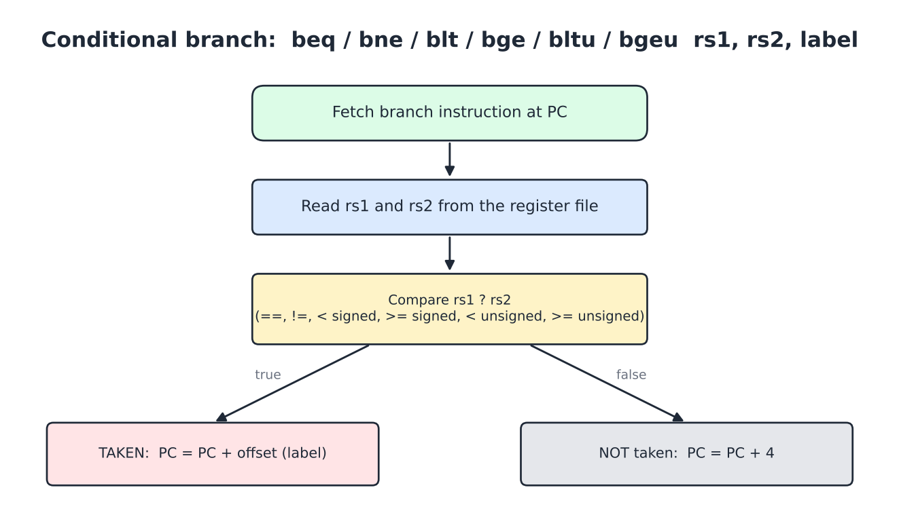

# Day 14 — Branch Instructions - Conditional

> **Course:** Week 3, Video 6 &nbsp;|&nbsp; **Playlist #14** &nbsp;|&nbsp; [Chip Design with Rashid — RISC-V Architecture Explained](https://www.youtube.com/playlist?list=PL0-xus8sJBCRzZtmL_fLWaohRKuc4j5aH)  
> **Notes source:** video topic + Rashid's weekly notes + standard RV32I material

```asm
beq  rs1, rs2, label   # if (rs1 == rs2) goto label
bne  rs1, rs2, label   # if (rs1 != rs2)
blt  rs1, rs2, label   # if (rs1 <  rs2)  signed
bge  rs1, rs2, label   # if (rs1 >= rs2)  signed
bltu rs1, rs2, label   # if (rs1 <  rs2)  unsigned
bgeu rs1, rs2, label   # if (rs1 >= rs2)  unsigned
```



- **Taken** → `PC = PC + offset`; **not taken** → `PC = PC + 4`.
- The target is **PC-relative**: the instruction stores the *distance* to the label, not its absolute address (B-type, ±4 KiB range — Week 6).
- Branches compare two **registers**; to compare with a constant, load it into a register first (or use `x0` for zero).

## Signed vs unsigned matters

```
t0 = 0xFFFFFFFF, t1 = 1
blt  t0, t1, L   → taken      (-1 < 1)
bltu t0, t1, L   → NOT taken  (4,294,967,295 > 1)
```

## Pseudo-branches (assembler swaps operands for you)

| Pseudo | Real |
|---|---|
| `beqz rs, L` | `beq rs, x0, L` |
| `bnez rs, L` | `bne rs, x0, L` |
| `bgt a, b, L` | `blt b, a, L` |
| `ble a, b, L` | `bge b, a, L` |
| `bgtu / bleu` | `bltu / bgeu` with swapped operands |
| `bltz / bgez / blez / bgtz` | compare with x0 |

<!-- rashid-notes -->
## 📒 From Rashid's Week 3 notes

> Extra points and worked examples from Rashid's members-only weekly notes ([RISCV_Arch folder](https://drive.google.com/drive/folders/1sIX-rAanGWWkZocAbXNmvW80JbdAEg6P), members only). Written here in my own words; most of his examples come from the reference book *Digital Design and Computer Architecture, RISC-V Edition* (Harris & Harris), chapters 6–7.

**Branching = check a condition, then either continue in sequence or jump to a label.**

- **Conditional** branches (6 of them): `beq`, `bne`, `blt`, `bge`, `bltu`, `bgeu`.
- **Unconditional** jumps: `j`, `jal`, `jr` (Day 16).

Format: `<instr> <reg0>, <reg1>, <LABEL>` — the two registers are **compared**, the label is **where to go if the condition is true**.

**Book example 6.12 — `beq` (branch taken):**

```asm
addi s0, zero, 4      # s0 = 4
addi s1, zero, 1      # s1 = 1
slli s1, s1, 2        # s1 = 4
beq  s0, s1, target   # 4 == 4 → TAKEN
addi s1, s1, 1        # skipped
sub  s1, s1, s0       # skipped
target:
add  s1, s1, s0       # s1 = 4 + 4 = 8
```

**Book example 6.13 — `bne` (branch NOT taken):** same code but `bne s0, s1, target`. Since 4 == 4, it falls through: s1 = 4 + 1 = 5, then 5 − 4 = 1, then at target 1 + 4 = **5**.

---
[⬅ Day 13](../Day-13-Shift-Instructions/README.md) | [Index](../README.md) | [Day 15 ➡](../Day-15-Week-3-Recap/README.md)
