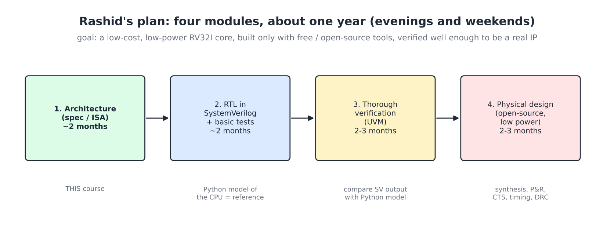
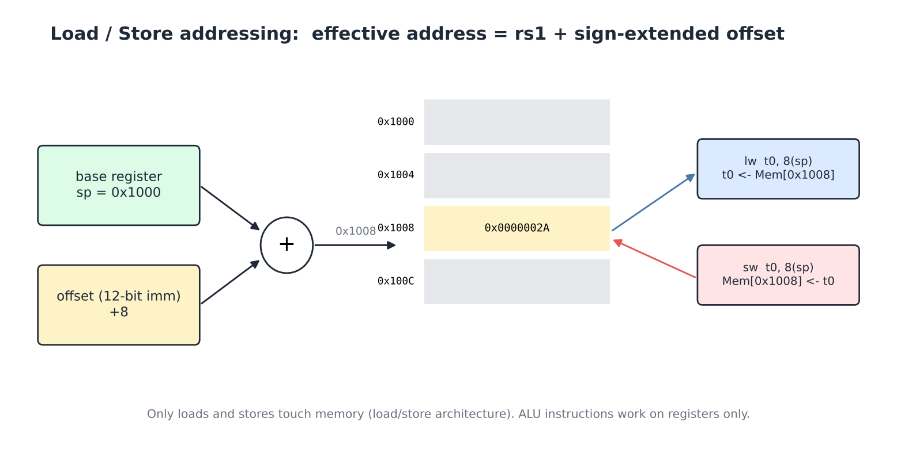
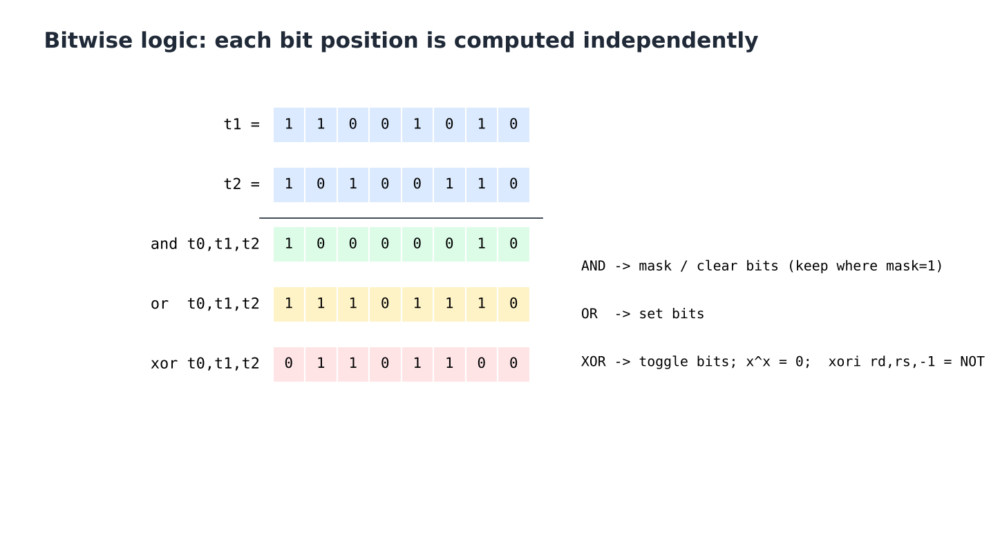
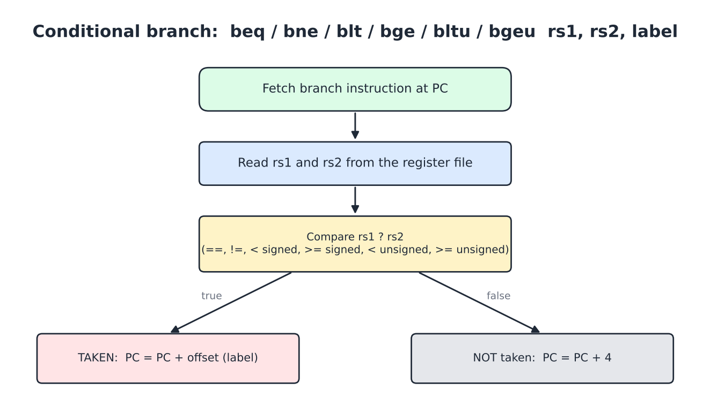

# Day 15 — Week 3 Recap

> **Course:** Week 3, Recap &nbsp;|&nbsp; **Playlist #15** &nbsp;|&nbsp; [Chip Design with Rashid — RISC-V Architecture Explained](https://www.youtube.com/playlist?list=PL0-xus8sJBCRzZtmL_fLWaohRKuc4j5aH)  
> **Notes source:** lecture transcript

## The bigger picture first



Goal: develop a **low-cost, low-power RV32I** (base integer) core using only **free / open-source tools**. Four modules:

| Module | Content | Rough time |
|---|---|---|
| 1 | Understand the RISC-V architecture / ISA spec in detail — exactly what we will build | ~2 months |
| 2 | Build the hardware in **SystemVerilog**, with some SystemVerilog-level checks; plus a **Python model** for practice and later verification | ~2 months |
| 3 | **Validate very thoroughly** with highly automated verification (**UVM** — new for Rashid too) so the result is a real, distributable **IP**, "not just a student project" | 2–3 months |
| 4 | **Physical design** with open-source tools — a very low-power version | 2–3 months |

**Study tip from Rashid:** give it **30 minutes a day** — about 15 minutes for his video and 15 minutes to revise or try the examples. He works full time and records in the evenings and weekends, so the pace is slow and steady.

Weekly **notes** and a **quiz** are shared for this week too.

## 1. Memory architecture (Day 09)

- The **register file is the fastest** storage, but it has only **32 registers × 32 bits** — not enough for all our data.
- So we need **memory** — for **data** and also for the **instructions**.
- The **program counter (PC)** holds the memory address and is **32 bits** → **2³² unique locations**. In hex that's 8 digits: from `0000_0000` to `FFFF_FFFF`.

### Byte-addressable

RISC-V gives **every byte** its own address, not every word:

```
word 0: bytes at 0x0, 0x1, 0x2, 0x3    → the word's address is 0x0
word 1: bytes at 0x4, 0x5, 0x6, 0x7    → the word's address is 0x4
```

So the address of a word is the address of its first byte, and the **PC increments by 4**. The **last word** is at `0xFFFF_FFFC` (its top byte is at `0xFFFF_FFFF`).

## 2. Load word and store word (Day 10)



### lw — load from memory into a register

Book example:

```asm
lw s7, 8(zero)       # s7 = Memory[0 + 8]  = word 2
```

- `zero` is the **base register** (x0, always 0); `8` (decimal) is added → address **8** = **word 2**.
- After this instruction, **s7 holds the content of word 2**.
- Machine code: `0x00802B83`.

### sw — store a register into memory

```asm
sw t3, 20(zero)      # Memory[0 + 20] = t3   → word 5
```

- 20 is **decimal** (= `0x14`) — don't confuse the two. 0 + 20 = address 20 = **word 5**.
- After execution, word 5 holds the value of t3.
- Machine code: `0x01C02A23`.

## 3. Bitwise logic (Days 11–12)



| Instruction | Main use |
|---|---|
| **and** | **clear / mask** certain bits (keep only the bits where the mask is 1) |
| **or** | **set** certain bits to 1, or **combine** two numbers |
| **xor** | **invert** certain bits (wherever the mask has a 1, the input bit is flipped) |

**Immediate versions** `andi, ori, xori`: one source is a register, the other is a **12-bit number** inside the instruction (not a register value).

## 4. Shifts (Day 13)

- `sll`, `srl`: **logical** — 0s are fed in on the side the bits move away from.
- `sra`: **arithmetic** — for signed numbers, the **sign bit is copied** in, so the number stays negative. There is **no shift left arithmetic**.
- Shift left by n = **× 2ⁿ**, shift right by n = **÷ 2ⁿ**. Example: **96 >> 2 = 24**.
- Immediate versions `slli, srli, srai`, e.g. shift left by 7, right by 17, right arithmetic by 3 (sign bit copied 3 times).

## 5. Branching (Day 14)

Branching makes programs interesting: the program can **make decisions**.

**Analogy:** a tree — the **trunk** is the normal sequence of instructions; a **branch** goes off it.

| Type | Meaning |
|---|---|
| **Conditional** | jump **only if** a condition is true |
| **Unconditional** | always jump, no condition |

### The 6 conditional branches

`beq` (equal) · `bne` (not equal) · `blt` (less than) · `bge` (greater or equal) · `bltu` (less than, unsigned) · `bgeu` (greater or equal, unsigned)

Common format: **two registers are compared**; if the condition is true, jump to a **label**. In assembly the label is just a name; the **assembler later turns it into an address**.

```asm
      beq  s0, s1, target    # if s0 == s1, go to target
      addi s1, s1, 1         # skipped when equal
      sub  s1, s1, s0        # skipped when equal
target:
      add  s1, s1, s0        # execution continues here when equal
```



## Week 3 Key Takeaways

- Registers are fastest but few → memory holds instructions and data. Byte-addressable: words at 0, 4, 8 …; PC + 4; last word `0xFFFF_FFFC`.
- `lw rd, offset(base)` / `sw rs, offset(base)`: address = base + offset (decimal offsets!).
- AND clears/masks, OR sets/combines, XOR inverts; immediate versions use a 12-bit number.
- Shifts: logical vs arithmetic; × and ÷ by powers of 2.
- Branches: 6 conditional branches compare two registers and jump to a label.

## Practice Questions

1. Which word does `lw t0, 12(zero)` read?
2. Write the instruction that stores a0 into word 3 (base 0).
3. Which logic instruction would you use to turn on bit 0 of t1 without changing the other bits?
4. What is the address of the last byte of word 2?
5. Name a conditional and an unconditional branch.

**Answers**

1. Address 12 → word 3.
2. `sw a0, 12(zero)`.
3. `ori t1, t1, 1`.
4. Word 2 starts at 8, so its last byte is at 11 (`0xB`).
5. Conditional: `beq` (any of the 6). Unconditional: `j` (`jal x0, label`).

---
[⬅ Day 14](../Day-14-Conditional-Branches/README.md) | [Index](../README.md) | [Day 16 ➡](../Day-16-Jump-If-Else-Switch-Case/README.md)
