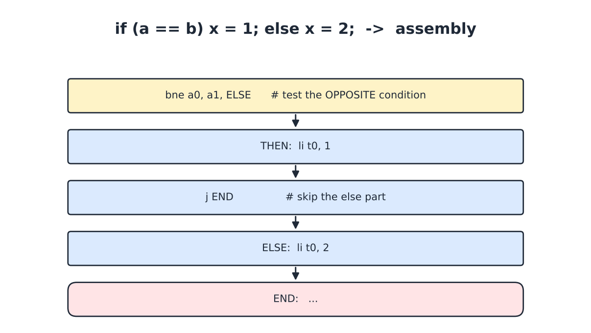

# Day 16 — Unconditional Jump, If-Else and Switch-Case Implementation

> **Course:** Week 4, Video 1 &nbsp;|&nbsp; **Playlist #16** &nbsp;|&nbsp; [Chip Design with Rashid — RISC-V Architecture Explained](https://www.youtube.com/playlist?list=PL0-xus8sJBCRzZtmL_fLWaohRKuc4j5aH)  
> **Notes source:** video topic + standard RV32I material (to be updated from the transcript)

## Jump instructions

| Instruction | Operation | Format |
|---|---|---|
| `jal rd, label` | `rd = PC + 4; PC = PC + offset` | J |
| `jalr rd, offset(rs1)` | `rd = PC + 4; PC = (rs1 + offset) & ~1` | I |

"jal" = **J**ump **A**nd **L**ink — *link* means "save the return address in `rd`".

| Pseudo | Real | Use |
|---|---|---|
| `j label` | `jal x0, label` | plain goto (return address discarded in x0) |
| `jal label` | `jal ra, label` | call a function |
| `jr rs` | `jalr x0, 0(rs)` | jump to address in a register |
| `ret` | `jalr x0, 0(ra)` | return from function |
| `call label` | `auipc ra, …` + `jalr ra, …(ra)` | call a far function |

## If-else



**Rule of thumb:** branch on the **opposite** condition to skip the "then" block.

```c
if (a == b)  x = 1;
else         x = 2;
```

```asm
# a in a0, b in a1, x in t0
        bne  a0, a1, ELSE     # if a != b, go to else
        addi t0, x0, 1        # then: x = 1
        j    END              # skip else
ELSE:   addi t0, x0, 2        # else: x = 2
END:
```

## If with compound conditions

```c
if (a < b && b < c) x++;
```

```asm
        bge  a0, a1, SKIP     # !(a < b) → skip
        bge  a1, a2, SKIP     # !(b < c) → skip
        addi t0, t0, 1
SKIP:
```

`||` is done the other way round: jump *into* the body as soon as one condition is true.

## Switch-case — method 1: chain of compares

```c
switch (k) { case 0: x = 10; break;  case 1: x = 20; break;  default: x = 0; }
```

```asm
        beq  a0, x0, CASE0
        addi t1, x0, 1
        beq  a0, t1, CASE1
        j    DEFAULT
CASE0:  addi t0, x0, 10
        j    END
CASE1:  addi t0, x0, 20
        j    END
DEFAULT:addi t0, x0, 0
END:
```

## Switch-case — method 2: jump table (fast for many dense cases)

```asm
        .data
JT:     .word CASE0, CASE1, CASE2      # table of code addresses
        .text
        li   t1, 3
        bgeu a0, t1, DEFAULT           # range check (unsigned catches negatives too)
        la   t2, JT                    # t2 = base of table
        slli t3, a0, 2                 # k * 4
        add  t2, t2, t3
        lw   t2, 0(t2)                 # t2 = JT[k]
        jr   t2                        # jalr x0, 0(t2)
```

`jalr` (jump to a *register*) is what makes jump tables, function pointers and returns possible.

---
[⬅ Day 15](../Day-15-Week-3-Recap/README.md) | [Index](../README.md) | [Day 17 ➡](../Day-17-Loops/README.md)
