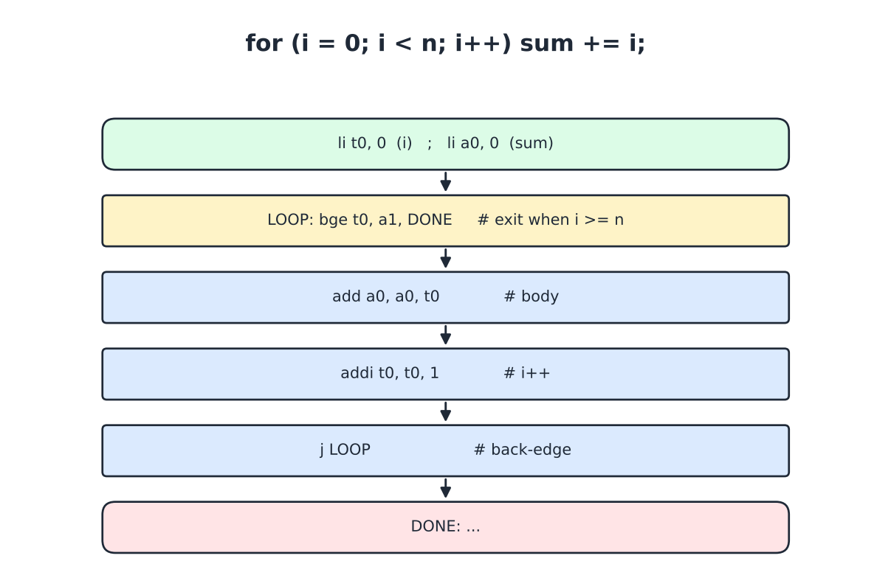

# Day 17 — Loop Instructions

> **Course:** Week 4, Video 2 &nbsp;|&nbsp; **Playlist #17** &nbsp;|&nbsp; [Chip Design with Rashid — RISC-V Architecture Explained](https://www.youtube.com/playlist?list=PL0-xus8sJBCRzZtmL_fLWaohRKuc4j5aH)  
> **Notes source:** video topic + Rashid's weekly notes + standard RV32I material

There is no special "loop" instruction — a loop is a **branch that goes backwards**.



## for loop

```c
int sum = 0;
for (int i = 0; i < n; i++) sum += i;
```

```asm
# n in a1, sum in a0, i in t0
        li   a0, 0
        li   t0, 0
LOOP:   bge  t0, a1, DONE     # exit test at top
        add  a0, a0, t0       # body
        addi t0, t0, 1        # i++
        j    LOOP
DONE:
```

## while loop

```c
while (x != 0) { x = x >> 1; count++; }
```

```asm
WHILE:  beqz a0, WEND
        srli a0, a0, 1
        addi a1, a1, 1
        j    WHILE
WEND:
```

## do-while (test at the bottom — one branch per iteration)

```asm
LOOP:   add  a0, a0, t0
        addi t0, t0, 1
        blt  t0, a1, LOOP     # loop while i < n
```

Compilers often turn `for`/`while` into this shape (with one check before entry) because it executes one fewer jump per iteration.

## Counting down to zero (very common)

```asm
        li   t0, 10
L:      ...                   # body
        addi t0, t0, -1
        bnez t0, L
```

<!-- rashid-notes -->
## 📒 From Rashid's Week 4 notes

> Extra points and worked examples from Rashid's members-only weekly notes ([RISCV_Arch folder](https://drive.google.com/drive/folders/1sIX-rAanGWWkZocAbXNmvW80JbdAEg6P), members only). Written here in my own words; most of his examples come from the reference book *Digital Design and Computer Architecture, RISC-V Edition* (Harris & Harris), chapters 6–7.

**Every loop needs 3 things:**

1. **Condition checking:** `beq`, `bne`, `bge`, …
2. **Variable initialisation:** `addi <reg>, zero, <value>`
3. **Increment:** `addi <reg>, <reg>, 1`

…plus **labels** to jump back to.

**Code Example 6.18 — while loop** (find x such that 2ˣ = 128; s0 = pow, s1 = x):

```asm
      addi s0, zero, 1     # pow = 1
      add  s1, zero, zero  # x = 0
      addi t0, zero, 128   # t0 = 128
while:
      beq  s0, t0, done    # pow == 128? exit
      slli s0, s0, 1       # pow = pow * 2
      addi s1, s1, 1       # x = x + 1
      j    while
done:                      # x = 7
```

**Code Example 6.19 — do/while:** the body runs **first**, then the branch decides (`bne s0, t0, while` at the bottom). It always runs at least once.

**Code Example 6.20 — for loop** (sum of 0 … 9; s0 = i, s1 = sum):

```asm
      addi s1, zero, 0     # sum = 0
      addi s0, zero, 0     # i = 0
      addi t0, zero, 10    # t0 = 10
for:  bge  s0, t0, done    # i >= 10? exit   (opposite of i < 10)
      add  s1, s1, s0      # sum += i
      addi s0, s0, 1       # i++
      j    for
done:                      # sum = 45
```

---
[⬅ Day 16](../Day-16-Jump-If-Else-Switch-Case/README.md) | [Index](../README.md) | [Day 18 ➡](../Day-18-Arrays-ASCII-Bytes-Halfwords/README.md)
