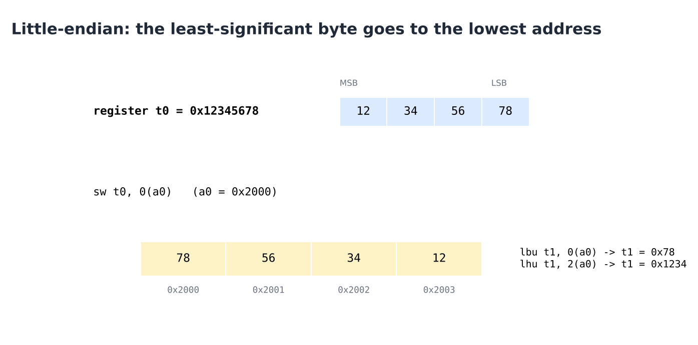

# Day 18 — Arrays, ASCII Characters, Load/Store Bytes and Half-Words

> **Course:** Week 4, Video 3 &nbsp;|&nbsp; **Playlist #18** &nbsp;|&nbsp; [Chip Design with Rashid — RISC-V Architecture Explained](https://www.youtube.com/playlist?list=PL0-xus8sJBCRzZtmL_fLWaohRKuc4j5aH)  
> **Notes source:** video topic + standard RV32I material (to be updated from the transcript)

## All load/store sizes

| Instruction | Size | Extension to 32 bits | Format |
|---|---|---|---|
| `lb rd, off(rs1)` | byte | **sign**-extend | I |
| `lbu rd, off(rs1)` | byte | **zero**-extend | I |
| `lh rd, off(rs1)` | half (16 b) | sign-extend | I |
| `lhu rd, off(rs1)` | half | zero-extend | I |
| `lw rd, off(rs1)` | word | — | I |
| `sb rs2, off(rs1)` | stores low 8 bits | — | S |
| `sh rs2, off(rs1)` | stores low 16 bits | — | S |
| `sw rs2, off(rs1)` | stores 32 bits | — | S |

There is no `sbu`/`shu` — stores just write the low bits, so sign does not matter.

```
memory byte = 0xF0
lb  → 0xFFFFFFF0  (-16)
lbu → 0x000000F0  (240)
```

## Little-endian



RISC-V stores the **least significant byte at the lowest address**.

## Array element addresses

| Element type | Size | Address of `A[i]` |
|---|---|---|
| `char` | 1 | `base + i` |
| `short` | 2 | `base + 2i` |
| `int` | 4 | `base + 4i` |

## ASCII characters

A `char` is a 1-byte code. Useful values:

| Char | Hex | Dec |
|---|---|---|
| `'\0'` (string end) | 0x00 | 0 |
| `'0'` … `'9'` | 0x30 … 0x39 | 48 … 57 |
| `'A'` … `'Z'` | 0x41 … 0x5A | 65 … 90 |
| `'a'` … `'z'` | 0x61 … 0x7A | 97 … 122 |
| space | 0x20 | 32 |

Upper ↔ lower case differ only in **bit 5** (0x20). Digit value = `char − '0'`.

## Example — string length (`strlen`)

```asm
# a0 = address of string; returns length in a0
strlen: mv   t0, a0            # t0 = pointer
LOOP:   lbu  t1, 0(t0)         # load one character
        beqz t1, DONE          # stop at '\0'
        addi t0, t0, 1         # next byte (char = 1 byte)
        j    LOOP
DONE:   sub  a0, t0, a0        # length = end - start
        ret
```

## Example — convert a string to upper case

```asm
# a0 = address of string
toupper:
LOOP:   lbu  t1, 0(a0)
        beqz t1, DONE
        li   t2, 'a'
        blt  t1, t2, NEXT      # below 'a' → not lowercase
        li   t2, 'z'
        bgt  t1, t2, NEXT      # above 'z' → not lowercase
        addi t1, t1, -32       # 'a' - 'A' = 32 (or: andi t1, t1, 0xDF)
        sb   t1, 0(a0)
NEXT:   addi a0, a0, 1
        j    LOOP
DONE:   ret
```

## Example — sum of an int array

```asm
# a0 = &A[0], a1 = n ; returns sum in a0
sum_array:
        li   t0, 0             # sum
        li   t1, 0             # i
L:      bge  t1, a1, E
        slli t2, t1, 2         # i*4
        add  t2, a0, t2        # &A[i]
        lw   t3, 0(t2)
        add  t0, t0, t3
        addi t1, t1, 1
        j    L
E:      mv   a0, t0
        ret
```

(A faster version increments a pointer by 4 instead of recomputing `i*4`.)

---
[⬅ Day 17](../Day-17-Loops/README.md) | [Index](../README.md) | [Day 19 ➡](../Day-19-Week-4-Recap/README.md)
