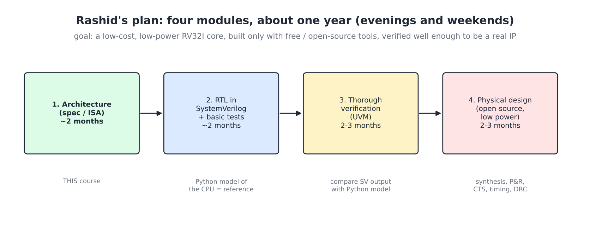
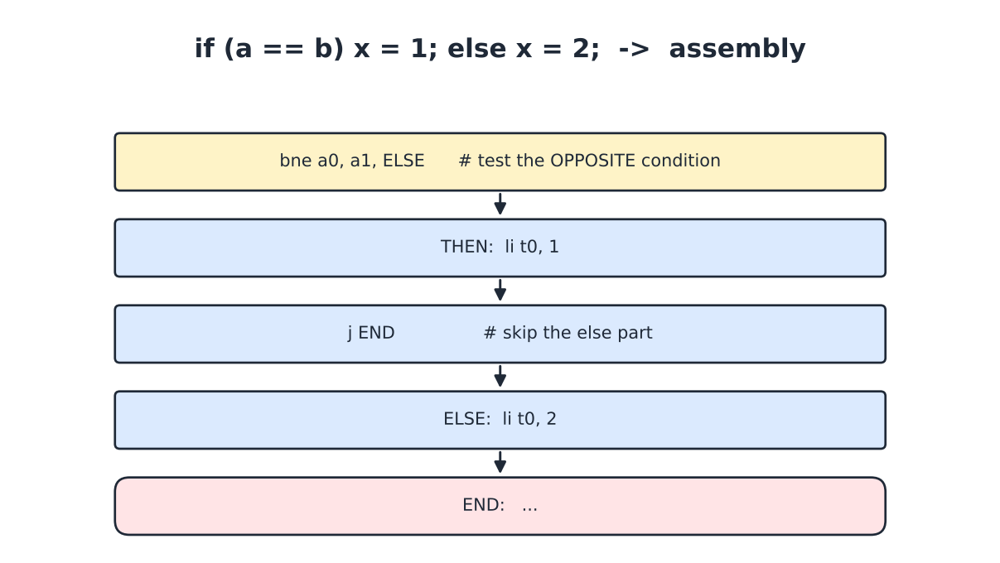
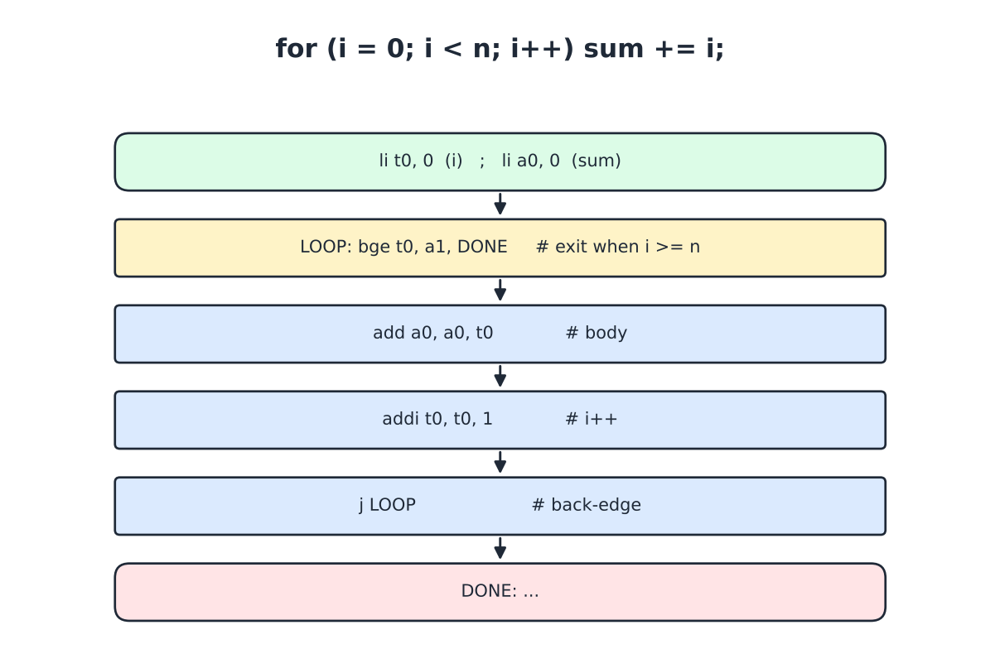
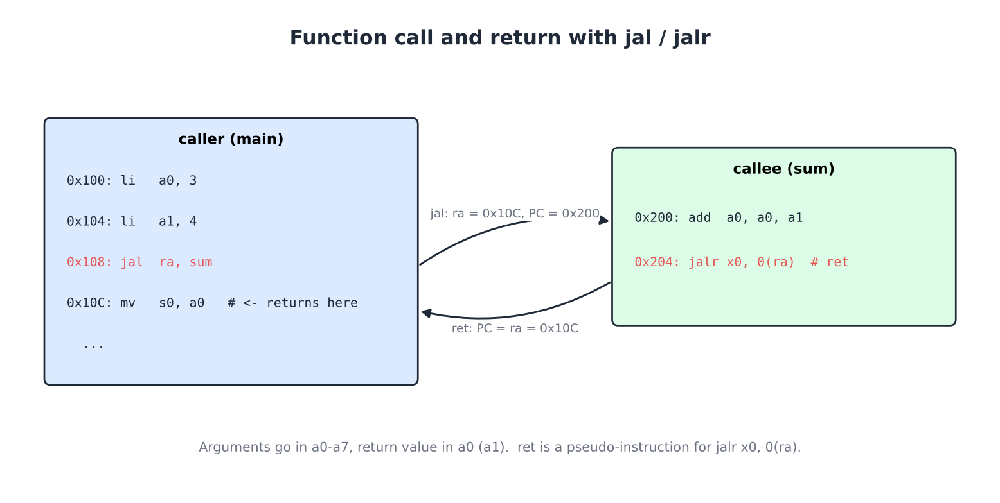

# Day 19 — Week 4 Recap - If-Else, Case, For, While, Arrays, Function

> **Course:** Week 4, Recap &nbsp;|&nbsp; **Playlist #19** &nbsp;|&nbsp; [Chip Design with Rashid — RISC-V Architecture Explained](https://www.youtube.com/playlist?list=PL0-xus8sJBCRzZtmL_fLWaohRKuc4j5aH)  
> **Notes source:** lecture transcript

## Where we are in the bigger series

This course is part of a bigger training: build a **low-cost, low-power RV32I core with free and open-source tools** (Rashid will explain in a separate video why open source is worth it).



- We are in the **architecture phase**. Next: **implementation, validation and physical design** — roughly **a year** in total, since he works on it in evenings and weekends.
- The series is for **members**, but the weekly **revision videos are free**.
- Tip again: **30 minutes a day** (15 to watch, 15 to revise or do the homework) — within a few months you'll know the RISC-V base core, and within a year the whole chip-design flow.

## 1. Unconditional jumps and labels (Day 16)

At the start of the week only **`j`** (jump) was used; **`jal`** and **`jr`** came later with functions.

```asm
      j    skip          # always jump - no condition
      addi s0, s0, 1     # skipped
skip:
      add  s1, s1, s0
```

The **label** marks the place to jump to; the jump is **unconditional** because we jump anyway.

## 2. if / else and switch-case (Day 16)

Why study this in assembly? It shows what the **hardware** will have to do — we are learning the **specs** of the RISC-V base core so we can implement them later.

**The key idea: always check a condition first, using a conditional branch.**

For `if (i == j)`, we branch on the **opposite** condition:

```asm
# if (i == j) f = g + h;      i=s3, j=s4, f=s0, g=s1, h=s2
      bne  s3, s4, L1        # NOT equal -> jump past the if-body
      add  s0, s1, s2        # equal -> run this in sequence
L1:
```

- Condition true (equal) → execute the next instructions **in sequence**.
- Condition false → **jump** to the label after the block.



**switch / case** looks longer but is the same pattern: assign a value with `addi`, check one case with a branch; if it doesn't match, move to the next check … and finally the **default**.

## 3. Loops: while, do-while, for (Day 17)

Every loop is built from the same few pieces:

| Piece | Instruction |
|---|---|
| check a condition | one of the **6 conditional branches** (Week 3) |
| initialise / assign a variable | `addi` |
| increment / decrement | `addi` |
| jump back / out | labels + `j` |

### while loop (book example)

```c
// pow = 1; x = 0;  while (pow != 128) { pow = pow * 2; x = x + 1; }
```

```asm
      addi s0, zero, 1       # pow = 1
      addi s1, zero, 0       # x = 0
      addi t0, zero, 128     # 128 must be in a REGISTER to compare
while:
      beq  s0, t0, done      # exit when pow == 128 (opposite of !=)
      slli s0, s0, 1         # pow = pow * 2
      addi s1, s1, 1         # x = x + 1
      j    while             # nothing repeats on its own - jump back!
done:
```

- **do-while:** execute the body **first**, then check the condition.
- **for loop:** initialise `i`, put the limit in a register, check → body → `i++` → `j` back to the check.



## 4. Arrays, characters, bytes and half-words (Day 18)

- An **array** = similar data stored **in sequence** in memory. For 32-bit words, each element is at the **next address + 4**.
- **ASCII characters** are **bytes** (8 bits), so we need to **load and store bytes**: `lb`, `lbu`, `sb`.

**Why signed and unsigned loads?** Registers are **not byte-addressable** — a register is always all 32 bits. When we load only 8 bits into it, we must decide what goes into the other 24 bits:

- `lb` (signed): **copy the sign bit**,
- `lbu` (unsigned): **fill with 0s**.

The same exists for **half-words (16 bits)**: `lh`, `lhu`, `sh` — the examples are identical to the byte ones.

## 5. Functions, cases I and II (Day 23)

| Case | What it showed |
|---|---|
| **I** — no arguments, no return value | the mechanics: **`jal`** jumps to the function and saves the return address in **`ra`**; **`jr ra`** jumps back |
| **II** — 4 arguments, 1 return value | arguments go in **a0, a1, a2, a3 … a7**; the result is returned in **a0** — a "handshake" between main and the function; then `jr ra` returns to the next instruction |



**Next week (Week 5): the stack** — how to save registers on the stack and upgrade the function example.

## Week 4 Key Takeaways

- `j label` = unconditional jump.
- if/else, switch and all loops = check a condition with a conditional branch (usually the **opposite** one), `addi` for assignments and counters, labels and `j` to jump.
- A value you compare against must first be put in a **register**.
- Arrays are sequential; words step by 4. Byte/half-word loads need sign (`lb`, `lh`) or zero (`lbu`, `lhu`) extension.
- Functions: `jal` saves `ra` and jumps; args in a0–a7; return value in a0; `jr ra` returns.

## Practice Questions

1. Which branch implements `if (a < b) { … }` (signed), skipping the body when false?
2. Why does the while loop need `j while` at the end?
3. A byte `0x9C` is loaded with `lb` and with `lbu`. What are the two register values?
4. Where does a function put its return value?
5. Why must 128 be loaded into t0 in the while example?

**Answers**

1. `bge a, b, skip` (the opposite of a < b).
2. Nothing repeats by itself; the jump sends execution back to the condition check.
3. `lb` → `0xFFFFFF9C`; `lbu` → `0x0000009C`.
4. In a0.
5. Branches compare two registers; they can't compare against a constant directly.

---
[⬅ Day 18](../Day-18-Arrays-ASCII-Bytes-Halfwords/README.md) | [Index](../README.md) | [Day 20 ➡](../Day-20-Stack-Backup-Registers/README.md)
