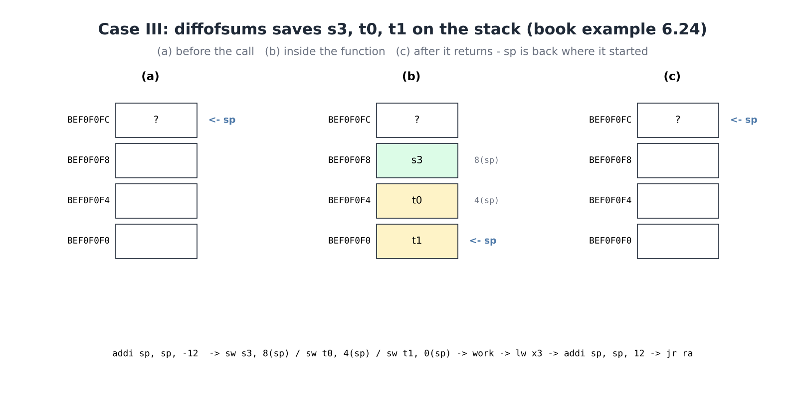

# Day 20 — Using the Stack to Back Up Registers During a Function Call

> **Course:** Week 5, Video 1 &nbsp;|&nbsp; **Playlist #20** &nbsp;|&nbsp; [Chip Design with Rashid — RISC-V Architecture Explained](https://www.youtube.com/playlist?list=PL0-xus8sJBCRzZtmL_fLWaohRKuc4j5aH)  
> **Notes source:** video topic + Rashid's weekly notes + standard RV32I material

## The problem

There are only 32 registers, and **every function uses the same registers**. If `main` keeps a value in `s0` and calls `f`, and `f` also uses `s0`, `main`'s value is destroyed. Also, if `f` calls `g`, the `jal` to `g` **overwrites `ra`**, so `f` can no longer return to `main`.

**Solution:** temporarily save registers in memory — on the **stack**.

## What is the stack?

- A region of RAM used as **Last-In-First-Out** storage.
- `sp` (x2) points to the **top** of the stack (the last used word).
- In RISC-V the stack **grows downward** (toward lower addresses).
- The RISC-V ABI requires `sp` to be **16-byte aligned** at function calls.


## Push and pop (no dedicated instructions — use addi + sw/lw)

```asm
# PUSH t0
addi sp, sp, -4      # make room (grow down)
sw   t0, 0(sp)       # store

# POP t0
lw   t0, 0(sp)       # load
addi sp, sp, 4       # free the room
```

Better: allocate the whole **stack frame** once in the **prologue** and free it in the **epilogue**:

```asm
func:
    # ---- prologue ----
    addi sp, sp, -16     # allocate 16 bytes (keeps 16-byte alignment)
    sw   ra, 12(sp)      # save return address
    sw   s0,  8(sp)      # save s0 (we are going to use it)
    # ---- body ----
    ...
    # ---- epilogue ----
    lw   s0,  8(sp)      # restore in reverse
    lw   ra, 12(sp)
    addi sp, sp, 16      # free the frame
    ret
```

## Golden rules

1. Every `addi sp, sp, -N` must be matched by `addi sp, sp, +N` on every return path.
2. Restore registers before `ret`.
3. Never read data below `sp` — it can be overwritten (e.g. by an interrupt handler).

<!-- rashid-notes -->
## 📒 From Rashid's Week 5 notes

> Extra points and worked examples from Rashid's members-only weekly notes ([RISCV_Arch folder](https://drive.google.com/drive/folders/1sIX-rAanGWWkZocAbXNmvW80JbdAEg6P), members only). Written here in my own words; most of his examples come from the reference book *Digital Design and Computer Architecture, RISC-V Edition* (Harris & Harris), chapters 6–7.



**Stack = "part of memory used as scratch space".** It **grows down** (towards smaller addresses) and is **last-in, first-out**. The `sp` register points to the top. Making room for one word = `sp − 4`.

**Rashid's question:** in `diffofsums` the function uses `t0`, `t1`, `s3` — *what if `main` was also using these?* They would be destroyed. Answer = **save them on the stack first and restore them before returning**.

**Case III — Code Example 6.24 (save everything):**

```asm
diffofsums:
  addi sp, sp, -12     # 1) make room for 3 words
  sw   s3, 8(sp)       # 2) save s3
  sw   t0, 4(sp)       # 3) save t0
  sw   t1, 0(sp)       # 4) save t1
  add  t0, a0, a1      # t0 = f + g
  add  t1, a2, a3      # t1 = h + i
  sub  s3, t0, t1      # result = (f + g) - (h + i)
  add  a0, s3, zero    # return value in a0
  lw   s3, 8(sp)       # 5) restore s3
  lw   t0, 4(sp)       # 6) restore t0
  lw   t1, 0(sp)       # 7) restore t1
  addi sp, sp, 12      # 8) give the space back
  jr   ra
```

With sp = 0xBEF0F0FC before the call, sp goes down to **0xBEF0F0F0** inside the function and is back to 0xBEF0F0FC after (the picture above).

---
[⬅ Day 19](../Day-19-Week-4-Recap/README.md) | [Index](../README.md) | [Day 21 ➡](../Day-21-Stack-Callee-and-Caller/README.md)
