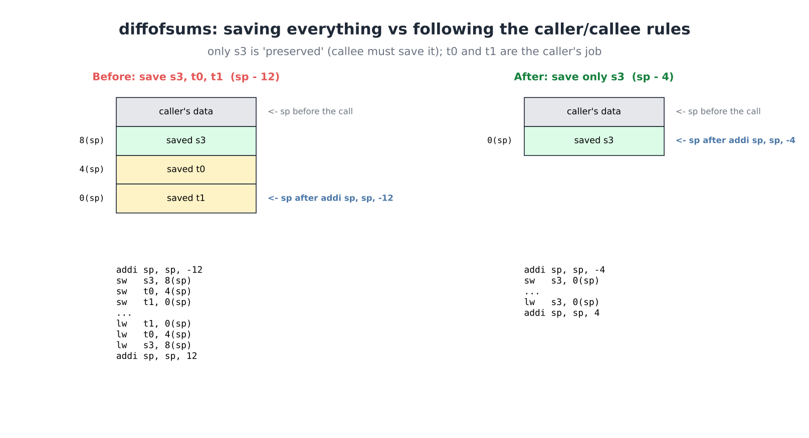

# Day 22 — Who Saves Which Register - Callee or Caller, Preserved Registers

> **Course:** Week 5, Video 2 &nbsp;|&nbsp; **Playlist #22** &nbsp;|&nbsp; [Chip Design with Rashid — RISC-V Architecture Explained](https://www.youtube.com/playlist?list=PL0-xus8sJBCRzZtmL_fLWaohRKuc4j5aH)  
> **Notes source:** lecture transcript

## Starting point: the previous version

In the previous function example (`diffofsums`), the function used **s3, t0 and t1**, so it **saved all three** on the stack (stack pointer moved by −12), changed them, and restored them before returning.

That works, but it's wasteful. Today: a **handshake** between the main program and the function — they **divide the responsibility** for saving registers, so the function doesn't have to save everything.

## Caller and callee

| Name | Who | In our example |
|---|---|---|
| **Caller** | the code that **calls** a function | `main` |
| **Callee** | the function **being called** | `diffofsums` |

Why not just say "main" and "function"? Later a **function will call another function** — then a function is a caller too. These names work in every case.

## Who saves what


### The callee's responsibility — "preserved"

If the callee **changes** any of these, it must first make a **backup on the stack** and restore it before returning:

| Preserved | Why |
|---|---|
| **s0 – s11** (saved registers) | the caller may be using them — the callee doesn't know, so it must **assume** the caller is |
| **ra** (return address) | the way back to the caller; if the callee changes it (e.g. to call another function), it must restore it |
| **sp** (stack pointer) | when the function exits, sp must point to the **same place** as before the call (e.g. it moved by −12 and came back by +12) |
| **memory above sp** | the caller's part of the stack; if the callee writes there, it must restore it |

### The caller's responsibility — "non-preserved"

The callee may **freely overwrite** these. If the caller is using any of them and still needs the value after the call, the **caller** must back it up **before** calling:

| Non-preserved |
|---|
| **t0 – t6** (temporaries) |
| **a0 – a7** (arguments / return value) |
| **memory below sp** (the area the function will use for its stack) |

**Why the names?** The callee *preserves* the preserved registers; the non-preserved ones are not preserved by the callee — that's the caller's job.

If either side doesn't do its part, it will **overwrite data** and the program goes wrong in unexpected ways.

## Applying the rules to diffofsums

The function changes **s3, t0, t1**:

| Register | Preserved? | Who saves it? |
|---|---|---|
| **s3** | yes (s0–s11) | **the function** must back it up |
| **t0** | no | not the function's job — **main** saves it if main needs it |
| **t1** | no | same as t0 |

So the function only needs to save **one word** (s3). The stack moves by **−4** instead of −12, and s3 is stored at **0(sp)**:



```asm
diffofsums:
      addi sp, sp, -4        # room for ONE register
      sw   s3, 0(sp)         # save s3 (preserved - our job)
      add  t0, a0, a1        # t0 = f + g   (t0, t1: no backup needed)
      add  t1, a2, a3        # t1 = h + i
      sub  s3, t0, t1        # result = (f + g) - (h + i)
      add  a0, s3, zero      # return value in a0
      lw   s3, 0(sp)         # restore s3
      addi sp, sp, 4         # sp back to where it was
      jr   ra                # return to the caller
```

t0 and t1 are still used, but the function doesn't back them up. If `main` had something important in t0, **main** must save it before the `jal`.

**Analogy:** you lend your room to a friend for an hour. The rule is: they must put back anything they move from the **shelves** (s registers) — but the **whiteboard** (t registers) is free to wipe. If you wrote something important on the whiteboard, it's your job to take a photo first.

## Key points

- **Callee saves:** s0–s11, ra, sp, memory above sp — if it changes them ("preserved").
- **Caller saves:** t0–t6, a0–a7, memory below sp — if it needs them after the call ("non-preserved").
- Following the rules, diffofsums only saves **s3**: `addi sp, sp, -4` … `addi sp, sp, 4`.

## Practice Questions

1. A function uses s1, s2 and t4. Which must it save?
2. main keeps a loop counter in t2 and calls a function. What must main do?
3. Why must sp be the same after a function returns?
4. A function calls another function. Which register must it save that a simple function doesn't?

**Answers**

1. s1 and s2 (8 bytes of stack). t4 is not its responsibility.
2. Save t2 before the call (or keep the counter in an s register instead).
3. The caller expects its stack data to be exactly where it left it.
4. `ra` — the inner `jal` overwrites it.

---
[⬅ Day 21](../Day-21-Stack-Callee-and-Caller/README.md) | [Index](../README.md) | [Day 23 ➡](../Day-23-Functions-Case-I-II/README.md)
