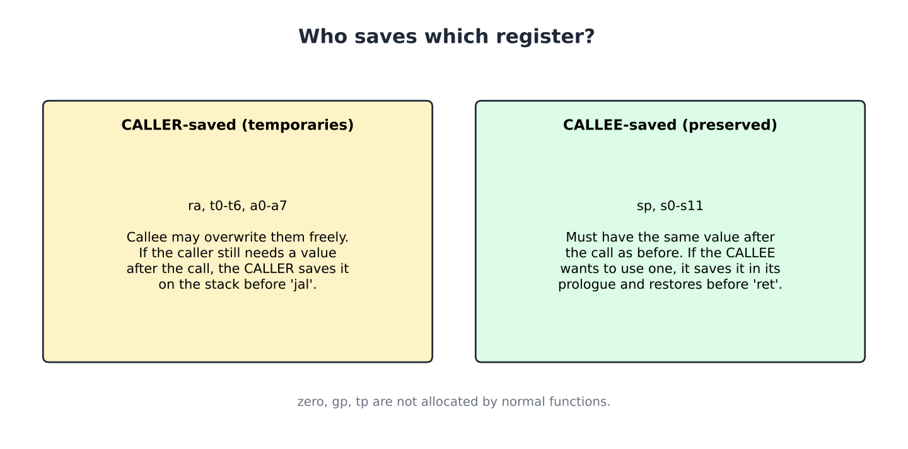

# Day 22 — Who Saves Which Register - Callee or Caller, Preserved Registers

> **Course:** Week 5, Video 2 &nbsp;|&nbsp; **Playlist #22** &nbsp;|&nbsp; [Chip Design with Rashid — RISC-V Architecture Explained](https://www.youtube.com/playlist?list=PL0-xus8sJBCRzZtmL_fLWaohRKuc4j5aH)  
> **Notes source:** video topic + standard RV32I material (to be updated from the transcript)

| Register | ABI name | Preserved across a call? | Who saves |
|---|---|---|---|
| x0 | zero | (constant) | — |
| x1 | ra | **No** | caller |
| x2 | sp | **Yes** | callee |
| x3, x4 | gp, tp | (not allocated) | — |
| x5–x7, x28–x31 | t0–t6 | **No** | caller |
| x8–x9, x18–x27 | s0–s11 | **Yes** | callee |
| x10–x17 | a0–a7 | **No** | caller |

## Caller-saved (temporary) registers: `t0–t6`, `a0–a7`, `ra`

- The called function may **freely overwrite** them.
- If the caller still needs a value after the call, the **caller** must save it before `jal` (or better, keep it in an `s` register).

## Callee-saved (preserved) registers: `s0–s11`, `sp`

- Must have **the same value after the call as before**.
- If a function wants to use `s3`, it must save `s3` in its prologue and restore it in its epilogue.

## Why split them?

It is a performance compromise:

- Short-lived values go in `t` registers → no saving at all in leaf functions.
- Long-lived values (needed across calls) go in `s` registers → saved once per function, not around every call.

---
[⬅ Day 21](../Day-21-Stack-Callee-and-Caller/README.md) | [Index](../README.md) | [Day 23 ➡](../Day-23-Functions-Case-I-II/README.md)
