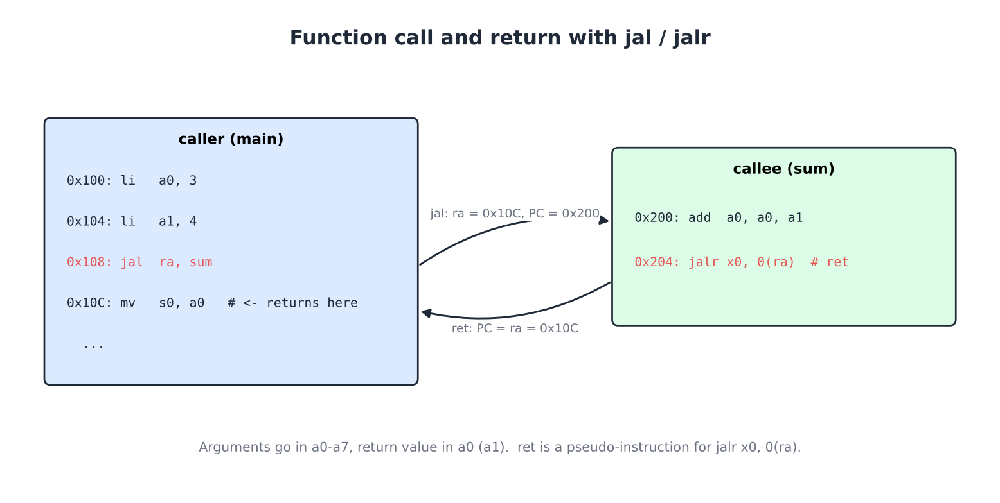

# Day 23 — Functions - Case I, Case II (4 Arguments, One Return Value)

> **Course:** Week 4, Video 4 &nbsp;|&nbsp; **Playlist #23** &nbsp;|&nbsp; [Chip Design with Rashid — RISC-V Architecture Explained](https://www.youtube.com/playlist?list=PL0-xus8sJBCRzZtmL_fLWaohRKuc4j5aH)  
> **Notes source:** video topic + standard RV32I material (to be updated from the transcript)



## The calling convention (rules everyone agrees on)

1. Put arguments in **`a0 – a7`** (first 8 arguments).
2. `jal ra, func` — saves the return address (PC + 4) in **`ra`** and jumps.
3. The function computes; return value goes in **`a0`** (and `a1` for 64-bit values).
4. `ret` (= `jalr x0, 0(ra)`) jumps back.

## Case I — simple leaf function (no arguments / one argument)

A **leaf function** calls no other function, so `ra` is never overwritten and it needs no stack if it only uses `t` and `a` registers.

```c
int inc(int x) { return x + 1; }
```

```asm
inc:    addi a0, a0, 1        # argument x arrives in a0, result returned in a0
        ret

main:   li   a0, 41
        jal  ra, inc          # a0 = 42
```

## Case II — 4 arguments, one return value

```c
int f(int g, int h, int i, int j) { return (g + h) - (i + j); }
```

```asm
# g=a0, h=a1, i=a2, j=a3 ; result in a0
f:      add  t0, a0, a1       # g + h
        add  t1, a2, a3       # i + j
        sub  a0, t0, t1       # return value in a0
        ret

main:   li   a0, 10
        li   a1, 20
        li   a2, 3
        li   a3, 7
        jal  ra, f            # a0 = (10+20) - (3+7) = 20
```

Because `f` uses only `t0`, `t1` (caller-saved temporaries) it does not need to save anything. If it wanted to use `s0`, it would have to save/restore it on the **stack** — that is Week 5.

## What if there are more than 8 arguments?

Arguments 9, 10, … are passed **on the stack** (the caller stores them at `0(sp)`, `4(sp)` … before the call).

---

## Week 4 Key Takeaways

- `jal` = jump + save return address; `jalr` = jump to register (returns, tables, pointers).
- `j`, `ret`, `call`, `jr` are pseudo-instructions.
- Loops are backward branches.
- `lb/lh` sign-extend, `lbu/lhu` zero-extend; RISC-V is little-endian.
- Calling convention: `a0–a7` in, `a0` out, `ra` holds the return address.

## Practice Questions

1. What is the difference between `lb` and `lbu` when the byte is `0x80`?
2. Write a loop that sets the 10 bytes starting at `a0` to zero.
3. Why must `j label` use `x0` as its `rd`?
4. Write a function `max(a, b)` returning the larger signed value.
5. In `toupper`, why is `andi t1, t1, 0xDF` the same as subtracting 32 for lowercase letters?

<details><summary>Answers</summary>

1. `lb` → `0xFFFFFF80` (−128); `lbu` → `0x00000080` (128).
2. `li t0, 10` ; `L: sb x0, 0(a0)` ; `addi a0, a0, 1` ; `addi t0, t0, -1` ; `bnez t0, L`.
3. A plain jump does not need a return address, so it is discarded by writing x0.
4. `max: bge a0, a1, 1f` ; `mv a0, a1` ; `1: ret`.
5. Lowercase letters have bit 5 (0x20) set; clearing it (mask 0xDF) subtracts exactly 32.
</details>

---
[⬅ Day 22](../Day-22-Caller-vs-Callee-Saved/README.md) | [Index](../README.md) | [Day 24 ➡](../Day-24-Stack-and-Pseudo-instructions/README.md)
