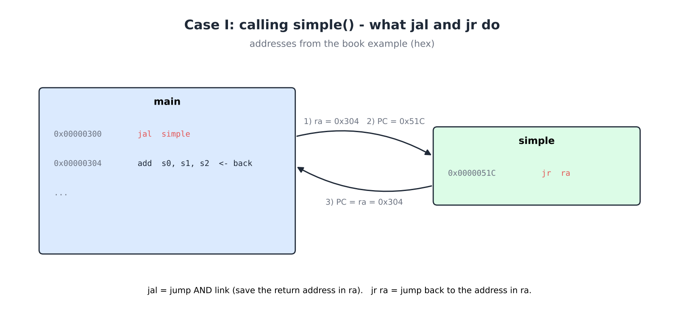

# Day 23 — Functions - Case I, Case II (4 Arguments, One Return Value)

> **Course:** Week 4, Video 4 &nbsp;|&nbsp; **Playlist #23** &nbsp;|&nbsp; [Chip Design with Rashid — RISC-V Architecture Explained](https://www.youtube.com/playlist?list=PL0-xus8sJBCRzZtmL_fLWaohRKuc4j5aH)  
> **Notes source:** lecture transcript + Rashid's weekly notes

## Why functions?

In C or any high-level language, if a piece of code is **repeated many times**, we write it **once** as a function and call it. If we later improve or fix it, we change only one place, and every call gets the update.

Today: functions in assembly, and the start of the **stack**. Rashid builds it up in **4–5 cases**, each a little more complete. Today: cases I and II.

| Name | Meaning |
|---|---|
| **Caller** | the code that calls (here: `main`) |
| **Callee** | the function being called |

## Case I: no arguments, no return value

```c
int main() {
    simple();          // call
    a = b + c;
}
void simple() {
    return;
}
```

It does nothing useful — it's just to learn the **mechanics**.



```asm
# address   instruction
0x00000300  jal  simple          # call the function
0x00000304  add  s0, s1, s2      # the next instruction
...
0x0000051C  simple: jr ra        # return
```

### jal — "jump and link" does two things

1. **Save the return address**: the next instruction is at `0x300 + 4 = 0x304` (byte-addressable memory, each instruction is 4 bytes) → put **0x304 into `ra`**.
2. **Jump** to the function: PC = `0x51C`.

`ra` (**return address**) is one of the special registers from the register-file video.

### jr ra — "jump register"

Jumps to the address stored in `ra` → back to `0x304`, and `main` continues.

Machine code check: `jal ra, simple` from 0x300 to 0x51C is an offset of 0x21C = 540 → `0x21C000EF`.

## Case II: arguments and a return value

**Arguments go in `a0`–`a7`** — up to **8** arguments (more than 8 → stack, coming next).

Book example:

```c
int main() {
    int y;
    y = diffofsums(2, 3, 4, 5);
}
int diffofsums(int f, int g, int h, int i) {
    int result;                    // a LOCAL variable
    result = (f + g) - (h + i);
    return result;
}
```

- `y` belongs to main; `result` is a **local variable** — it only exists inside the function and disappears when the function ends.

```asm
main:
      addi a0, zero, 2      # f = 2   (argument 1 in a0)
      addi a1, zero, 3      # g = 3   (argument 2 in a1)
      addi a2, zero, 4      # h = 4
      addi a3, zero, 5      # i = 5
      jal  diffofsums       # ra = next instruction, jump
      add  s7, a0, zero     # y = return value (from a0)

diffofsums:
      add  t0, a0, a1       # t0 = f + g
      add  t1, a2, a3       # t1 = h + i
      sub  s3, t0, t1       # result = (f + g) - (h + i)
      add  a0, s3, zero     # put the return value in a0
      jr   ra               # return
```


### The handshake

| Agreement | Register |
|---|---|
| arguments go in | **a0, a1, a2 … a7** (in order) |
| the return value comes back in | **a0** |
| where to return to | **ra** |

Because both sides follow the same rule, `main` knows to look in **a0** after the call, and the function knows where its arguments are. Every call `diffofsums(8, 9, 11, 12)` just puts different values in a0–a3.

Result here: (2 + 3) − (4 + 5) = **−4**, returned in a0, copied into s7 (y).

### Pseudo-instructions

`jal diffofsums` and `jr ra` are **pseudo-instructions** — convenient names; the assembler turns them into real base instructions (`jal ra, offset` and `jalr x0, 0(ra)`). Covered on Day 30.

## Not finished yet

This function changes **s3, t0, t1** — which `main` might be using! And what if there are **more than 8 arguments**? Both need the **stack** → next videos (Days 20–22).

## Key points

- `jal label`: save PC + 4 in `ra`, then jump. `jr ra`: jump back.
- Arguments in a0–a7, return value in a0, return address in ra.
- Local variables live only inside the function.

## Practice Questions

1. `jal` is at 0x1000. What value goes into ra?
2. Where does the 3rd argument of a function go?
3. Where does main find the function's result?
4. What does `diffofsums(10, 5, 2, 1)` return?

**Answers**

1. 0x1004.
2. a2.
3. In a0.
4. (10 + 5) − (2 + 1) = 12.

<!-- rashid-notes -->
## 📒 From Rashid's Week 4 notes

> Extra points and worked examples from Rashid's members-only weekly notes ([RISCV_Arch folder](https://drive.google.com/drive/folders/1sIX-rAanGWWkZocAbXNmvW80JbdAEg6P), members only). Written here in my own words; most of his examples come from the reference book *Digital Design and Computer Architecture, RISC-V Edition* (Harris & Harris), chapters 6–7.

**Case I — no arguments, no return value:**

```
0x...300  main:   jal ra, simple    # 1) ra = 0x...304   2) PC = address of simple
0x...304          ...
0x...51C  simple: jr ra             # PC = ra = 0x...304
```

`jal` does two things: **saves the return address in `ra`** and **jumps to the function**. `jr ra` jumps back to the address in `ra`.

**Case II — arguments (`a0…a7`) and a return value (`a0`):** `y = diffofsums(2, 3, 4, 5);`

```asm
main:
  addi a0, zero, 2
  addi a1, zero, 3
  addi a2, zero, 4
  addi a3, zero, 5
  jal  diffofsums        # ra = return address
  ...                    # y (s7) = a0
diffofsums:
  add  t0, a0, a1        # 2 + 3 = 5
  add  t1, a2, a3        # 4 + 5 = 9
  sub  s3, t0, t1        # 5 - 9 = -4
  add  a0, s3, zero      # return -4
  jr   ra
```

**More than 8 arguments?** The extras go on the **stack**.

---
[⬅ Day 22](../Day-22-Caller-vs-Callee-Saved/README.md) | [Index](../README.md) | [Day 24 ➡](../Day-24-Stack-and-Pseudo-instructions/README.md)
