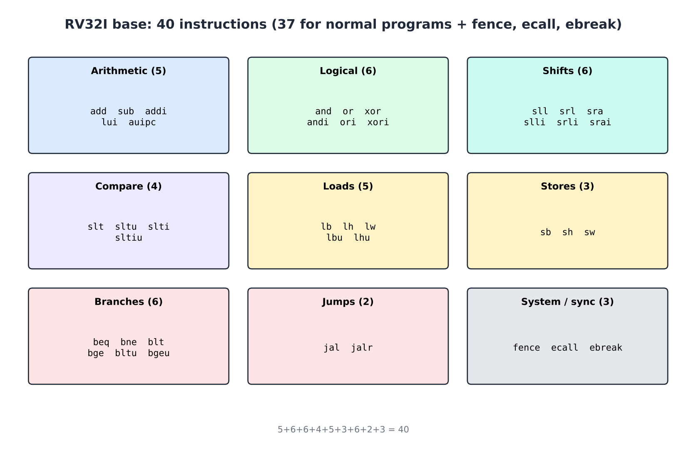

# Day 25 — Wrapping Up All 37/40 Base Instructions - Next Steps

> **Course:** Week 5, Video 5 &nbsp;|&nbsp; **Playlist #25** &nbsp;|&nbsp; [Chip Design with Rashid — RISC-V Architecture Explained](https://www.youtube.com/playlist?list=PL0-xus8sJBCRzZtmL_fLWaohRKuc4j5aH)  
> **Notes source:** video topic + Rashid's weekly notes + standard RV32I material

## The complete RV32I instruction list

| # | Instr | Fmt | Operation |
|---|---|---|---|
| 1 | `lui` | U | rd = imm << 12 |
| 2 | `auipc` | U | rd = PC + (imm << 12) |
| 3 | `jal` | J | rd = PC+4; PC += imm |
| 4 | `jalr` | I | rd = PC+4; PC = (rs1+imm) & ~1 |
| 5–10 | `beq bne blt bge bltu bgeu` | B | if (cond) PC += imm |
| 11–15 | `lb lh lw lbu lhu` | I | rd = M[rs1+imm] |
| 16–18 | `sb sh sw` | S | M[rs1+imm] = rs2 |
| 19 | `addi` | I | rd = rs1 + imm |
| 20–21 | `slti sltiu` | I | rd = rs1 < imm |
| 22–24 | `xori ori andi` | I | rd = rs1 op imm |
| 25–27 | `slli srli srai` | I | rd = rs1 shift shamt |
| 28–29 | `add sub` | R | rd = rs1 ± rs2 |
| 30 | `sll` | R | rd = rs1 << rs2 |
| 31–32 | `slt sltu` | R | rd = rs1 < rs2 |
| 33 | `xor` | R | rd = rs1 ^ rs2 |
| 34–35 | `srl sra` | R | rd = rs1 >> rs2 |
| 36–37 | `or and` | R | rd = rs1 op rs2 |
| 38 | `fence` | I | order memory / I/O accesses |
| 39 | `ecall` | I | environment call (system call) → trap |
| 40 | `ebreak` | I | breakpoint → debugger / trap |

Instructions **1–37** are what you write in everyday programs. `fence`, `ecall`, `ebreak` are for the system level: memory ordering, operating-system calls and debugging (Week 9).

## What is *not* in RV32I

- No multiply/divide (→ **M** extension: `mul`, `div`, `rem` …).
- No floating point (→ **F/D**).
- No `subi`, `not`, `mov`, `push`, `pop`, `call` as real instructions — all are pseudo or composed.
- No condition flags (no carry/overflow flags — compare with `slt`/`sltu` and branch directly).

## Next steps (where the course goes)

Now that we can *write* every instruction, the next question is: **what does the hardware see?** → Weeks 6–7 encode every instruction into 32 bits.

---

## Week 5 Key Takeaways

- The stack grows down; `sp` stays 16-byte aligned; prologue allocates, epilogue frees.
- `s0–s11`, `sp` are **callee-saved**; `t0–t6`, `a0–a7`, `ra` are **caller-saved**.
- Any non-leaf function must save `ra`.
- Pseudo-instructions are expanded by the assembler — the CPU only knows the 40 real ones.

## Practice Questions

1. Why must a non-leaf function save `ra`, but a leaf function need not?
2. A function uses `s0, s1, s2` and calls another function. How many bytes should its frame be?
3. Expand `bgt a0, a1, L`, `seqz t0, a2`, and `ret` into real instructions.
4. `main` keeps a value in `t2` and calls `f`. Is the value safe? What should `main` do?
5. Why is there no carry flag in RISC-V, and how do you detect unsigned overflow of `a + b`?

Answers

1. Its own `jal` overwrites `ra`; a leaf function never executes `jal`.
2. 4 registers (`ra`, `s0`, `s1`, `s2`) × 4 = 16 bytes → 16 (already 16-byte aligned).
3. `blt a1, a0, L`; `sltiu t0, a2, 1`; `jalr x0, 0(ra)`.
4. No — `t2` is caller-saved. Save it on the stack before the call, or keep it in an `s` register.
5. Flags complicate out-of-order/pipelined hardware. `add t0, a, b` ; `sltu t1, t0, a` → `t1 = 1` if a carry (unsigned overflow) occurred.

<!-- rashid-notes -->
## 📒 From Rashid's Week 5 notes

> Extra points and worked examples from Rashid's members-only weekly notes ([RISCV_Arch folder](https://drive.google.com/drive/folders/1sIX-rAanGWWkZocAbXNmvW80JbdAEg6P), members only). Written here in my own words; most of his examples come from the reference book *Digital Design and Computer Architecture, RISC-V Edition* (Harris & Harris), chapters 6–7.

**The 40 RV32I base instructions** (his table):

| Group | # | Instructions |
|---|---|---|
| Arithmetic | 5 | add, addi, sub, lui, auipc |
| Logical | 6 | and, andi, or, ori, xor, xori |
| Shift | 6 | sll, slli, srl, srli, sra, srai |
| Comparison | 4 | slt, slti, sltu, sltiu |
| Memory access | 8 | lb, lbu, lh, lhu, lw, sb, sh, sw |
| Control flow | 8 | beq, bne, blt, bltu, bge, bgeu, jal, jalr |
| System & fence | 3 | fence, ecall, ebreak |
| **Total** | **40** | |

**Comparison instructions:**

- `slt s4, s3, s2` → s4 = 1 if s3 < s2 (signed), else 0.
- `slti s4, s3, imm` → same but with a 12-bit **sign-extended** immediate.
- `sltu` / `sltiu` → both operands treated as **unsigned** numbers.

**`auipc` = add upper immediate to PC** (used for **PC-relative addressing**): `auipc ra, imm` → **ra = PC + (imm << 12)**.

**His project flow from here:** assembly → machine-code conversion → Python simulator (no memory) → Python simulator + assembler (37 instructions) → I/O handling & exceptions → Python simulator, all 40 (complete ISA) → RTL implementation → RTL validation (UVM) → physical design.

---
[⬅ Day 24](../Day-24-Stack-and-Pseudo-instructions/README.md) | [Index](../README.md) | [Day 26 ➡](../Day-26-R-Type-Encoding/README.md)
