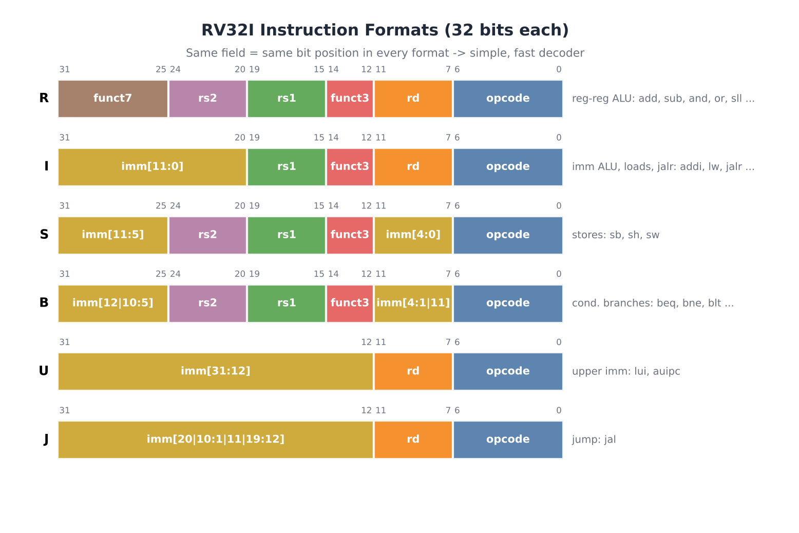
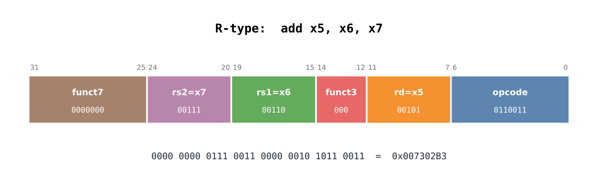

# Day 26 — R-Type Instructions

> **Course:** Week 6, Video 1 &nbsp;|&nbsp; **Playlist #26** &nbsp;|&nbsp; [Chip Design with Rashid — RISC-V Architecture Explained](https://www.youtube.com/playlist?list=PL0-xus8sJBCRzZtmL_fLWaohRKuc4j5aH)  
> **Notes source:** video topic + Rashid's weekly notes + standard RV32I material

## The Big Picture — Six Formats



Every RV32I instruction is 32 bits. The **opcode** (bits 6:0) tells the decoder which format it is.

## Design choices that make the hardware simple

1. **`rs1`, `rs2`, `rd` are always in the same bit positions** (19:15, 24:20, 11:7). The register file can start reading *before* the instruction is fully decoded.
2. **The sign bit of every immediate is always bit 31** → sign-extension can start immediately.
3. Immediate bits are placed so that the **same instruction bit feeds the same immediate bit** in as many formats as possible (this is why S/B/J immediates look "scrambled").

## Opcode table (bits 6:0)

| Opcode (binary) | Hex | Name | Format | Instructions |
|---|---|---|---|---|
| `0110011` | 0x33 | OP | R | add sub sll slt sltu xor srl sra or and |
| `0010011` | 0x13 | OP-IMM | I | addi slti sltiu xori ori andi slli srli srai |
| `0000011` | 0x03 | LOAD | I | lb lh lw lbu lhu |
| `1100111` | 0x67 | JALR | I | jalr |
| `0100011` | 0x23 | STORE | S | sb sh sw |
| `1100011` | 0x63 | BRANCH | B | beq bne blt bge bltu bgeu |
| `0110111` | 0x37 | LUI | U | lui |
| `0010111` | 0x17 | AUIPC | U | auipc |
| `1101111` | 0x6F | JAL | J | jal |
| `0001111` | 0x0F | MISC-MEM | I | fence |
| `1110011` | 0x73 | SYSTEM | I | ecall ebreak (+ CSR instructions) |

## Step-by-step method for any instruction

1. Find the instruction's **format, opcode, funct3, funct7**.
2. Convert register names to numbers (`t0 = x5`, `a0 = x10` …) and then to **5-bit binary**.
3. Convert the immediate to **binary two's complement** of the right width.
4. **Place** the bits into the fields.
5. Group into 4-bit nibbles → **hex**.

## Register number cheat-sheet

| ABI | x# | 5-bit | | ABI | x# | 5-bit |
|---|---|---|---|---|---|---|
| zero | 0 | 00000 | | a0 | 10 | 01010 |
| ra | 1 | 00001 | | a1 | 11 | 01011 |
| sp | 2 | 00010 | | a2 | 12 | 01100 |
| gp | 3 | 00011 | | a3 | 13 | 01101 |
| tp | 4 | 00100 | | a4 | 14 | 01110 |
| t0 | 5 | 00101 | | a5 | 15 | 01111 |
| t1 | 6 | 00110 | | s2 | 18 | 10010 |
| t2 | 7 | 00111 | | s11 | 27 | 11011 |
| s0 | 8 | 01000 | | t3 | 28 | 11100 |
| s1 | 9 | 01001 | | t6 | 31 | 11111 |

```
 31      25 24   20 19   15 14  12 11    7 6      0
┌─────────┬───────┬───────┬──────┬───────┬────────┐
│ funct7  │  rs2  │  rs1  │funct3│  rd   │ opcode │
└─────────┴───────┴───────┴──────┴───────┴────────┘
     7        5       5       3      5       7
```

Used for **register–register** ALU operations. `opcode = 0110011`.

| Instr | funct7 | funct3 |
|---|---|---|
| add | 0000000 | 000 |
| **sub** | **0100000** | 000 |
| sll | 0000000 | 001 |
| slt | 0000000 | 010 |
| sltu | 0000000 | 011 |
| xor | 0000000 | 100 |
| srl | 0000000 | 101 |
| **sra** | **0100000** | 101 |
| or | 0000000 | 110 |
| and | 0000000 | 111 |

`funct7` bit 30 is the only difference between `add`/`sub` and `srl`/`sra` — in hardware it simply tells the ALU "subtract" or "arithmetic shift".

## Worked example 1 — `add x5, x6, x7`



| Field | Value | Binary |
|---|---|---|
| funct7 | add | 0000000 |
| rs2 | x7 | 00111 |
| rs1 | x6 | 00110 |
| funct3 | add | 000 |
| rd | x5 | 00101 |
| opcode | OP | 0110011 |

```
0000000 00111 00110 000 00101 0110011
= 0000 0000 0111 0011 0000 0010 1011 0011
=   0    0    7    3    0    2    B    3      → 0x007302B3
```

## Worked example 2 — `sub t2, t0, t1`

```
funct7=0100000  rs2=t1=00110  rs1=t0=00101  funct3=000  rd=t2=00111  opcode=0110011
0100000 00110 00101 000 00111 0110011
= 0100 0000 0110 0010 1000 0011 1011 0011  → 0x406283B3
```

## Worked example 3 — `xor a2, a3, a4` → `0x00E6C633`

```
0000000 01110 01101 100 01100 0110011
```

<!-- rashid-notes -->
## 📒 From Rashid's Week 6 notes

> Extra points and worked examples from Rashid's members-only weekly notes ([RISCV_Arch folder](https://drive.google.com/drive/folders/1sIX-rAanGWWkZocAbXNmvW80JbdAEg6P), members only). Written here in my own words; most of his examples come from the reference book *Digital Design and Computer Architecture, RISC-V Edition* (Harris & Harris), chapters 6–7.

**The 4 format families in one line each:**

- **R-type** → 3 registers.
- **I-type** → 2 registers + a 12-bit immediate.
- **S/B-type** (store/branch) → 2 registers + a 12-bit (S) / 13-bit (B) immediate.
- **U/J-type** (upper-imm/jump) → 1 register + a 20-bit (U) / 21-bit (J) immediate.

**R-type field widths:** funct7 (7) | rs2 (5) | rs1 (5) | funct3 (3) | rd (5) | op (7).

**Worked examples (verified with an assembler):**

| Assembly | funct7, rs2, rs1, funct3, rd, op | Machine code |
|---|---|---|
| `add s2, s3, s4` | 0, 20, 19, 0, 18, 51 | **0x01498933** |
| `sub t0, t1, t2` | 32, 7, 6, 0, 5, 51 | **0x407302B3** |

**R-type opcode table (op = 51 for all):**

| Instr | funct3 | funct7 |
|---|---|---|
| add | 0 | 0 |
| sub | 0 | 32 |
| sll | 1 | 0 |
| slt | 2 | 0 |
| sltu | 3 | 0 |
| xor | 4 | 0 |
| srl | 5 | 0 |
| sra | 5 | 32 |
| or | 6 | 0 |
| and | 7 | 0 |

`funct7 = 32` (bit 30 set) is what tells `sub` from `add` and `sra` from `srl`.

---
[⬅ Day 25](../Day-25-All-40-Base-Instructions/README.md) | [Index](../README.md) | [Day 27 ➡](../Day-27-I-Type-Encoding/README.md)
