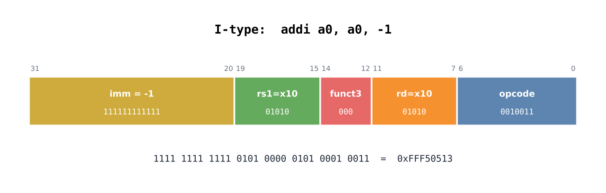

# Day 27 — I-Type Instructions (Assembly to Machine Language)

> **Course:** Week 6, Video 2 &nbsp;|&nbsp; **Playlist #27** &nbsp;|&nbsp; [Chip Design with Rashid — RISC-V Architecture Explained](https://www.youtube.com/playlist?list=PL0-xus8sJBCRzZtmL_fLWaohRKuc4j5aH)  
> **Notes source:** video topic + Rashid's weekly notes + standard RV32I material

```
 31             20 19   15 14  12 11    7 6      0
┌─────────────────┬───────┬──────┬───────┬────────┐
│    imm[11:0]    │  rs1  │funct3│  rd   │ opcode │
└─────────────────┴───────┴──────┴───────┴────────┘
        12            5       3      5       7
```

The 12-bit immediate replaces `funct7 + rs2`. It is **sign-extended** to 32 bits.

| Group | Opcode | funct3 |
|---|---|---|
| `addi` | 0010011 | 000 |
| `slti` / `sltiu` | 0010011 | 010 / 011 |
| `xori` / `ori` / `andi` | 0010011 | 100 / 110 / 111 |
| `slli` | 0010011 | 001 (imm[11:5]=0000000) |
| `srli` / `srai` | 0010011 | 101 (imm[11:5]=0000000 / **0100000**) |
| `lb lh lw lbu lhu` | 0000011 | 000 001 010 100 101 |
| `jalr` | 1100111 | 000 |

For shifts the immediate field holds `funct7` (bits 31:25) + **5-bit shamt** (bits 24:20), because a 32-bit value can only be shifted 0–31.

## Worked example 1 — `addi a0, a0, -1`



```
-1 in 12 bits = 1111 1111 1111
imm=111111111111  rs1=a0=01010  funct3=000  rd=a0=01010  opcode=0010011
= 1111 1111 1111 0101 0000 0101 0001 0011 → 0xFFF50513
```

## Worked example 2 — `lw a0, 12(s0)`

```
imm=12=000000001100  rs1=s0=01000  funct3=010(lw)  rd=a0=01010  opcode=0000011
= 0000 0000 1100 0100 0010 0101 0000 0011 → 0x00C42503
```

## Worked example 3 — `srai t0, t1, 3`

```
imm[11:5]=0100000  shamt=00011  rs1=t1=00110  funct3=101  rd=t0=00101  opcode=0010011
→ 0x40335293
```

## Worked example 4 — `jalr x0, 0(ra)`  (= `ret`) → `0x00008067`

> 💡 You will see `0x00008067` at the end of almost every function in a disassembly — it is `ret`.

## Decoding (the reverse direction): what is `0x00C42503`?

```
0000 0000 1100 0100 0010 0101 0000 0011
opcode = 0000011 → LOAD (I-type)
rd     = bits 11:7  = 01010 → x10 (a0)
funct3 = bits 14:12 = 010   → lw
rs1    = bits 19:15 = 01000 → x8 (s0)
imm    = bits 31:20 = 000000001100 → 12
→ lw a0, 12(s0)
```

<!-- rashid-notes -->
## 📒 From Rashid's Week 6 notes

> Extra points and worked examples from Rashid's members-only weekly notes ([RISCV_Arch folder](https://drive.google.com/drive/folders/1sIX-rAanGWWkZocAbXNmvW80JbdAEg6P), members only). Written here in my own words; most of his examples come from the reference book *Digital Design and Computer Architecture, RISC-V Edition* (Harris & Harris), chapters 6–7.

**I-type fields:** imm[11:0] (12) | rs1 (5) | funct3 (3) | rd (5) | op (7).

**Worked examples from his page (verified with an assembler):**

| Assembly | imm, rs1, funct3, rd, op | Machine code |
|---|---|---|
| `addi s0, s1, 12` | 12, 9, 0, 8, 19 | **0x00C48413** |
| `addi s2, t1, -14` | −14, 6, 0, 18, 19 | **0xFF230913** |
| `lw t2, -6(s3)` | −6, 19, 2, 7, 3 | **0xFFA9A383** |
| `lb s4, 0x1F(s4)` | 31, 20, 0, 20, 3 | **0x01FA0A03** |
| `slli s2, s7, 5` | 5, 23, 1, 18, 19 | **0x005B9913** |
| `srai t1, t2, 29` | (0100000 ‖ 29), 7, 5, 6, 19 | **0x41D3D313** |
| `lw t3, -36(s4)` | −36, 20, 2, 28, 3 | **0xFDCA2E03** |

**Shifts are special:** only imm[4:0] is the shift amount. imm[11:5] is `0000000` for `slli`/`srli` and **`0100000`** for `srai` — that's how srli and srai (same funct3 = 5) are told apart.

**The 15 I-type instructions:**

| Group | op | funct3 |
|---|---|---|
| addi / slti / sltiu / xori / ori / andi | 19 | 0 / 2 / 3 / 4 / 6 / 7 |
| slli / srli / srai | 19 | 1 / 5 / 5 |
| lb / lh / lw / lbu / lhu | 3 | 0 / 1 / 2 / 4 / 5 |
| jalr | 103 | 0 |

---
[⬅ Day 26](../Day-26-R-Type-Encoding/README.md) | [Index](../README.md) | [Day 28 ➡](../Day-28-S-B-Type-Encoding/README.md)
