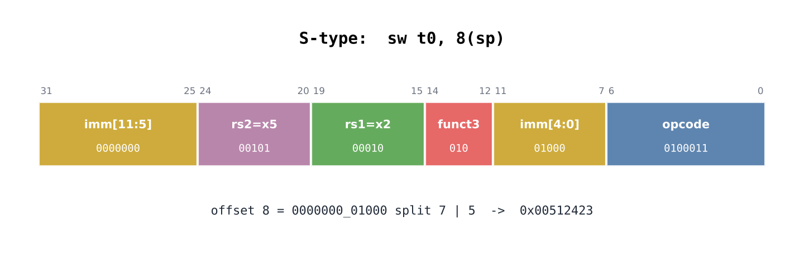
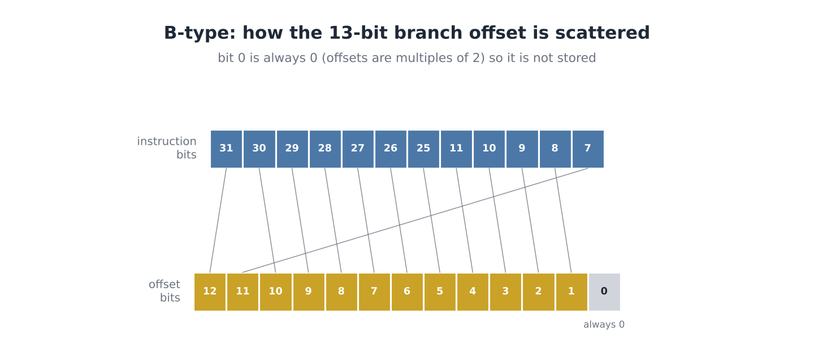
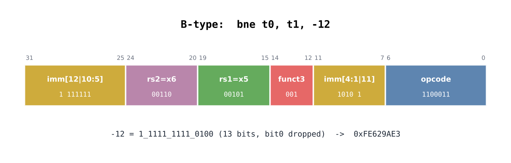

# Day 28 — S/B-Type Instructions - Assembly to Binary

> **Course:** Week 6, Video 3 &nbsp;|&nbsp; **Playlist #28** &nbsp;|&nbsp; [Chip Design with Rashid — RISC-V Architecture Explained](https://www.youtube.com/playlist?list=PL0-xus8sJBCRzZtmL_fLWaohRKuc4j5aH)  
> **Notes source:** video topic + standard RV32I material (to be updated from the transcript)

## S-type (stores)

```
 31      25 24   20 19   15 14  12 11    7 6      0
┌─────────┬───────┬───────┬──────┬───────┬────────┐
│imm[11:5]│  rs2  │  rs1  │funct3│imm[4:0]│ opcode │
└─────────┴───────┴───────┴──────┴───────┴────────┘
```

A store has **two source registers** (`rs2` = data, `rs1` = base) and **no destination register**. To keep `rs1`/`rs2` in their usual places, the 12-bit offset is **split**: upper 7 bits where `funct7` is, lower 5 bits where `rd` would be.

`opcode = 0100011`; `funct3`: `sb 000`, `sh 001`, `sw 010`.

### Worked example — `sw t0, 8(sp)`



```
offset 8 = 0000000 01000 → imm[11:5]=0000000, imm[4:0]=01000
imm[11:5]=0000000 rs2=t0=00101 rs1=sp=00010 funct3=010 imm[4:0]=01000 opcode=0100011
= 0000 0000 0101 0001 0010 0100 0010 0011 → 0x00512423
```

### Worked example — `sb t0, -1(a0)` → `0xFE550FA3`

```
-1 = 1111111 11111 → imm[11:5]=1111111, imm[4:0]=11111
```

## B-type (conditional branches)

```
 31   30      25 24   20 19   15 14  12 11     8   7    6      0
┌────┬─────────┬───────┬───────┬──────┬────────┬────┬────────┐
│[12]│ [10:5]  │  rs2  │  rs1  │funct3│ [4:1]  │[11]│ opcode │
└────┴─────────┴───────┴───────┴──────┴────────┴────┴────────┘
```



- The branch **offset** is in bytes and is **always even** (instructions are 2- or 4-byte aligned), so **bit 0 is not stored**. 12 stored bits therefore encode a **13-bit** offset → range **−4096 … +4094 bytes** (±4 KiB).
- The layout is the S-type layout with the bits rotated: `imm[11]` moves to bit 7 and `imm[12]` (the sign) is at bit 31.
- `opcode = 1100011`; `funct3`: `beq 000`, `bne 001`, `blt 100`, `bge 101`, `bltu 110`, `bgeu 111`.

### Recipe for B-type

1. `offset = address(label) − address(branch)`.
2. Write `offset` as a 13-bit two's complement number `b12 … b0` (b0 must be 0).
3. Place: bit 31 ← b12, bits 30:25 ← b10..b5, bits 11:8 ← b4..b1, bit 7 ← b11.

### Worked example — `beq a0, zero, +16` (forward)

```
16 = 0 0000 0001 0000 (13 bits)
b12=0  b11=0  b10:5=000000  b4:1=1000
0 000000 00000 01010 000 1000 0 1100011
= 0000 0000 0000 0101 0000 1000 0110 0011 → 0x00050863
```

### Worked example — `bne t0, t1, -12`



```
-12 = 1 1111 1111 0100
b12=1  b11=1  b10:5=111111  b4:1=1010
1 111111 00110 00101 001 1010 1 1100011 → 0xFE629AE3
```

---
[⬅ Day 27](../Day-27-I-Type-Encoding/README.md) | [Index](../README.md) | [Day 29 ➡](../Day-29-U-J-Type-Encoding/README.md)
