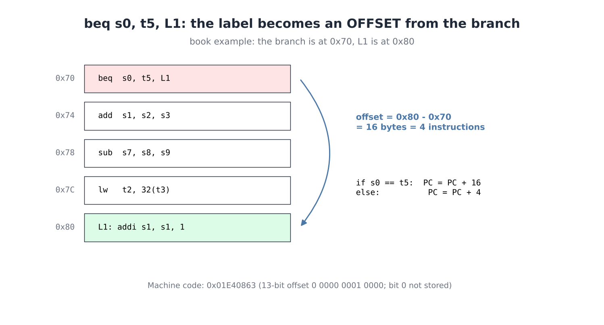

# Day 28 — S/B-Type Instructions - Assembly to Binary

> **Course:** Week 6, Video 3 &nbsp;|&nbsp; **Playlist #28** &nbsp;|&nbsp; [Chip Design with Rashid — RISC-V Architecture Explained](https://www.youtube.com/playlist?list=PL0-xus8sJBCRzZtmL_fLWaohRKuc4j5aH)  
> **Notes source:** lecture transcript

A small change of plan: instead of starting the **Python** implementation of R and I types now, Rashid first **finishes the theory** — S/B types today, then U/J. Coding takes time to improve, so it's better to have all the theory first.

Colour code used in the course tables: **R-type yellow, I-type green, S/B-type pink**.


## "SB" type = Store + Branch

| Group | Instructions | opcode | funct3 |
|---|---|---|---|
| **S (store)** | `sb` (8 bits), `sh` (16 bits), `sw` (32 bits) | **35** (`0100011`) | 0, 1, 2 |
| **B (branch)** | `beq bne blt bge bltu bgeu` | **99** (`1100011`) | 0, 1, 4, 5, 6, 7 |

As always, the opcode sits in bits 0–6.

## S-type: stores

```asm
sw t2, -6(s3)        # Memory[s3 + (-6)] = t2
```

- `s3` holds a **base address**; `-6` is added → a 32-bit address.
- At that address, the content of `t2` is **written**.
- **Both registers are sources** — neither is a destination. So the **rd place (bits 7–11) is free** → use it for part of the immediate.

### The S-type layout

```
 31      25 24  20 19  15 14 12 11      7 6     0
┌──────────┬──────┬──────┬─────┬─────────┬───────┐
│imm[11:5] │ rs2  │ rs1  │ f3  │imm[4:0] │opcode │
└──────────┴──────┴──────┴─────┴─────────┴───────┘
     7        5      5      3       5        7
```

7 + 5 = **12-bit immediate**, split in two.

**Why split it?** So that **rs1 and rs2 are always in the same bit positions** in every format. In the hardware, the wires from those instruction bits to the register file **never change** — fewer wires and less "if this type, wire it this way" logic. Small decisions like this make a big difference to the hardware (you'll appreciate it in the SystemVerilog part).

### Worked example: `sw t2, -6(s3)`

| Field | Value | Bits |
|---|---|---|
| opcode | 35 | `0100011` |
| funct3 | 2 (sw) | `010` |
| rs1 = s3 | x19 | `10011` |
| rs2 = t2 | x7 | `00111` |
| imm = −6 | 2's complement | `1111111 11010` |

−6: +6 = `000000000110` → invert → `111111111001` → +1 → `111111111010`. Split: `imm[11:5] = 1111111`, `imm[4:0] = 11010`.

```
1111111 00111 10011 010 11010 0100011  =  0xFE79AD23
```

### How the hardware builds the address


- Read the value of **rs1** (32 bits) from the register file.
- Build a **32-bit** immediate from the instruction bits: bits 0–4 from instruction bits 7–11, bits 5–11 from instruction bits 25–31, and **bit 11 (the sign) copied into bits 12–31**. This is just wiring — not a register.
- Add the two → the memory address.

## B-type: branches

```asm
beq s0, t5, L1       # if s0 == t5, jump to L1
```

Same layout idea: **rs1, rs2** to compare, opcode 99, funct3 picks which branch.

### The label is an OFFSET, not an address



In the book example the `beq` is at **0x70** and `L1` is at **0x80**. The instruction does **not** store 0x80. It stores the **distance**:

```
offset = 0x80 - 0x70 = 16 bytes  (4 instructions × 4 bytes)
```

At run time: **PC + 16** if the condition is true → **PC-relative addressing**. (The offset is relative to the PC of the branch itself.)

### Why 13 bits are stored in 12

Every jump lands on an instruction, and instructions are at **even** addresses — **bit 0 of the offset is always 0**. (For 32-bit instructions the lowest *two* bits are 0, but RISC-V also has **16-bit compressed instructions**, so only bit 0 is guaranteed to be 0 — this keeps compatibility.)

So why store a bit that's always 0? The B-type stores **imm[12:1]** (12 bits) and the hardware **hard-wires bit 0 to 0** → the offset is really **13 bits** (±4 KB).

### The bit "swizzling"

```
 31     30    25 24  20 19  15 14 12 11     8    7    6     0
┌──────┬────────┬──────┬──────┬─────┬────────┬──────┬───────┐
│im[12]│im[10:5]│ rs2  │ rs1  │ f3  │im[4:1] │im[11]│opcode │
└──────┴────────┴──────┴──────┴─────┴────────┴──────┴───────┘
```

Why this odd order? **To match the S-type wiring as much as possible:**
- `imm[10:5]` is in bits 30–25 — **same as S-type**.
- `imm[4:1]` is in bits 11–8 — **same as S-type**.
- `imm[12]` (the **sign bit**) is in bit 31 — **same position as S-type's sign bit**.
- Only **imm[11]** moves — into bit 7, where S-type had imm[0] (which B-type doesn't need).

So the hardware only needs a tiny change for B-type: route bit 7 to imm[11] and put a 0 in imm[0]. Everything else is the same wiring.

### Worked example: `beq s0, t5, L1` (offset +16)

```
16 = 0 0000 0001 0000 (13 bits)
imm[12]=0  imm[11]=0  imm[10:5]=000000  imm[4:1]=1000  (bit 0 dropped)

0 000000 11110 01000 000 1000 0 1100011
im12 10:5  rs2=t5 rs1=s0 beq 4:1 im11 opcode   =  0x01E40863
```

### What the hardware will do

1. **Compare** rs1 and rs2 (for beq: are they equal?).
2. **Add** the sign-extended offset to the **PC** (an adder fed by the PC, not by a register value).
3. Only **if** the comparison is true, **load** that new value into the PC; otherwise PC + 4.

Rashid admits this video got messy in places (he first drew a comparator where an adder was needed). If something isn't clear yet, it will be when we do it in **Python** and then build the hardware in **SystemVerilog**.

## Key points

- S-type: no rd → its 5 bits hold imm[4:0]; imm[11:5] is in bits 31–25. 12-bit offset.
- B-type: 13-bit **PC-relative** offset, bit 0 always 0 so only 12 bits stored; bits shuffled to match S-type wiring.
- rs1/rs2/opcode/funct3 never move → simpler hardware.

## Practice Questions

1. Encode `sb t0, 4(a0)`: which fields hold the 4?
2. A `bne` at 0x200 jumps to a label at 0x1F0. What offset is stored?
3. Why is bit 0 of a branch offset not stored?
4. Which immediate bit moves between S-type and B-type?

**Answers**

1. 4 = `0000000 00100` → imm[11:5] = 0000000 (bits 31–25), imm[4:0] = 00100 (bits 11–7).
2. 0x1F0 − 0x200 = −16.
3. Instructions are at even addresses, so it's always 0; the hardware hard-wires it.
4. imm[11] (it goes to bit 7, where S-type has imm[0]).

---
[⬅ Day 27](../Day-27-I-Type-Encoding/README.md) | [Index](../README.md) | [Day 29 ➡](../Day-29-U-J-Type-Encoding/README.md)
