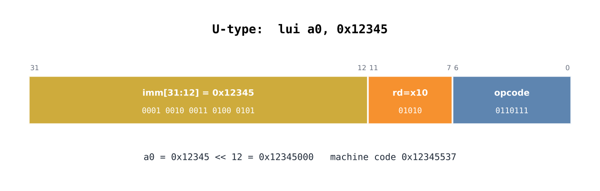
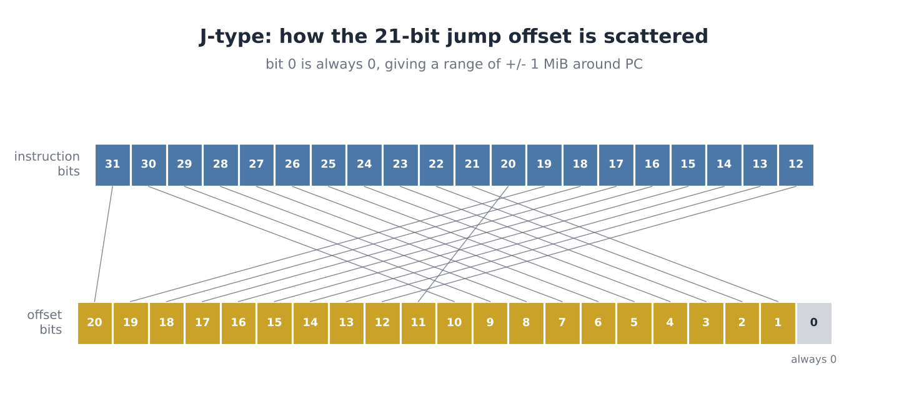
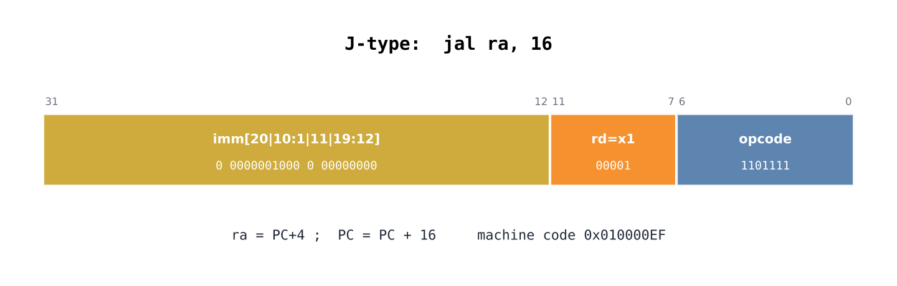

# Day 29 — U/J-Type Instructions - Assembly to Machine Language

> **Course:** Week 7, Video 2 &nbsp;|&nbsp; **Playlist #29** &nbsp;|&nbsp; [Chip Design with Rashid — RISC-V Architecture Explained](https://www.youtube.com/playlist?list=PL0-xus8sJBCRzZtmL_fLWaohRKuc4j5aH)  
> **Notes source:** video topic + standard RV32I material (to be updated from the transcript)

## U-type

```
 31                        12 11    7 6      0
┌────────────────────────────┬───────┬────────┐
│        imm[31:12]          │  rd   │ opcode │
└────────────────────────────┴───────┴────────┘
             20                  5       7
```

| Instr | Opcode | Operation |
|---|---|---|
| `lui rd, imm` | 0110111 | `rd = imm << 12` |
| `auipc rd, imm` | 0010111 | `rd = PC + (imm << 12)` |

The 20 bits are already the **upper** bits of the result — they are placed directly in bits 31:12. No shuffling, no sign-extension needed (the value is already 32 bits).

### Worked example — `lui a0, 0x12345`



```
imm = 0x12345 = 0001 0010 0011 0100 0101   rd = a0 = 01010   opcode = 0110111
0001 0010 0011 0100 0101 | 0101 0 | 011 0111
= 0x12345537
```

Nice property: for `lui`, the first 5 hex digits of the machine code **are** the immediate.

### Worked example — `auipc t0, 0x1` at PC = 0x0000_2000

```
machine code: 0x00001297
result:       t0 = 0x2000 + 0x1000 = 0x3000
```

## J-type

```
 31   30          21  20  19        12 11    7 6      0
┌────┬──────────────┬────┬────────────┬───────┬────────┐
│[20]│   [10:1]     │[11]│  [19:12]   │  rd   │ opcode │
└────┴──────────────┴────┴────────────┴───────┴────────┘
```



- `jal rd, label`: `rd = PC + 4`; `PC = PC + offset`.
- Offset is **21 bits, always even** (bit 0 not stored) → range **±1 MiB**.
- Bits 19:12 are in the same place as in U-type; bits 10:1 and 11 are placed to match I-type positions as much as possible — again to share wires in the decoder.
- `opcode = 1101111`.

### Recipe

1. `offset = address(label) − address(jal)`.
2. 21-bit two's complement `b20 … b0`.
3. bit 31 ← b20, bits 30:21 ← b10..b1, bit 20 ← b11, bits 19:12 ← b19..b12.

### Worked example — `jal ra, +16`



```
16 = 0 0000 0000 0000 0001 0000 (21 bits)
b20=0  b10:1=0000001000  b11=0  b19:12=00000000   rd=ra=00001   opcode=1101111
0 0000001000 0 00000000 00001 1101111
= 0000 0001 0000 0000 0000 0000 1110 1111 → 0x010000EF
```

### Worked example — `jal x0, 0` (infinite loop: `j .`) → `0x0000006F`

---
[⬅ Day 28](../Day-28-S-B-Type-Encoding/README.md) | [Index](../README.md) | [Day 30 ➡](../Day-30-Label-Address-Calculation/README.md)
