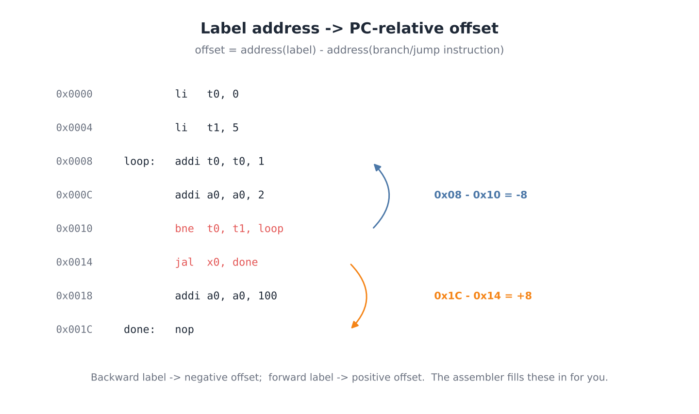
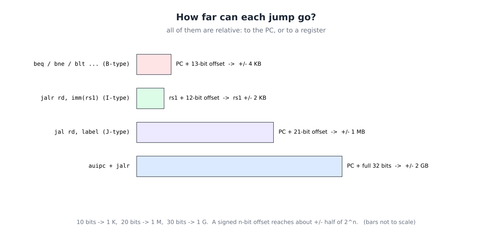

# Day 30 — Recap of Jumps and How LABEL Address is Calculated

> **Course:** Week 7, Video 3 &nbsp;|&nbsp; **Playlist #30** &nbsp;|&nbsp; [Chip Design with Rashid — RISC-V Architecture Explained](https://www.youtube.com/playlist?list=PL0-xus8sJBCRzZtmL_fLWaohRKuc4j5aH)  
> **Notes source:** lecture transcript

This video brings all the **jump instructions** together in one place, and answers: in assembly we write a **label** — how does it become an address, and how is the jump made? (In other words: **relative addressing**.)

## What a jump is

The PC points to the current instruction (yellow in the video). Normally the next one is at PC + 4 (blue). A **jump/branch** means: the next instruction is **somewhere else** in memory — go there and run the instructions there.

Sometimes we **come back** to the blue instruction afterwards (function call), sometimes we **don't**.

## Three uses of jumps

| Use | Example | Comes back? |
|---|---|---|
| **1. Call a function** (procedure / subroutine) and return | `jal f2` … `jr ra` | yes — using **ra** |
| **2. Conditional jump** | if-else, switch, for/while: `bge s0, a0, done` | no |
| **3. Unconditional jump** | `j for` (back to the loop check) | no |

### The book example (a loop that calls a function)

```c
int f1(int a) {
    int i, x;
    for (i = 0; i < a; i++)
        x = x + f2(x + i);
    return x;
}
```

```asm
f1:   ...                       # save registers on the stack
      addi s0, zero, 0          # i = 0
for:  bge  s0, a0, return       # (1) CONDITIONAL: exit when i >= a  (opposite of i < a)
      ...                       # put args on the stack / in a0
      jal  f2                   # (2) FUNCTION CALL: ra = next, jump to f2
      ...                       # x = x + result
      addi s0, s0, 1            # i++
      j    for                  # (3) UNCONDITIONAL: back to the check
return: ...
      jr   ra                   # return to f1's caller

f2:   ...
      jr   ra                   # (2) RETURN: jump to the address in ra
```

`jal f2` jumps to f2 and, at the same time, puts the address of the **next instruction** into `ra` — so `jr ra` at the end of f2 brings us back.

## Under the hood: only three base instructions

`j`, `jal label`, `jr`, `ret` are **pseudo-instructions**. Among the 37 base instructions, everything comes down to:

| Base instruction | Format | Registers + immediate |
|---|---|---|
| `beq bne blt bge bltu bgeu` | **B-type** | 2 source registers + 13-bit offset |
| `jalr rd, imm(rs1)` | **I-type** | rd + rs1 + 12-bit offset |
| `jal rd, label` | **J-type** | rd + 21-bit offset (20 stored) |

*(In the video Rashid says both the branch and jalr are "I-type" — the branches are actually **B-type**; they both have two registers, which is what he meant.)*

## How a label becomes a jump: PC-relative addressing



The assembler calculates:

```
offset = address(label) - address(branch or jump instruction)
```

and stores that **offset**. At run time the CPU adds it to the PC:

```
new PC = PC + offset
```

We never store the absolute address — that's **PC-relative addressing**.

## jal: jump and link

```asm
jal rd, offset       # rd = PC + 4 ;  PC = PC + offset
```

1. Jump: **PC = PC + offset**.
2. Link: save **PC + 4** (the next instruction) into **rd** (normally `ra`).

The offset is **21 bits** (bit 0 always 0, so 20 are stored).

### How far can jal go?

Quick rule: 10 bits ≈ **1 K**, 20 bits ≈ **1 M**. A signed 21-bit offset reaches about **±1 MB** around the PC (inside the 4 GB that a 32-bit address can reach).

## jalr: jump and link register — pay attention here

```asm
jalr rd, offset(rs1)     # rd = PC + 4 ;  PC = rs1 + offset
```

- Like jal, it saves **PC + 4** into rd.
- But the target is **rs1 + offset** — a **register** plus a 12-bit offset (±2 KB around rs1).

### Use 1: returning from a function

```asm
jalr zero, 0(ra)      # PC = ra + 0 ; the "PC+4" goes into x0 (thrown away)
```

- rs1 = **ra**, offset = **0** → PC = ra → back to the caller.
- rd = **zero (x0)** → x0 can't be written, so **nothing is saved** — we only want to jump.
- This is exactly what `jr ra` (and `ret`) mean. Machine code: `0x00008067`.

### Use 2: really long jumps

12 bits looks small (±2 KB), but because the base is a **register**, you can put **any 32-bit value** in it first:

```asm
auipc t0, upper20          # t0 = PC + (upper 20 bits << 12)
jalr  ra, lower12(t0)      # jump to t0 + lower 12 bits
```

A full 32-bit signed value → **±2 GB**. That's the far-call (`call`) pattern.



## Summary

| Instruction | New PC | Saves PC + 4? | Range |
|---|---|---|---|
| branches (B) | PC + offset, if condition true | no | ±4 KB |
| `jal rd, L` (J) | PC + offset | yes, in rd | ±1 MB |
| `jalr rd, imm(rs1)` (I) | rs1 + imm | yes, in rd (x0 = discard) | rs1 ± 2 KB |
| `auipc` + `jalr` | PC + 32-bit value | yes | ±2 GB |

Next: the **Python** part.

## Practice Questions

1. A `jal ra, L` is at 0x400 and L is at 0x480. What offset is stored, and what goes into ra?
2. Why is `jr ra` written as `jalr x0, 0(ra)`?
3. Which instruction would you use to jump 10 MB away?
4. Is a branch's target an absolute address?

**Answers**

1. Offset 0x80 (128); ra = 0x404.
2. Target = ra + 0; writing x0 discards the return address because we only want to jump back.
3. `auipc` + `jalr` (jal only reaches ±1 MB).
4. No — it's PC + offset (PC-relative).

---
[⬅ Day 29](../Day-29-U-J-Type-Encoding/README.md) | [Index](../README.md) | [Day 31 ➡](../Day-31-Revision-R-I-S-B/README.md)
