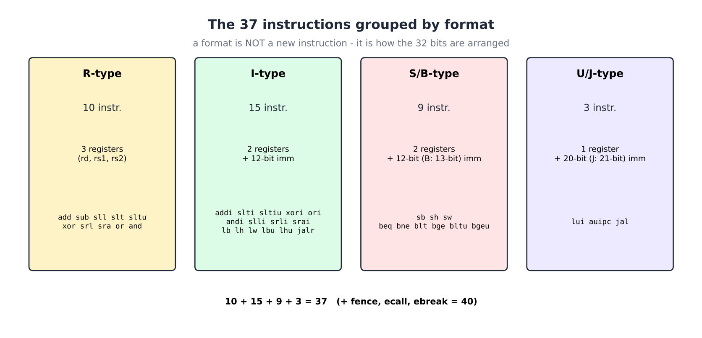
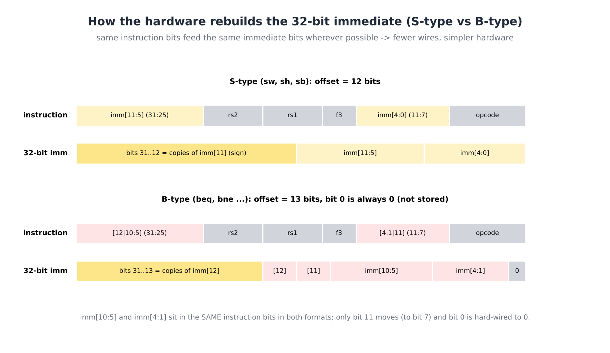

# Day 31 — Revision of R-Type, I-Type, S/B-Type Instructions

> **Course:** Week 7, Video 1 &nbsp;|&nbsp; **Playlist #31** &nbsp;|&nbsp; [Chip Design with Rashid — RISC-V Architecture Explained](https://www.youtube.com/playlist?list=PL0-xus8sJBCRzZtmL_fLWaohRKuc4j5aH)  
> **Notes source:** lecture transcript

## Where we are

We understand **assembly** and did many examples. Next step: how each assembly instruction is **stored in memory** — as 0s and 1s. RV32I is a 32-bit processor, so **every instruction is exactly 32 bits**. How do we build those 32 bits? Rashid: "Very important, but not difficult — just revise it so you don't mix things up. I needed this revision too."

**Keep in mind:** R, I, S/B and U/J are **not new instructions**. They are **formats** — ways of arranging the 32 bits.



| Format | Registers | Immediate |
|---|---|---|
| **R** | 3 (rd, rs1, rs2) | none |
| **I** | 2 (rd, rs1) | 12 bits |
| **S/B** | 2 (rs1, rs2) | 12 bits (B: 13 bits) |
| **U/J** | 1 (rd) | 20 bits (J: 21 bits) |

We cover the **37** normal instructions (not `fence` and the system ones `ecall/ebreak`).

## 1. R-type — 10 instructions (yellow)

`add sub sll slt sltu xor srl sra or and`

```
 31     25 24  20 19  15 14 12 11   7 6     0
┌─────────┬──────┬──────┬─────┬──────┬───────┐
│ funct7  │ rs2  │ rs1  │ f3  │  rd  │opcode │
└─────────┴──────┴──────┴─────┴──────┴───────┘
     7       5      5      3     5      7
```

| Bits | Field | Job |
|---|---|---|
| 0–6 | **opcode** | which **kind** of instruction — common to **every** format. All R-type have opcode **51** (`0110011`): see 51 → it's R-type |
| 7–11 | rd | destination register |
| 12–14 | **funct3** | which instruction **within** the group |
| 15–19 | rs1 | source 1 |
| 20–24 | rs2 | source 2 |
| 25–31 | **funct7** | more differentiation (e.g. add vs sub, srl vs sra) |

**Why this order?** So the hardware always pulls rs1, rs2, rd and the funct fields from the **same bits** → simpler hardware. "Not the only possible way, but a relatively simple one" — we'll see it in SystemVerilog.

Example: `add s0, s1, s2` → `0x01248433`.

## 2. I-type — 15 instructions (green)

`addi slti sltiu xori ori andi slli srli srai` (9) + `lb lh lw lbu lhu` (5) + **`jalr`** (1) = **15**

```
 31          20 19  15 14 12 11   7 6     0
┌──────────────┬──────┬─────┬──────┬───────┐
│  imm[11:0]   │ rs1  │ f3  │  rd  │opcode │
└──────────────┴──────┴─────┴──────┴───────┘
      12          5      3     5      7
```

- Only **two registers**: one destination, one source (e.g. `addi s0, s1, 12` → `0x00C48413`).
- No funct7 — the **12-bit immediate** takes its place (and rs2's place). funct3 + opcode tell the instructions apart.
- **jalr** is I-type (rd, rs1, imm). It's easy to think it belongs with the jumps/branches, but its *format* is I — Rashid had to check the book himself.

### Example: `lw t3, -36(s4)`

| Field | Value |
|---|---|
| opcode | 3 (load) |
| funct3 | 2 (lw) |
| rs1 = s4 | x20 |
| rd = t3 | x28 |
| imm | −36 = `111111011100` |

→ `0xFDCA2E03`. At run time: **address = s4 + (−36)**; the whole word at that address is loaded into **t3**. *(In the video he says the sum "goes into the PC" — it's the **data address** for memory, not the PC.)*

## 3. S/B-type — 9 instructions (pink)

`sb sh sw` + `beq bne blt bge bltu bgeu`

Each has its own opcode (35 for stores, 99 for branches) and funct3.

- Both registers are **sources** (rs1, rs2), kept in the **same places as R-type**.
- No rd and no funct7 → bits 7–11 and 25–31 hold the immediate: 5 + 7 = **12 bits stored**.

### S vs B: the one difference

- **S:** imm[11:0] — imm[4:0] in bits 7–11, imm[11:5] in bits 25–31. The sign bit is copied to make 32 bits.
- **B:** you *see* 12 bits, but it reaches **13 bits** — **bit 0 is always 0** (hard-wired in the hardware). The bits are shuffled: imm[11] in bit 7, imm[4:1] in bits 8–11, imm[10:5] in bits 25–30, **imm[12] (sign) in bit 31**. imm[4:1] and imm[10:5] stay where S-type has them → common wiring.



### Thinking like hardware

**Store** (`sw t2, -6(s3)`): register **s3** + **offset** from the instruction → the **memory address** (not the PC); the content of **t2** is written there. Address calculation, read and write all happen in **one cycle** (single-cycle CPU).

**Branch** (`beq s0, t5, L1`): two jobs:
1. **compare** s0 and t5;
2. **add** the offset to the **current PC** (the address of the branch itself — not the next one).

The PC is a **register** with a **load** signal: only **if the comparison is true** do we load PC + offset; otherwise the PC just goes to the next instruction. "We're getting closer to the hardware — start thinking like hardware."

## 4. U/J-type — next video

Only 3 instructions: `lui`, `auipc` (U) and `jal` (J). (`jalr` is I-type; the branches are in SB.)

## Key points

- Formats arrange the 32 bits; they are not new instructions.
- opcode is always bits 0–6; funct3 bits 12–14; funct7 bits 25–31 (R only).
- R = 10, I = 15 (includes jalr), S/B = 9, U/J = 3 → 37.
- rs1, rs2, rd always in the same bits → simpler hardware.
- B-type offset = 13 bits with bit 0 hard-wired to 0; branches are PC-relative.

## Practice Questions

1. Which format is `jalr`?
2. An instruction ends in `...0110011` (opcode 51). Which format is it?
3. How many immediate bits does I-type store?
4. In `lw t3, -36(s4)`, what is added to form the address?
5. Why does B-type reach 13 bits with only 12 stored?

**Answers**

1. I-type.
2. R-type.
3. 12.
4. The value in s4 plus −36.
5. Bit 0 is always 0, so it isn't stored; the hardware adds it.

---
[⬅ Day 30](../Day-30-Label-Address-Calculation/README.md) | [Index](../README.md) | [Day 32 ➡](../Day-32-BNE-Backward-Label/README.md)
