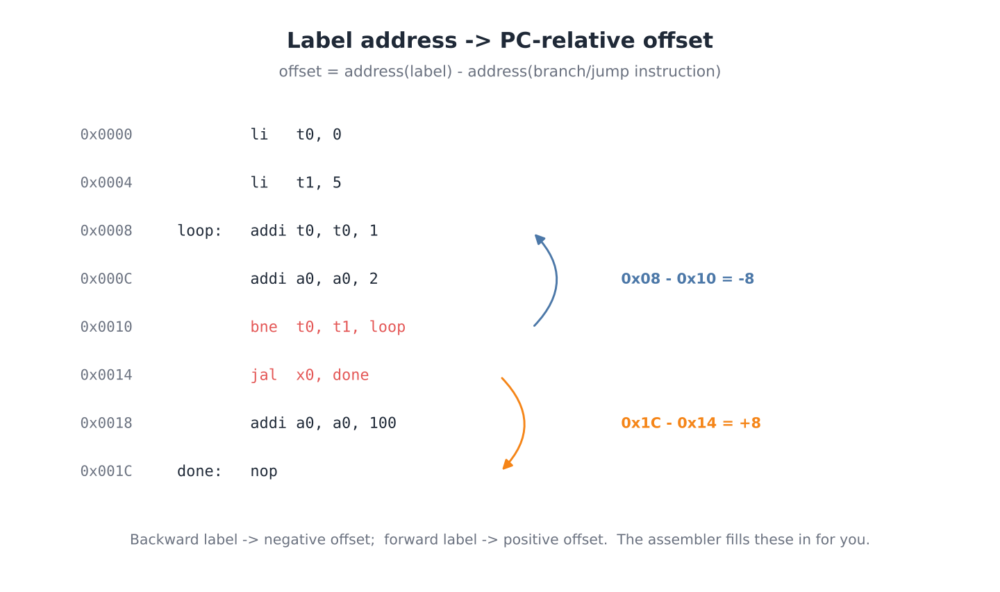

# Day 32 — An Example of BNE (B-Type) with Label Going Backward

> **Course:** Week 6, Video 4 &nbsp;|&nbsp; **Playlist #32** &nbsp;|&nbsp; [Chip Design with Rashid — RISC-V Architecture Explained](https://www.youtube.com/playlist?list=PL0-xus8sJBCRzZtmL_fLWaohRKuc4j5aH)  
> **Notes source:** video topic + Rashid's weekly notes + standard RV32I material



```asm
0x0000          li   t0, 0
0x0004          li   t1, 5
0x0008  loop:   addi t0, t0, 1
0x000C          addi a0, a0, 2
0x0010          bne  t0, t1, loop     # ← encode this
```

**Step 1 — offset:** `0x0008 − 0x0010 = −8` (the label is *behind* the branch → negative).

**Step 2 — 13-bit two's complement of −8:**

```
+8  = 0 0000 0000 1000
-8  = 1 1111 1111 1000         (invert + 1)
       b12=1  b11=1  b10..b5=111111  b4..b1=1100  b0=0 (dropped)
```

**Step 3 — fields:**

| Field | Bits | Value |
|---|---|---|
| imm[12] | 31 | 1 |
| imm[10:5] | 30:25 | 111111 |
| rs2 = t1 (x6) | 24:20 | 00110 |
| rs1 = t0 (x5) | 19:15 | 00101 |
| funct3 (bne) | 14:12 | 001 |
| imm[4:1] | 11:8 | 1100 |
| imm[11] | 7 | 1 |
| opcode | 6:0 | 1100011 |

**Step 4 — hex:**

```
1 111111 00110 00101 001 1100 1 1100011
= 1111 1110 0110 0010 1001 1100 1110 0011
=   F    E    6    2    9    C    E    3   → 0xFE629CE3
```

**Check by decoding:** sign bit (31) = 1 → negative; rebuild `b12 b11 b10..5 b4..1 0` = `1 1 111111 1100 0` = −8 ✓. At run time the CPU computes `PC + (−8) = 0x10 − 8 = 0x08` = `loop`.

> 💡 A backward branch always has bit 31 = 1, so its hex starts with `0xF` or higher (`8–F`). A quick visual check in any disassembly!

---

## Week 6 Key Takeaways

- `opcode` → format; `funct3`/`funct7` → exact operation.
- `rs1`, `rs2`, `rd` never move; the immediate sign bit is always bit 31.
- I-type: 12-bit signed imm; shifts use only 5 bits (`shamt`) + funct7.
- S-type: offset split 7 | 5 because there is no `rd`.
- B-type: 13-bit even offset, bit 0 dropped, bits shuffled; range ±4 KiB.

## Practice Questions

Encode (answers can be checked with `tools/rv32i_encoder.py`):

1. `or s0, s1, s2`
2. `andi t1, t0, 0xFF`
3. `sh t1, 6(a0)`
4. `beq t0, x0, +8`
5. Decode `0x00229293`.

<details><summary>Answers</summary>

1. `0000000 10010 01001 110 01000 0110011` → `0x0124E433`
2. `0x0FF2F313`
3. `0x00651323`
4. `0x00028463`
5. opcode 0010011, funct3 001 → `slli`; rd = x5, rs1 = x5, shamt = 2 → `slli t0, t0, 2`.
</details>

<!-- rashid-notes -->
## 📒 From Rashid's Week 7 notes

> Extra points and worked examples from Rashid's members-only weekly notes ([RISCV_Arch folder](https://drive.google.com/drive/folders/1sIX-rAanGWWkZocAbXNmvW80JbdAEg6P), members only). Written here in my own words; most of his examples come from the reference book *Digital Design and Computer Architecture, RISC-V Edition* (Harris & Harris), chapters 6–7.

**Where jumps really come from** — in a whole program you only ever see three kinds of jump:

1. **Function call** → jump to a LABEL (`jal`)
2. **Return** from a function → jump to `ra` (`jalr` / `jr ra`)
3. **Conditional jumps** — if-else, case-switch, for/while loops → jump to a LABEL (`beq`, `bge` …)

**So the hardware only needs 3 jump mechanisms:**

| Instruction | Operands | Target | Range |
|---|---|---|---|
| `beq/bne/bge…` | rs1, rs2, imm | PC + offset (13-bit) | ±4 KB |
| `jal` | rd, imm | **PC + offset** (21-bit) | **±1 MB** (−2²⁰ … 2²⁰−1) |
| `jalr` | rd, rs1, imm | **rs1 + offset** (12-bit) | **±2 KB** around a register |

**`jal rd, offset` — relative to the PC:** 1) PC = PC + offset, 2) save PC + 4 in `rd`.

**`jalr rd, rs1, offset` — relative to a REGISTER:** 1) PC = rs1 + offset, 2) save PC + 4 in `rd`. `jalr zero, ra, 0` = PC = ra and nothing is saved → that's `jr ra`.

**"Only ±2 KB? Small jump??" — No, wait:** together with `auipc`,

```asm
auipc rd1, imm_upper      # rd1 = PC + (imm_upper << 12)
jalr  rd, rd1, imm_lower
```

lets you jump **anywhere in the 32-bit space (±2 GB)**. The pseudo-instructions **`call`** and **`tail`** use exactly this two-instruction sequence.

Memory sizes on his page: 10 bits → 1K, 20 bits → 1M, 2³² → 4 GB addressable space.

---
[⬅ Day 31](../Day-31-Revision-R-I-S-B/README.md) | [Index](../README.md) | [Day 33 ➡](../Day-33-Peripherals/README.md)
