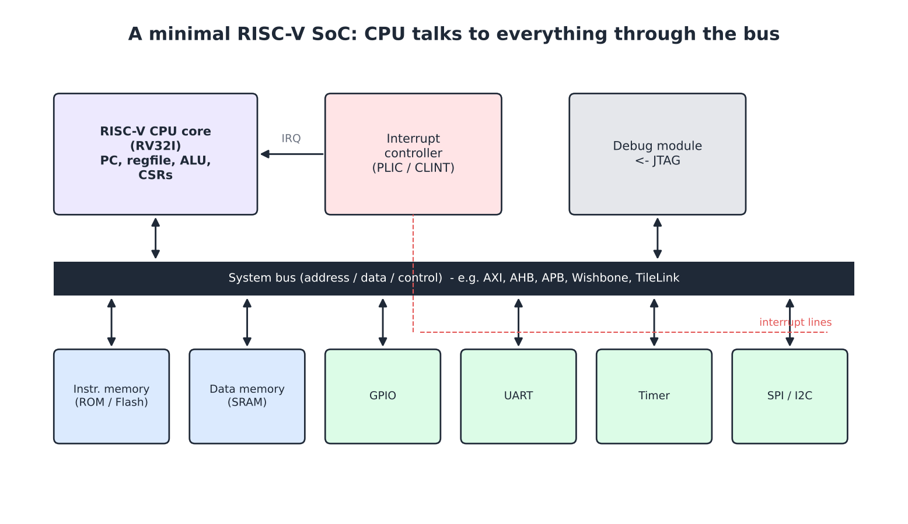

# Day 33 — RISC-V Interface to the Outside World, Peripherals

> **Course:** Week 8, Video 1 &nbsp;|&nbsp; **Playlist #33** &nbsp;|&nbsp; [Chip Design with Rashid — RISC-V Architecture Explained](https://www.youtube.com/playlist?list=PL0-xus8sJBCRzZtmL_fLWaohRKuc4j5aH)  
> **Notes source:** video topic + standard RV32I material (to be updated from the transcript)

A CPU alone just computes. To be useful it must sense and control the world: buttons, LEDs, sensors, displays, serial links. These are handled by **peripherals** — hardware blocks on the same chip, connected to the CPU through a **bus**. The whole chip is a **System-on-Chip (SoC)**.

## Common peripherals

| Peripheral | What it does | Typical registers |
|---|---|---|
| **GPIO** | General Purpose I/O pins — LEDs, buttons | `OUTPUT_VAL`, `INPUT_VAL`, `OUTPUT_EN`, interrupt enable |
| **UART** | serial text link (e.g. to a PC terminal) | `TXDATA`, `RXDATA`, `STATUS`, `BAUD_DIV` |
| **Timer** | counts clock cycles; periodic interrupts | `mtime`, `mtimecmp` |
| **SPI / I²C** | talk to sensors, flash, displays | `DATA`, `CTRL`, `STATUS` |
| **PWM** | motor / LED brightness control | `PERIOD`, `DUTY` |
| **Interrupt controller** (PLIC/CLINT) | collects interrupt requests, prioritises them | `ENABLE`, `PRIORITY`, `CLAIM/COMPLETE` |
| **Debug module** | lets an external debugger control the CPU | (Week 9) |

## The system bus

The CPU (as **master/manager**) issues read and write transactions; memories and peripherals are **slaves/subordinates**. Each transaction carries:

- **Address** — which location (decides which peripheral responds — *address decoding*)
- **Data** — the value written or read
- **Control** — read/write, size (byte/half/word), valid/ready handshake

Common on-chip bus protocols: **AXI, AHB, APB** (ARM AMBA family), **Wishbone**, **TileLink** (used by many RISC-V SoCs). Slow peripherals usually sit on a simple bus like APB behind a bridge.

## Two ways to know "something happened"

| | **Polling** | **Interrupts** |
|---|---|---|
| How | CPU repeatedly reads a status register in a loop | Peripheral signals the CPU, which jumps to a handler |
| CPU usage | busy the whole time | free to do other work / sleep (`wfi`) |
| Latency | depends on loop speed | fast, bounded |
| Complexity | very simple | needs handler, CSRs, stack saving |
| Good for | simple start-up code, very frequent events | rare / unpredictable events, low power |

---
[⬅ Day 32](../Day-32-BNE-Backward-Label/README.md) | [Index](../README.md) | [Day 34 ➡](../Day-34-Memory-Mapped-IO/README.md)
