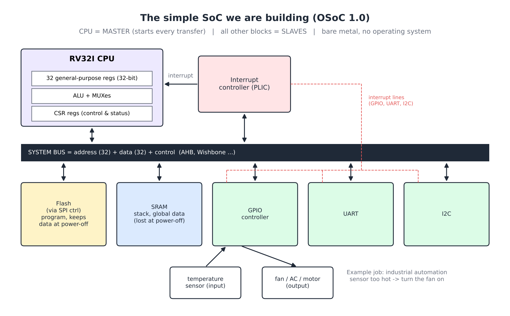
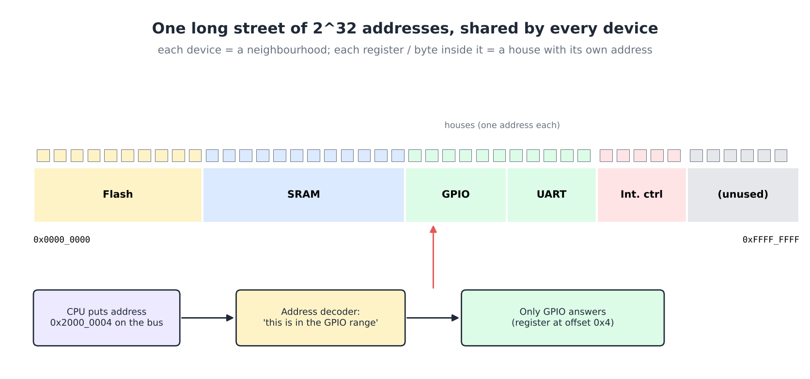

# Day 33 — RISC-V Interface to the Outside World, Peripherals

> **Course:** Week 8, Video 1 &nbsp;|&nbsp; **Playlist #33** &nbsp;|&nbsp; [Chip Design with Rashid — RISC-V Architecture Explained](https://www.youtube.com/playlist?list=PL0-xus8sJBCRzZtmL_fLWaohRKuc4j5aH)  
> **Notes source:** lecture transcript

A new phase starts: we step **outside the CPU** and look at **peripherals**. Rashid plans about 6–7 short videos on this. In his experience this part is not explained well in most books and courses, so he focuses on the **core ideas with examples**, not every small detail. The details come in the **next course (micro-architecture)**, where we will write the hardware in **SystemVerilog**, test it, and see every signal.

## 1. What we have covered so far (the CPU part)

| Covered | What it means |
|---|---|
| **32 general-purpose registers** | each 32 bits wide |
| **ALU** (the instructions, not yet the hardware) | the 37 base instructions: R, I, S/B, U/J types |
| **Machine code** | the binary that each instruction becomes and that is stored in memory |
| **Simulator & debugger** | a Python simulator and debugger (built with AI help, after a short Python tutorial) to run assembly and watch registers and memory |
| **SRAM** | the memory the CPU reads and writes |

So far, the CPU only talked to **SRAM**. That is not enough for a real product.

## 2. Problem 1: SRAM forgets everything

**SRAM loses its data when the power is turned off.** So every time you switch on, the program must be put into memory again before the PC can start running it.

**Solution: flash memory.** Flash **keeps its data when the power is off**.

- We write our program (instructions + start-up code) into flash **once**.
- At every power-on, the CPU reads the code from flash. It can run it from flash, or copy parts into SRAM and run from there.
- A **start-up (reset) code** runs first to set everything up so the processor is ready (covered later).
- **SRAM** is still needed for the **stack** and **global data**. SRAM is best **on the chip** because it is fast; flash can be **outside the chip on the PCB**.

## 3. Problem 2: a real system needs inputs and outputs

A real system **takes inputs, processes them, and produces outputs**.

**Example (industrial automation):**

```
temperature sensor ──► CPU checks: "is it too hot?" ──► turn ON a fan / AC / motor
      (input)                (processing)                       (output)
```

This kind of job is where an RV32I chip is mostly used. The 37 instructions can already do the **processing**, but the **interface to the outside world is missing**. That interface is what this part of the course adds.

## 4. The bigger picture: our simple SoC



| Block | What it does | Simple way to remember |
|---|---|---|
| **CPU** | 32 registers, ALU, MUXes (to steer results to registers or memory) and a few **CSR registers** | the brain |
| **CSR registers** (Control & Status Registers) | a small number (about 4–5 in our system) of special 32-bit registers; studied next | the brain's settings and status flags |
| **SRAM** | stack and global data; fast; lost at power-off | the brain's notebook |
| **Flash** | program and start-up code; kept at power-off | the book on the shelf |
| **GPIO controller** | General Purpose Input/Output pins: inputs come in, outputs go out | the hands and eyes |
| **UART, I2C** | slow serial interfaces used in embedded systems | the telephone |
| **Interrupt controller** | devices use it to get the CPU's attention | the doorbell |

### No operating system

Our RV32I system runs **bare metal** — there is **no operating system**. The program starts right after reset and is **"the king"**: it can access **any register and any memory**. In a PC, the OS has more privilege than user apps; here there is only one program with **full privilege**. This keeps the system **simple and low power**, which suits embedded jobs.

## 5. How do all these blocks talk to the CPU? The system bus

All blocks connect to one **system bus**, which has:

- an **address bus** (32 bits) — *which location?*
- a **data bus** — *the value*
- a **control bus** — *read or write, ready, etc.*

Examples of bus protocols to search for: **AHB**, **Wishbone** (open source).

| Role | Who | Meaning |
|---|---|---|
| **Master** | the CPU | starts every transfer by putting out an address |
| **Slaves** | flash, SRAM, GPIO, UART, I2C, interrupt controller | answer when the address is theirs |

**Each device knows when an address is for it.** The CPU sends an address, and only the device that owns that address responds.

## 6. Every device has addresses — the street analogy



Remember the address bus is 32 bits. Rashid's analogy:

- The whole address range is like a **city**.
- Each **device** (flash, SRAM, GPIO …) is a **neighbourhood / street**.
- Each **register or memory location** inside it is a **house** with its own address.

**New idea:** the 2³² addresses are **not all for SRAM**! The CPU sees **one continuous line of addresses**, but we **assign** different parts of it to different devices. This is called **address mapping** (the **memory map** / memory space).

**Example:** to turn the fan on, the CPU does a normal **store** (`sw`) to the address of a GPIO register. The system bus sees the address is in the GPIO range, so the GPIO controller receives the data and drives the pin.

## 7. Topics coming next

| Next video | Topic | One-line idea |
|---|---|---|
| Day 34 | **Memory space & mapping** | which addresses belong to which device |
| Days 35–36 | **Interrupts** | how a GPIO input (e.g. the temperature sensor) gets the CPU's attention, and how the CPU sends a signal to the fan |
| Day 37 | **Exceptions** | errors inside a program: an **illegal instruction** (binary that matches no instruction), a **misaligned** instruction address, or an address that **does not exist** |
| Day 38 | **Assembler directives** | special assembler commands (no machine code) that say, for example, which part of the address space data goes into |

**Interrupts + exceptions together are called *traps*.**

## Key takeaways

- A CPU alone cannot do a real job; it needs **flash, SRAM and I/O peripherals**.
- **Flash keeps** the program at power-off; **SRAM forgets**.
- Everything talks over the **system bus**; the **CPU is the master**, devices are **slaves**.
- Every device has **addresses**; the 32-bit address space is **shared** by all devices → **memory mapping**.
- Our system is **bare metal**: no OS, the program has full control.

## Practice Questions

1. Why do we need flash if we already have SRAM?
2. Give one input and one output in an industrial-automation system.
3. Who is the master on the system bus, and who are the slaves?
4. Using the street analogy, what is a "neighbourhood" and what is a "house"?
5. What is the name for interrupts and exceptions together?

**Answers**

1. SRAM loses its data at power-off; flash keeps the program so the system can start every time.
2. Input: temperature sensor. Output: fan / AC / motor.
3. Master: the CPU. Slaves: flash, SRAM, GPIO, UART, I2C, interrupt controller.
4. Neighbourhood = a device's address range (e.g. GPIO); house = one register or memory location inside it.
5. Traps.

---
[⬅ Day 32](../Day-32-BNE-Backward-Label/README.md) | [Index](../README.md) | [Day 34 ➡](../Day-34-Memory-Mapped-IO/README.md)
