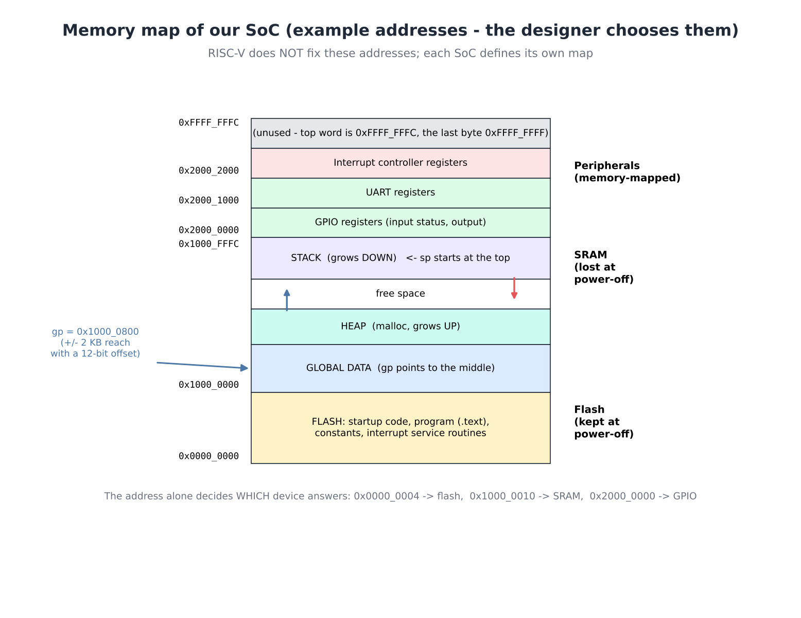

# Day 34 — Memory Address Space: How the CPU Talks to Peripherals through Memory Mapping

> **Course:** Week 8, Video 2 &nbsp;|&nbsp; **Playlist #34** &nbsp;|&nbsp; [Chip Design with Rashid — RISC-V Architecture Explained](https://www.youtube.com/playlist?list=PL0-xus8sJBCRzZtmL_fLWaohRKuc4j5aH)  
> **Notes source:** lecture transcript

Today's topic: the **memory map** (also called the **address space** or **memory space**). It answers one question: **which addresses belong to which device?**

## 1. Quick recap: the system bus

From Day 33: flash, SRAM, the interface controllers (GPIO, UART) and the **interrupt controller** (some books call it the **Platform-Level Interrupt Controller, PLIC**) all talk to the CPU through the **system bus**. It has:

- a **32-bit address bus**,
- a **data bus**,
- an **acknowledgement** line (the device says "done"),
- and **address decoders** inside (we will build these in the micro-architecture course).

Rashid keeps the hardware details for later — "no point giving theory after theory"; it makes more sense when we build it.

## 2. The 32-bit address space

The picture used in the lecture comes from the course reference book (Sarah & David Harris, *Digital Design and Computer Architecture, RISC-V Edition*).

| Fact | Value |
|---|---|
| Address width | 32 bits = **8 hex digits** (each hex digit = 4 bits, 0–F) |
| Lowest address | `0x0000_0000` (all zeros) |
| Highest address | `0xFFFF_FFFF` (all Fs) |
| Total | 2³² bytes ≈ **4 GB** |

### Why does the top word start at `0xFFFF_FFFC`, not `0xFFFF_FFFF`?

Two facts from earlier:

1. Memory is **byte-addressable** — every **byte** has its own address.
2. RISC-V is **little-endian** — in a 32-bit word, **byte 0** (the lowest address) holds the least significant byte.

One word = 4 bytes, so the **last word** holds the bytes at `…FFFC`, `…FFFD`, `…FFFE`, `…FFFF`. A word is named by the address of its **byte 0**, so the last word is at **`0xFFFF_FFFC`**.

```
word address   byte3   byte2   byte1   byte0
0xFFFF_FFFC     FFFF    FFFE    FFFD    FFFC   ← the last word
0xFFFF_FFF8     FFFB    FFFA    FFF9    FFF8
   ...
0x0000_0000     0003    0002    0001    0000   ← the first word
```

## 3. The key point: the address space is NOT all SRAM

4 GB of addresses **does not mean 4 GB of SRAM**. We *could* fill it all with RAM, but that is not how it works. **Ranges of addresses are given to different devices**: some to flash, some to SRAM, some to the GPIO controller, and so on.

**The RISC-V specification does not say which addresses to use** for flash, SRAM or peripherals. **The designer is free to choose.**

## 4. The memory map, region by region



*(The addresses are an example. Rashid stresses you can move these regions around; the layout shown is a typical one.)*

### Flash region — kept when the power is off

When the board powers up, SRAM is empty (its data was lost at power-off), but flash still has everything. So the **first code** lives here:

| What is stored in flash | Why |
|---|---|
| **Start-up (boot) code** | runs first after power-on; sets up registers (e.g. the stack pointer) |
| **Program code (`.text`)** | all the instructions we studied — your program written in C or assembly, compiled into these |
| **Constants** | fixed values and parameters defined in the program |
| **Interrupt / exception handler routines** | the special code that runs when an interrupt or exception happens (next videos) — you, the user of this microcontroller, write it |

**How the bus uses it:** whenever the CPU puts an address from the flash range on the bus, the **address decoder** selects the flash, and the flash sends back the data. "This address is for you."

Our CPU is a **simple, super-low-power, super-cheap microcontroller** for **industrial automation**: turning fans on and off, automating switches and factory machines.

### SRAM region — fast, but lost at power-off

| Part | What goes there | How it grows |
|---|---|---|
| **Global data** | **global variables** — visible to all functions (unlike stack data, which disappears when a function returns). Can be big, e.g. a long array. | fixed size |
| **Heap** | memory you ask for while the program runs (e.g. `malloc` in C) — **dynamic allocation / de-allocation** | grows **up**, starting just after global data |
| **Stack** | temporary data inside functions (saved registers, local variables) | grows **down** from the top; **`sp`** points to it |

#### The `gp` register (global pointer)

`gp` (x3) is one of the 32 general-purpose registers, but it has a **special job**: it points to the **middle** of the global data area.

Why the middle? Loads and stores use **base + 12-bit offset**, and a 12-bit signed offset reaches −2048 … +2047. With `gp` in the middle, one instruction can reach data **above and below** it:

```asm
# global data starts at 0x1000_0000, gp = 0x1000_0800 (the middle)
lw  t0, -2048(gp)    # reads 0x1000_0000  (start of global data)
lw  t1,  0(gp)       # reads 0x1000_0800
lw  t2,  2044(gp)    # reads 0x1000_0FFC
```

There is **no register for the heap**; its bottom is "just after global data", and its top is limited by the stack.

**Example:** any address in the SRAM range (e.g. `0x1000_0010`) → the bus knows it is for **SRAM**.

### Peripheral region — memory-mapped I/O

Now the CPU must talk to the **GPIO controller**. Why? Think of the outside world:

- **Input:** a signal from outside goes **low → high** (e.g. "temperature too high"). Inside the GPIO controller there is a **register bit that becomes 1** when such a low-to-high change happens. The CPU can **read** it.
- **Output:** when the CPU decides the fan must turn on, it **writes** a register in the controller, and the controller **drives the output pin**.

So the controller's job is to **manage communication between the outside world and the CPU's system bus**.

Those controller registers **have addresses** — that is exactly what **memory-mapped** means: the GPIO (and UART, and the interrupt controller) registers sit at addresses in the map. To talk to them, the CPU simply **puts that address on the bus**.

*(We may not design every controller ourselves; we will probably reuse open-source hardware in SystemVerilog.)*

## 5. Example: turn the fan on with a normal store

Using the example map (GPIO registers at `0x2000_0000`; assume the output register is at offset `0x4` and the fan is on pin 2):

```asm
.equ GPIO_BASE, 0x20000000
.equ GPIO_OUT,  0x4             # offset of the output register (example)

    li   t0, GPIO_BASE          # t0 = address of the GPIO "neighbourhood"
    lw   t1, GPIO_OUT(t0)       # read the current outputs
    ori  t1, t1, 0x4            # set bit 2 (fan) = 1, keep the other pins
    sw   t1, GPIO_OUT(t0)       # write back -> the fan turns ON
```

To the CPU, this is **just a store to memory**. The bus decoder sends it to the GPIO controller because the address is in the GPIO range.

## 6. The core message

> **All devices, including SRAM, are slaves; the CPU is the master. Every device is reached through its own range of addresses — it is "mapped" to those addresses.**

External devices can also *start* a conversation — that is an **interrupt**, the topic of the next video.

"Simple concept, but people struggle to understand it — and struggle to teach it."

## Key takeaways

- 32-bit addresses: `0x0000_0000` … `0xFFFF_FFFF` (≈ 4 GB); the last **word** is at `0xFFFF_FFFC` (byte-addressable, little-endian).
- The address space is **shared**: flash, SRAM and peripherals each get a range; **RISC-V lets the designer choose**.
- **Flash:** start-up code, program, constants, interrupt handlers. **SRAM:** global data (`gp` in the middle), heap (grows up), stack (`sp`, grows down).
- **Memory-mapped I/O:** peripheral registers have addresses, so `lw`/`sw` read sensors and drive outputs.

## Practice Questions

1. Why is the last word address `0xFFFF_FFFC`?
2. Does a 32-bit CPU need 4 GB of SRAM? Explain.
3. Name three things stored in flash.
4. `gp = 0x1000_0800`. Which address does `lw t0, -16(gp)` read?
5. Which way do the heap and the stack grow?
6. With GPIO at `0x2000_0000`, which device answers an access to `0x2000_0004`? To `0x1000_0004`?

**Answers**

1. Each word is 4 bytes, named by the address of byte 0; the last 4 bytes are `…FFFC`–`…FFFF`.
2. No. The addresses are shared between flash, SRAM and peripherals; only part of the space is SRAM.
3. Start-up code, program instructions, constants (also interrupt handlers).
4. `0x1000_0800 − 16 = 0x1000_07F0`.
5. Heap grows up; stack grows down.
6. `0x2000_0004` → GPIO controller; `0x1000_0004` → SRAM.

---
[⬅ Day 33](../Day-33-Peripherals/README.md) | [Index](../README.md) | [Day 35 ➡](../Day-35-Interrupt-Flow-Part-1/README.md)
