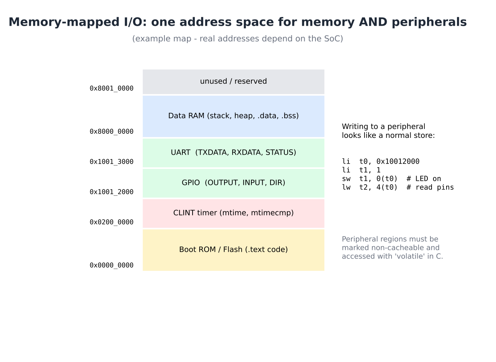

# Day 34 — Memory Address Space - Memory-Mapped Peripherals

> **Course:** Week 8, Video 2 &nbsp;|&nbsp; **Playlist #34** &nbsp;|&nbsp; [Chip Design with Rashid — RISC-V Architecture Explained](https://www.youtube.com/playlist?list=PL0-xus8sJBCRzZtmL_fLWaohRKuc4j5aH)  
> **Notes source:** video topic + standard RV32I material (to be updated from the transcript)

RISC-V has **no special I/O instructions** (unlike x86 `in`/`out`). Instead, every peripheral register is given an **address** in the normal 32-bit address space. Reading or writing a peripheral is just `lw` / `sw`. This is **Memory-Mapped I/O (MMIO)**.



*(The addresses above are an example in the style of SiFive/QEMU boards. Every SoC publishes its own memory map in its datasheet.)*

## Example — turn an LED on (GPIO)

```asm
.equ GPIO_BASE,   0x10012000
.equ GPIO_OUTPUT, 0x0C        # offset of the output register (example)

    li   t0, GPIO_BASE
    lw   t1, GPIO_OUTPUT(t0)  # read current output pins
    ori  t1, t1, 0x20         # set bit 5 (LED on pin 5) – keep other pins!
    sw   t1, GPIO_OUTPUT(t0)  # write back
```

This **read-modify-write** pattern (load, OR/AND/XOR, store) is used all the time — it is exactly why Week 3's logic instructions matter.

## Example — send a character over UART with polling

```asm
.equ UART_BASE, 0x10013000
.equ TXDATA,    0x00          # bit 31 = "FIFO full" flag when read (SiFive style)

# a0 = character to send
uart_putc:
    li   t0, UART_BASE
WAIT:
    lw   t1, TXDATA(t0)
    bltz t1, WAIT             # bit 31 set → negative → still full → wait
    sw   a0, TXDATA(t0)       # write the character
    ret
```

## The same in C

```c
#define GPIO_OUTPUT (*(volatile unsigned int *)0x1001200C)

GPIO_OUTPUT |= (1u << 5);     // LED on
```

`volatile` tells the compiler: *every* access really goes to the hardware — never cache it in a register or remove "useless" repeated reads.

## Important properties of MMIO regions

- **Side effects**: reading `RXDATA` may pop a byte from a FIFO; writing `TXDATA` starts a transmission.
- **Not cacheable**: the CPU must not keep a stale copy.
- **Ordering**: the `fence` instruction (and `fence io,io`) forces earlier I/O accesses to complete before later ones.

---
[⬅ Day 33](../Day-33-Peripherals/README.md) | [Index](../README.md) | [Day 35 ➡](../Day-35-Interrupt-Flow-Part-1/README.md)
