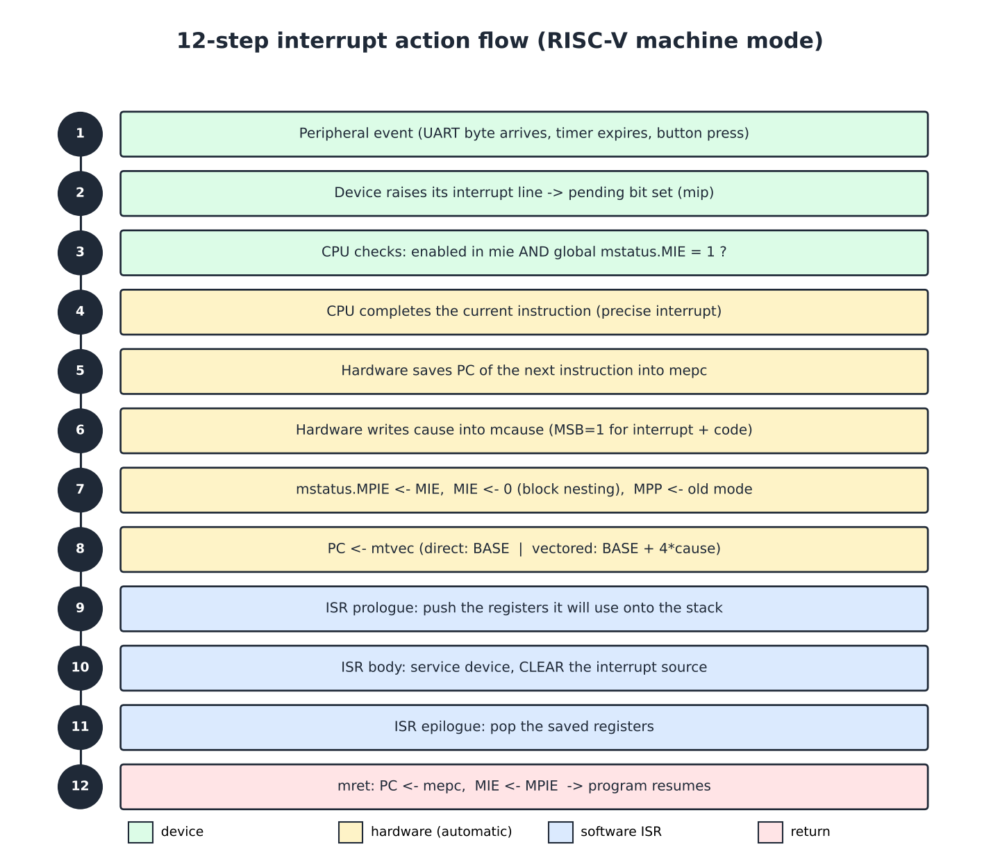

# Day 35 — 12-Step Interrupt Action Flow - Part 1/2

> **Course:** Week 8, Video 2 &nbsp;|&nbsp; **Playlist #35** &nbsp;|&nbsp; [Chip Design with Rashid — RISC-V Architecture Explained](https://www.youtube.com/playlist?list=PL0-xus8sJBCRzZtmL_fLWaohRKuc4j5aH)  
> **Notes source:** video topic + standard RV32I material (to be updated from the transcript)

An **interrupt** is an asynchronous request from hardware: "stop what you're doing, handle me, then continue". To support it, RISC-V uses **Control and Status Registers (CSRs)** — special registers outside `x0–x31`, accessed with the `csr*` instructions (Zicsr extension).

## Machine-mode CSRs used for traps

| CSR | Name | Role |
|---|---|---|
| `mstatus` | Machine status | `MIE` (bit 3) global interrupt enable; `MPIE` (bit 7) previous MIE; `MPP` (bits 12:11) previous privilege |
| `mie` | Machine interrupt enable | per-source enables: `MSIE` (3) software, `MTIE` (7) timer, `MEIE` (11) external |
| `mip` | Machine interrupt pending | which sources are currently requesting (`MSIP`, `MTIP`, `MEIP`) |
| `mtvec` | Trap vector base | address of the handler; `MODE` bits [1:0]: 0 = direct, 1 = vectored |
| `mepc` | Exception PC | where to return to |
| `mcause` | Trap cause | bit 31 = 1 for interrupt; low bits = cause code |
| `mtval` | Trap value | extra info (bad address / bad instruction) |
| `mscratch` | Scratch | free register for the handler (e.g. to swap stack pointers) |

## CSR instructions

| Instruction | Operation (atomic) |
|---|---|
| `csrrw rd, csr, rs1` | rd = csr; csr = rs1 |
| `csrrs rd, csr, rs1` | rd = csr; csr \|= rs1 (set bits) |
| `csrrc rd, csr, rs1` | rd = csr; csr &= ~rs1 (clear bits) |
| `csrrwi / csrrsi / csrrci` | same with a 5-bit immediate |
| pseudo `csrr rd, csr` | `csrrs rd, csr, x0` (read) |
| pseudo `csrw csr, rs` | `csrrw x0, csr, rs` (write) |
| pseudo `csrs / csrc csr, rs` | set / clear bits |

## Interrupt cause codes (mcause with bit 31 = 1)

| Code | Interrupt |
|---|---|
| 3 | Machine software interrupt |
| 7 | Machine **timer** interrupt |
| 11 | Machine **external** interrupt (from PLIC: UART, GPIO …) |

## The 12 steps

**Part 1 — the request and the hardware response (steps 1–8)**

1. **Event** — e.g. a byte arrives at the UART, the timer reaches its compare value, a button is pressed.
2. **Request** — the peripheral raises its interrupt line; (through the PLIC/CLINT) the matching bit in **`mip`** becomes 1 → the interrupt is *pending*.
3. **Check enables** — the CPU takes the interrupt only if that source is enabled in **`mie`** *and* interrupts are globally enabled (**`mstatus.MIE = 1`**). Otherwise it stays pending.
4. **Finish current instruction** — the instruction in progress completes; the interrupt is taken *between* instructions (a *precise* interrupt: everything before is done, nothing after has started).
5. **Save the return address** — hardware writes the PC of the next instruction to execute into **`mepc`**.
6. **Record the cause** — hardware writes **`mcause`** (bit 31 = 1, code = 7 for timer, 11 for external …).
7. **Update status** — `mstatus.MPIE ← MIE`, then `MIE ← 0` (further interrupts blocked, no accidental nesting), `MPP ←` current privilege; CPU is now in machine mode.
8. **Jump to the handler** — `PC ← mtvec`. In *direct* mode all traps go to `BASE`; in *vectored* mode interrupts go to `BASE + 4 × cause`.

Steps 4–8 are done **automatically by hardware in a single step** — no instructions are executed for them.

---
[⬅ Day 34](../Day-34-Memory-Mapped-IO/README.md) | [Index](../README.md) | [Day 36 ➡](../Day-36-Interrupt-Flow-Part-2/README.md)
