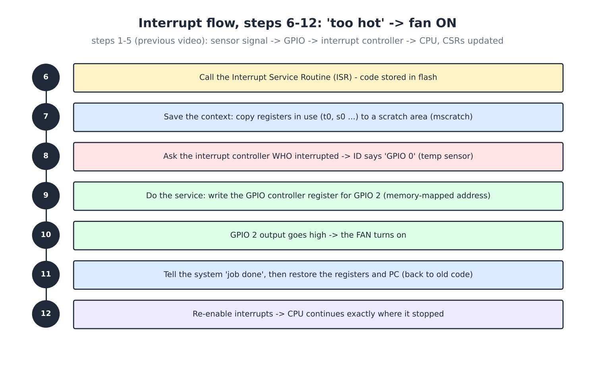

# Day 36 — 12-Step Interrupt Action Flow, Part 2/2 (Steps 6–12)

> **Course:** Week 8, Video 3 &nbsp;|&nbsp; **Playlist #36** &nbsp;|&nbsp; [Chip Design with Rashid — RISC-V Architecture Explained](https://www.youtube.com/playlist?list=PL0-xus8sJBCRzZtmL_fLWaohRKuc4j5aH)  
> **Notes source:** lecture transcript

The previous video (Day 35) covered **steps 1–5**; this one finishes **steps 6–12**. Watch Part 1 first — it is needed to understand this one.

## 1. Why we are learning this: the bigger picture

So far we learnt the **CPU internals**. Now we are learning the CPU **together with its peripherals** — a simple **SoC (System-on-Chip)** architecture.

The chip-design journey for this simple SoC:

```
architecture → micro-architecture → implementation (RTL) → verification → physical design
   (now)
```

Commercial chips at companies follow **exactly the same steps**, just bigger: more cores, more peripherals, more features. The **fundamentals are the same**.

Why this matters for you:
- Later you may work on one big block (RTL, verification or physical design). Knowing the **whole picture** means you are never lost — you know what is on your left and right.
- Every company has an **architecture document** and a **micro-architecture document**. These simple examples give you the background to read those long, complex documents.
- "Every course I build has a reason. It's not a university course where I am completing credits."

## 2. The example we follow

A chip in a factory. An input pin is connected to a **thermal (temperature) sensor**. When the temperature goes above a limit, the chip must **turn ON a fan** on an output pin.

- **Input:** temperature sensor → **GPIO 0**
- **Output:** fan → **GPIO 2** (this pin assignment was set up during **initialisation at start-up**)

**Steps 1–5 (Part 1, recap):** the sensor's signal reaches the GPIO controller, which signals the **interrupt controller**, which tells the **CPU**. The CPU's **control and status registers (CSRs)** are updated.

## 3. Steps 6–12 with the fan example



*(The lecture explains these as one flow; the numbering below groups it into steps 6–12.)*

### Step 6 — Call the Interrupt Service Routine (ISR)

The interrupt has reached the CPU. Now it must be **served** — something must be done about it. The piece of software that does this is the **Interrupt Service Routine (ISR)**.

- The ISR is stored in **flash** (it could later be copied to SRAM).
- The CPU was busy running some other instruction flow — that flow is **paused**.

### Step 7 — Save the context (the CPU's registers)

The interrupted code was using registers such as **`t0`, `s0`** and others. The ISR will use registers too, so their current values must be **saved first**.

- They are saved to a **scratch area** in memory. A special CSR, **`mscratch`**, points to where this scratch area is.
- Saving and later restoring these registers = saving the **context**.

**Analogy:** you are reading a book and the doorbell rings. You put a **bookmark** in the page (save the context) before answering the door.

### Step 8 — Find out WHO interrupted

Many devices are connected to the interrupt controller. The ISR asks the **interrupt controller**, which gives an **ID number**. The ID tells us: **"it is GPIO 0"** — the temperature sensor.

### Step 9 — Talk to that GPIO through the system bus

The CPU (running the ISR's instructions) talks to the GPIO controller over the **system bus**:

- The GPIO controller has an **address**, and inside it **each GPIO has a register** that shows its **status** or tells it what to do.
- All the CPU does is **put the right address on the bus**. The bus **address decoder** sees that the data is for that GPIO inside the GPIO controller.
- This is the **memory-mapped** idea from Day 34.

### Step 10 — Do the service: turn the fan ON

The ISR knows that "temperature too high" means **turn on the fan**, and that the fan is on **GPIO 2**.

1. The CPU sends the **address** of the GPIO 2 register on the system bus.
2. The bus decoder sees: *GPIO controller → GPIO 2*.
3. The CPU writes the value (a **1**, or whatever level the fan needs).
4. **GPIO 2 acts as an output → the fan turns ON.**

### Step 11 — Say "job done", then restore the CPU

- The ISR must tell the system that **the job is finished** — there is a **register** for this.
- Then the CPU is put back **exactly in the state it was in before the interrupt**. The "state" means the **registers**, because every RISC-V operation works on registers (data is brought from memory into registers by special instructions, and all operations happen there).
  - Registers are **loaded back** from the scratch area (`mscratch` shows where it is).
  - The **PC** was changed to the ISR's address; now it is set back to the address of the **next instruction of the interrupted program**.

### Step 12 — Re-enable interrupts and continue

While one interrupt is being served, **new interrupts are disabled** (in our simple system there are **no priorities** — a new one must wait, or be ignored; priorities may come later). Now interrupts are **enabled again**, and the CPU **continues the code it was running before**, as if nothing happened.

## 4. The whole picture in one line

```
sensor → GPIO 0 → interrupt controller → CPU (steps 1–5)
→ ISR → save registers → ID = GPIO 0 → write GPIO 2 → FAN ON
→ "done" → restore registers + PC → interrupts on → back to old code (steps 6–12)
```

## 5. Extra (beyond the lecture): the same flow as RISC-V code

A sketch of an ISR for this example. The addresses follow the example memory map from Day 34 (interrupt controller at `0x2000_2000`, GPIO at `0x2000_0000`); real chips publish their own register addresses.

```asm
.equ GPIO_BASE, 0x20000000
.equ GPIO_OUT,  0x4          # output register (example offset)
.equ IC_BASE,   0x20002000
.equ IC_CLAIM,  0x4          # read: ID of the device that interrupted; write: "done"

        .align 2
isr:                          # step 6: CPU jumps here (mtvec points to isr)
        csrrw sp, mscratch, sp    # step 7: swap to the scratch stack (mscratch points to it)
        addi  sp, sp, -16
        sw    t0, 12(sp)          #   save the registers we will use
        sw    t1,  8(sp)
        sw    t2,  4(sp)

        li    t0, IC_BASE         # step 8: who interrupted?
        lw    t1, IC_CLAIM(t0)    #   t1 = ID (say 1 = GPIO 0, the sensor)
        li    t2, 1
        bne   t1, t2, done

        li    t2, GPIO_BASE       # steps 9-10: write GPIO 2 = 1 -> fan ON
        lw    t0, GPIO_OUT(t2)
        ori   t0, t0, 0x4         #   bit 2 = fan
        sw    t0, GPIO_OUT(t2)

done:   li    t0, IC_BASE         # step 11: tell the controller "job done"
        sw    t1, IC_CLAIM(t0)
        lw    t2,  4(sp)          #   restore the registers
        lw    t1,  8(sp)
        lw    t0, 12(sp)
        addi  sp, sp, 16
        csrrw sp, mscratch, sp    #   swap the original sp back
        mret                      # step 12: PC <- mepc, interrupts re-enabled
```

| Lecture step | RISC-V detail |
|---|---|
| Save / restore context | registers stored in a scratch area; `mscratch` holds its pointer |
| Return to the old code | the hardware saved the old PC in **`mepc`**; `mret` puts it back |
| Interrupts off during the ISR, on again after | `mstatus.MIE` is cleared on entry and restored by `mret` |

A complete timer-interrupt example is in [`code/timer_interrupt.s`](../code/timer_interrupt.s).

## What comes next

Only a few videos are left in this RISC-V architecture part; then the course moves on to **SystemVerilog / micro-architecture**.

## Key takeaways

- The **ISR** (in flash) serves the interrupt.
- **Save registers → find who interrupted (ID) → talk to that device by its address → do the job → say "done" → restore registers and PC → re-enable interrupts.**
- Talking to the device is just a **memory-mapped** read/write on the system bus.
- Our simple system has **no interrupt priorities**: one interrupt at a time.

## Practice Questions

1. What is an ISR and where is it stored in our SoC?
2. Why must the ISR save registers like `t0` and `s0` first?
3. How does the ISR know which device interrupted?
4. How does the CPU turn on the fan on GPIO 2?
5. What two things must be restored before going back to the old program?
6. What happens to new interrupts while one is being served in our simple system?

**Answers**

1. Interrupt Service Routine — the software that serves the interrupt; stored in flash.
2. The interrupted program was using them; without saving, the ISR would destroy its values.
3. It reads an ID number from the interrupt controller.
4. It writes a 1 to the GPIO 2 register by putting that register's address on the system bus (memory-mapped write).
5. The registers (from the scratch area) and the PC (the address where the old program stopped).
6. They are disabled (must wait or are ignored) until the current one finishes — no priorities.

---
[⬅ Day 35](../Day-35-Interrupt-Flow-Part-1/README.md) | [Index](../README.md) | [Day 37 ➡](../Day-37-CPU-Exceptions/README.md)
