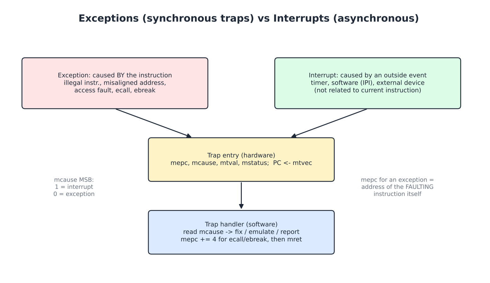

# Day 37 — What are CPU Exceptions? How are They Handled?

> **Course:** Week 9, Video 1 &nbsp;|&nbsp; **Playlist #37** &nbsp;|&nbsp; [Chip Design with Rashid — RISC-V Architecture Explained](https://www.youtube.com/playlist?list=PL0-xus8sJBCRzZtmL_fLWaohRKuc4j5aH)  
> **Notes source:** video topic + standard RV32I material (to be updated from the transcript)

## Trap = Exception or Interrupt

| | **Exception** | **Interrupt** |
|---|---|---|
| Cause | the **current instruction** (something went wrong or it asked for a service) | an **external event** |
| Timing | **synchronous** — always at the same instruction | **asynchronous** — any time |
| `mcause[31]` | 0 | 1 |
| `mepc` holds | address of the **faulting instruction itself** | address of the next instruction |
| Repeatable? | yes, re-running the same code gives the same exception | no |

Both use the **same mechanism** (`mtvec`, `mepc`, `mcause`, `mstatus`, `mret`) from Week 8.



## Exception cause codes (mcause with bit 31 = 0)

| Code | Exception | Example cause |
|---|---|---|
| 0 | Instruction address misaligned | jump to an address not a multiple of 4 (without C ext.) |
| 1 | Instruction access fault | fetch from a non-existent / protected address |
| 2 | **Illegal instruction** | unknown opcode, `mul` on a core without M, CSR not allowed |
| 3 | **Breakpoint** | `ebreak` |
| 4 | Load address misaligned | `lw` from address `0x1002` (if HW doesn't support it) |
| 5 | Load access fault | `lw` from unmapped memory |
| 6 | Store/AMO address misaligned | `sw` to `0x1001` |
| 7 | Store/AMO access fault | write to ROM / unmapped region |
| 8 | **Environment call from U-mode** | `ecall` in a user program |
| 9 | Environment call from S-mode | |
| 11 | **Environment call from M-mode** | `ecall` in bare-metal / firmware |
| 12, 13, 15 | Instruction / load / store page fault | virtual memory (with MMU) |

`mtval` gives extra information: the bad address for misaligned/access faults, or the instruction bits for an illegal instruction.

## How an exception is handled

1. The faulting instruction is **not completed** (no register/memory is changed by it).
2. Hardware: `mepc ← PC of the faulting instruction`, `mcause ← code`, `mtval ← info`, `mstatus` updated, `PC ← mtvec`.
3. The handler reads `mcause` and decides:
   - **Fix and retry** (e.g. load the missing page, emulate a misaligned access) → `mret` returns to the *same* instruction.
   - **Emulate** (e.g. software multiply for an illegal `mul` on an RV32I-only core) → `mepc += 4`, then `mret`.
   - **Service call** (`ecall`) → do the requested service, `mepc += 4` (otherwise it would execute `ecall` forever!), `mret`.
   - **Fatal** → report the error (print `mcause`, `mepc`, `mtval`) and stop/reset.

## `ecall` — system calls

`ecall` is how a program asks the environment (OS, firmware, simulator) for a service. By convention the service number goes in **`a7`** and arguments in `a0–a6`.

```asm
# RARS / Venus style: print integer and exit
    li   a0, 42
    li   a7, 1          # service 1 = print integer
    ecall
    li   a7, 10         # service 10 = exit
    ecall
```

(Linux uses different numbers: e.g. `write` = 64, `exit` = 93.)

## A combined trap handler skeleton

```asm
trap_handler:
    addi sp, sp, -16
    sw   t0, 12(sp)
    sw   t1,  8(sp)
    csrr t0, mcause
    bltz t0, handle_interrupt          # bit 31 = 1 → interrupt (Week 8)

    li   t1, 11                        # ecall from M-mode?
    beq  t0, t1, handle_ecall
    li   t1, 2                         # illegal instruction?
    beq  t0, t1, handle_illegal
    j    fatal_error

handle_ecall:
    # ... perform service selected by a7 ...
    csrr t0, mepc
    addi t0, t0, 4                     # skip the ecall instruction
    csrw mepc, t0
    j    trap_exit

handle_illegal:
    csrr a0, mtval                     # the offending instruction bits
    j    fatal_error

handle_interrupt:
    # ... see Week 8 ...
trap_exit:
    lw   t1,  8(sp)
    lw   t0, 12(sp)
    addi sp, sp, 16
    mret
```

## Privilege modes (context)

| Mode | Level | Who runs there |
|---|---|---|
| **M** — Machine | highest, always present | firmware, bare-metal programs, trap handlers |
| S — Supervisor | middle | OS kernel (Linux) |
| U — User | lowest | applications |

Simple microcontroller-class RISC-V cores implement only **M-mode** (or M + U).

---
[⬅ Day 36](../Day-36-Interrupt-Flow-Part-2/README.md) | [Index](../README.md) | [Day 38 ➡](../Day-38-Assembler-Directives-Alignment/README.md)
