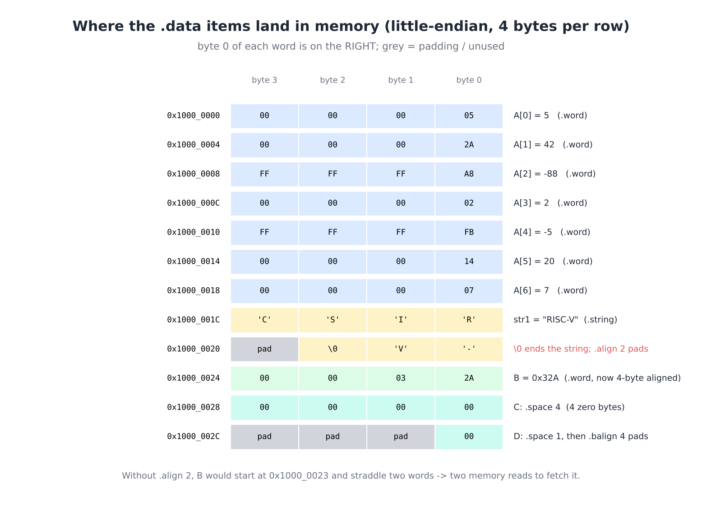
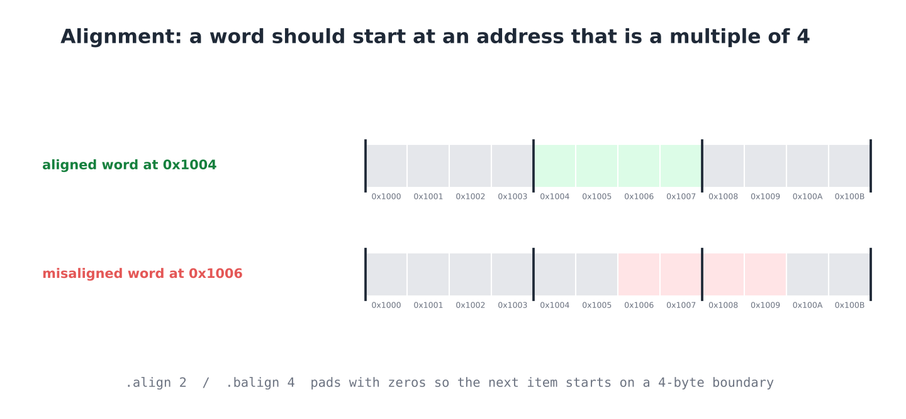

# Day 38 — Assembler Directives and 4-Byte Boundary Alignment

> **Course:** Week 9, Video 2 &nbsp;|&nbsp; **Playlist #38** &nbsp;|&nbsp; [Chip Design with Rashid — RISC-V Architecture Explained](https://www.youtube.com/playlist?list=PL0-xus8sJBCRzZtmL_fLWaohRKuc4j5aH)  
> **Notes source:** lecture transcript

Rashid says this video maybe should have come earlier, but it is not too late. The directives are part of the reference book (Sarah & David Harris), and the goal is simple: **when you see these dot-commands in an assembly program, you won't be shocked.**

## 1. What is a directive?

A **directive** gives **direction** to the **assembler**. Directives are the commands that **start with a dot (`.`)**.

Remember the assembler's job: convert **assembly language → machine code** (just 0s and 1s), which we will later store in **flash**.

**Directives are NOT converted into machine code.** They only guide the assembler while it works.

You already know one thing like this: the **label**. When we jump to a label, the label itself is not stored; the assembler just **calculates an address** from it (Day 30). Directives work the same way — instructions *for the assembler*, not for the CPU.

## 2. Where things go: sections

Remember the **memory-mapped** idea (Day 34): some addresses are for flash, some for SRAM, some for the interrupt controller or GPIO controller.

| Directive | Section | What goes there | Where in our SoC |
|---|---|---|---|
| `.text` | text | **code** — the instructions for the CPU (program memory) | **Flash** |
| `.section .rodata` | read-only data | **constants**; "we will not change it, so put it where it cannot be written" | **Flash** |
| `.data` | data | **initialised** variables (have a starting value) | **SRAM** |
| `.bss` | bss ("block started by symbol") | **uninitialised** variables | **SRAM** |

A section directive means: *everything after this line belongs to this section, until the next section directive.*

### `.data` vs `.bss` — why two?

In C you often declare variables **without a starting value** — they get a value while the program runs.

- If you gave them all an initial value, the **binary** (the executable file) would have to store all those `0000…` bytes → **bigger file**.
- With **`.bss`**, the file just records "I need *N* bytes here". The space is reserved in SRAM, and the **start-up code fills it with zeros**. → **Smaller executable.**

Remember: **SRAM loses everything at power-off**, so the start-up code must set up `.data` and `.bss` every time; flash keeps the code and constants.

## 3. Walking through an example

This example is written in the same style as the book's (values chosen for these notes). It assembles cleanly — see [`code/directives_example.s`](../code/directives_example.s).

```asm
        .globl main                 # 'main' is visible to other files
        .equ   N, 5                 # wherever N appears, use 5

        .data                       # ---- SRAM ----
A:      .word  5, 42, -88, 2, -5, 20, 7
str1:   .string "RISC-V"
        .align 2
B:      .word  0x32A
C:      .space 4
D:      .space 1
        .balign 4

        .text                       # ---- flash: code ----
main:   la   t0, A                  # pseudo-instruction: load the address of A
        li   t1, N                  # N is replaced by 5
        ...

        .section .rodata            # ---- flash: read-only ----
str2:   .string "read only"
```

### Line by line

| Line | Meaning (simple words) |
|---|---|
| `.globl main` | Make **`main`** **global** (visible to other code). Why? We will write a **start-up / boot-loader** program that first sets things up (stack pointer, etc.) and then **calls `main`** — so it must be able to see `main`. |
| `.equ N, 5` | Like a **find-and-replace**: wherever `N` appears, the assembler puts **5**. No memory is used. |
| `.data` | What follows are **variables stored in SRAM**. |
| `A: .word 5, 42, …` | `A` is a variable of **7 words**. `.word` = **32 bits** each. Even a small value like 5 takes a full word. Negative numbers are stored in 2's complement, so they show lots of `F`s: `−88 = 0xFFFF_FFA8`. |
| `str1: .string "RISC-V"` | A **string** of characters `R I S C - V`, one byte each (ASCII). Like C, the assembler adds a **0 byte at the end** to mark the **end of the string**. |
| `.align 2` | Start the next item on a **4-byte boundary** (explained below). |
| `B: .word 0x32A` | One word; now it starts at an address divisible by 4. |
| `C: .space 4` | Reserve **4 bytes** (filled with 0). |
| `D: .space 1` | Reserve **1 byte**. |
| `.balign 4` | Same idea as `.align 2` — align to **4 bytes** (`balign` takes the number of bytes directly). |
| `.text` / `main:` | The **main code**. It uses pseudo-instructions like **`la`** (load address), which is not one of the 37 base instructions but the assembler converts it into real ones. |
| `.section .rodata` | **Read-only data** (e.g. another string) — kept in flash. |

### Where everything lands in memory



*(Assuming `.data` starts at `0x1000_0000`, the SRAM start in our example memory map. Offsets were checked with a real assembler.)*

Notice the **grey "pad" byte** after `"RISC-V\0"`: the string uses 7 bytes (`0x1C`–`0x22`), so `.align 2` **skips** `0x23` and starts `B` at **`0x24`**.

## 4. What does "4-byte boundary aligned" mean?



- Our data bus is **32 bits**: one memory access brings **4 bytes** (one word).
- We **can** access each byte separately, but normally the CPU gives one address (a multiple of 4) and gets **the whole word** in one go — just like **PC + 4** for instructions.

**Aligned** (word starts at an address divisible by 4, e.g. `0x24`): **one access** gets the whole word. ✅

**Not aligned** (e.g. a word starting at `0x23`): the 4 bytes are split across **two** words. The CPU must:

1. read the first word and **keep only some bytes**,
2. read the second word and keep the rest, **throwing away** the other bytes,
3. join them.

That is a **waste of resources** and **more cycles** → bad for performance (and many simple CPUs raise an exception instead — Day 37).

**`.align 2`** means align to **2² = 4 bytes**: it makes sure a 4-byte item **starts at an address divisible by 4**. In the example, without it, `B` would start at `0x23` and straddle two words.

| Directive | Aligns to | Same as |
|---|---|---|
| `.align 2` | 2² = 4 bytes | `.balign 4` |
| `.align 3` | 2³ = 8 bytes | `.balign 8` |

## 5. More common directives (quick reference)

| Directive | Meaning |
|---|---|
| `.byte v` | 8-bit value |
| `.half v` | 16-bit value |
| `.word v` | 32-bit value |
| `.string "s"` / `.asciz "s"` | string with a 0 at the end |
| `.ascii "s"` | string **without** the 0 |
| `.space n` / `.zero n` | reserve *n* zero bytes |
| `.equ name, v` | a named constant (no memory) |
| `.globl name` | make a label visible to other files |

## Key takeaways

- Directives start with **`.`**, guide the **assembler**, and produce **no machine code**.
- **`.text`** and **`.rodata`** → flash; **`.data`** (initialised) and **`.bss`** (uninitialised, zero-filled) → SRAM.
- `.word` = 32 bits; strings end with a **0 byte**.
- **`.align 2` = 4-byte boundary** → a word can be read in **one** access instead of two.

## Practice Questions

1. Is a directive turned into machine code?
2. Why is `main` declared with `.globl`?
3. What is the difference between `.data` and `.bss`?
4. How many bytes does `.string "RISC-V"` use?
5. A string ends at address `0x1000_0022`. With `.align 2`, where does the next word start?
6. Why is an unaligned word slower to read?

**Answers**

1. No — directives only guide the assembler.
2. So the start-up (boot) code can find and call it.
3. `.data` holds variables with a starting value; `.bss` holds uninitialised variables (zero-filled at start-up, keeping the executable smaller).
4. 7 bytes (6 characters + the 0 at the end).
5. `0x1000_0024` (the next address divisible by 4).
6. It spans two words, so the CPU needs two accesses and must throw away unwanted bytes and join the rest.

---
[⬅ Day 37](../Day-37-CPU-Exceptions/README.md) | [Index](../README.md) | [Day 39 ➡](../Day-39-Debug-GDB-OpenOCD-JTAG/README.md)
