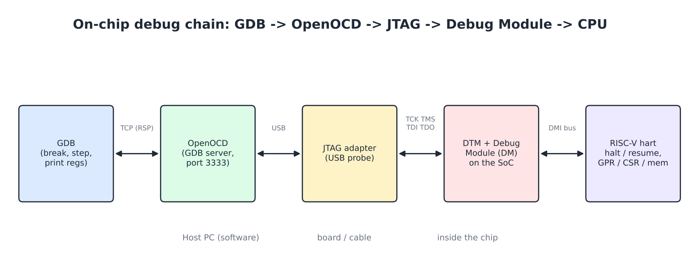

# Day 39 — Adding Debug Features to our SoC - GDB, OpenOCD, JTAG, OCD

> **Course:** Week 9, Video 3 &nbsp;|&nbsp; **Playlist #39** &nbsp;|&nbsp; [Chip Design with Rashid — RISC-V Architecture Explained](https://www.youtube.com/playlist?list=PL0-xus8sJBCRzZtmL_fLWaohRKuc4j5aH)  
> **Notes source:** video topic + standard RV32I material (to be updated from the transcript)

When software runs on a real chip there is no simulator window. We need **On-Chip Debug (OCD)**: a way to stop the CPU, look inside, and control it from a PC.



## The chain, piece by piece

| Piece | Where | Role |
|---|---|---|
| **GDB** (`riscv64-unknown-elf-gdb`) | host PC | the debugger UI: breakpoints, step, print variables / registers / memory, view source |
| **OpenOCD** | host PC | "On-Chip Debugger" server: translates GDB's Remote Serial Protocol (TCP port 3333) into JTAG operations; knows the RISC-V debug spec |
| **JTAG adapter** | USB dongle / on-board | converts USB to the 4–5 JTAG wires |
| **JTAG TAP + DTM** | on chip | Test Access Port state machine + Debug Transport Module; carries debug requests into the chip |
| **Debug Module (DM)** | on chip | can **halt / resume** harts, read/write GPRs, CSRs and memory (abstract commands / program buffer / system bus access) |
| **Trigger module** | in the CPU | hardware breakpoints & watchpoints (compare PC / address) |

## JTAG signals (IEEE 1149.1)

| Signal | Direction | Purpose |
|---|---|---|
| **TCK** | in | test clock |
| **TMS** | in | test mode select — steps the TAP state machine |
| **TDI** | in | test data in (serial) |
| **TDO** | out | test data out (serial) |
| TRST | in (optional) | test reset |

JTAG was originally made for **boundary-scan** testing of boards; debug reuses the same 4-wire serial port so a chip needs no extra pins.

## What the CPU needs for debugging (RISC-V Debug Specification)

- A **Debug Mode**: a special state where the hart is halted and controlled by the DM.
- Debug CSRs: `dcsr` (debug control/status, e.g. `step` bit for single-step), `dpc` (PC to resume at), `dscratch`.
- `ebreak` → enter Debug Mode (software breakpoint: the debugger replaces an instruction with `ebreak`).
- **Hardware triggers**: breakpoints in ROM/Flash where the code cannot be patched.
- `dret` to leave Debug Mode.

## A typical session

```bash
# terminal 1 — connect to the board
openocd -f interface/ftdi/olimex-arm-usb-tiny-h.cfg -f target/my_riscv_soc.cfg

# terminal 2 — debug the program
riscv64-unknown-elf-gdb firmware.elf
(gdb) target extended-remote localhost:3333
(gdb) load                    # program flash / RAM
(gdb) break main
(gdb) continue
(gdb) stepi                   # one machine instruction
(gdb) info registers          # x0..x31, pc
(gdb) p/x $mcause             # read a CSR
(gdb) x/4xw 0x80000000        # examine 4 words of memory
(gdb) watch counter           # stop when variable changes (hardware trigger)
```

## Simulation-only alternatives

- `spike --rbb-port=9824` + OpenOCD (remote bit-bang) → the same GDB flow on an ISA simulator.
- `qemu-system-riscv32 -s -S` → GDB server built into QEMU.

---
[⬅ Day 38](../Day-38-Assembler-Directives-Alignment/README.md) | [Index](../README.md) | [Day 40 ➡](../Day-40-Course-Overview-Roadmap/README.md)
