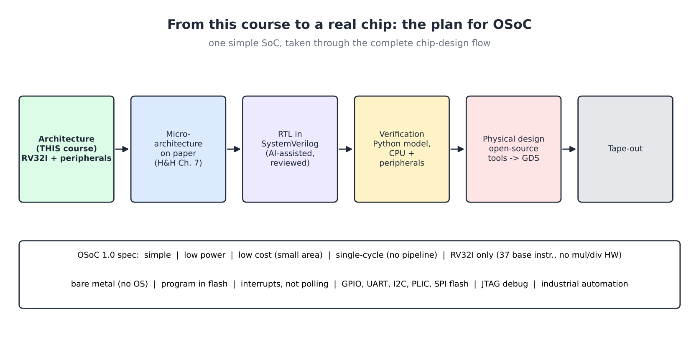

# Day 40 — Complete Course Overview and Roadmap

> **Course:** Week 9, Overview &nbsp;|&nbsp; **Playlist #40** &nbsp;|&nbsp; [Chip Design with Rashid — RISC-V Architecture Explained](https://www.youtube.com/playlist?list=PL0-xus8sJBCRzZtmL_fLWaohRKuc4j5aH)  
> **Notes source:** lecture transcript

Rashid recorded this video **after** finishing the course, as a wrap-up. He plans to move it to the **start** of the playlist, because it gives a newcomer the clearest idea of what the whole course covers. If you are revising, this is the best page to start from.

## 1. How the course changed while it was taught

It was the first time he taught RISC-V. He started with a plan, then adjusted:

- He covered **everything planned — and more** — but the order and style changed.
- At first he wanted to mix in hardware (digital-design) concepts. Later he decided to **keep the micro-architecture (hardware) separate** — it is the **next course**.
- So this course stays at the **architecture level**. Some digital-design blocks appeared (and he pointed to his older videos), but **you can follow this course even without a digital-design background**. Doing digital design first is still the ideal order.

## 2. Where this course sits: the learning tracks

On his website, his content is grouped into **tracks**:

| Track | For whom | Contents |
|---|---|---|
| **Track 1** | people **new to chip design** — "where do I start?" (e.g. after 12th grade, through undergrad, wanting to become an IC designer) | the practical courses for **digital IC design** — this RISC-V course is part of it |
| **Track 2** | physical design | detailed physical-design training |

His view: these practical courses need **about 1–2 years**, not 4. If you take them well, you should be ready for **interviews** and a good job.

### The Track 1 path so far (started June 2024)

```
Digital design basics        → combinational + sequential circuits
Transistors (practical)      → inverter, gates, flip-flops from transistors; power, performance, area (PPA)
Physical design overview     → high-level idea of physical design
(SystemVerilog training)     → a 7-day in-person training (not on YouTube)
Physical design (Track 2)    → detailed training
RISC-V architecture          → THIS course: CPU + peripherals
Micro-architecture           → NEXT
```

Why transistors? Every circuit you design **finally becomes transistors**, and that is where **power, performance and area** limits come from.

## 3. Why build our own SoC instead of "generic" computer architecture?

Teaching computer architecture concept-by-concept, slide after slide, becomes **too much and boring**. So instead:

- We **create our own SoC**, based on **RISC-V** because it is **open source**.
- Start **very simple** and go back to the **RISC-V specification** when needed.
- Rashid also learnt RISC-V himself while teaching it (he had studied MIPS before).

## 4. The SoC: OSoC 1.0



| Feature | Choice | Why |
|---|---|---|
| Goal | **simple + low power** | more features = more complexity |
| CPU type | **single-cycle**, **no pipelining** | simplicity, low power |
| Cost | **low cost** — few options → **small area** | cheap chip |
| ISA | **RV32I only** — the **37 base instructions** | no multiply/divide hardware (do it with shifts and adds), **no extensions** |
| Extras | a few interface/halt-related additions on top of the 37 | to control and stop the CPU |
| Use | **industrial automation** | this choice decided which interfaces were picked |
| Software | **bare metal** — no operating system | simple; one program with full control |
| Program storage | **flash** — the code stays there | survives power-off |

**The name:** Rashid calls it **OSoC** ("O-SoC"), inspired by Irish surnames such as O'Connell and O'Connor — he lived in Ireland for 8 years. This is version **OSoC 1.0**; later versions (2.0 …) will add features step by step.

## 5. The three parts of this course

### Part 1 — the RV32I instructions (about 5–6 weeks)

- The **37 base instructions**, with **assembly examples**.
- Why assembly? Real programs are written in C → compiled to assembly → machine code. Assembly shows **exactly what each instruction does** — and **if you don't know what the instructions do, how can you build the hardware?**
- These notes: **Days 01–32**.

### Part 2 — Python + simulator and debugger *(separate videos, not in this playlist)*

- All instructions were worked out **by hand**, which limits how much practice you can do.
- So Rashid gave a **Python tutorial**, then built his **own RISC-V simulator and debugger in Python** (with AI help). It is meant for education: practise every instruction, and later use it for **verification**.
- He plans to link it on his website; the next version of the course will use it from the start.

### Part 3 — the SoC: CPU + peripherals

A CPU alone **cannot do anything** useful — it must talk to the real world. So this part added:

- **CSRs** (control & status registers) inside the CPU
- **SRAM**, **GPIOs**, other interfaces
- a **platform-level interrupt controller** (plus a small interrupt controller) — **interrupts, not polling**, because interrupts save power
- the **system bus**: CPU = **master**, other blocks = agents/slaves
- **flash** through an **SPI controller**
- **memory mapping**: how the CPU actually works with all these devices
- and finally **debug** — to find problems in registers and elsewhere **after the chip is manufactured**

These notes: **Days 33–39**.

All of this is the **architecture** of the SoC — how the components connect at a **conceptual** level, not yet at the hardware level.

## 6. What comes next: the full chip-design flow

1. **Micro-architecture on paper** — start from **Chapter 7** of the Sarah & David Harris book; build the **CPU** first (the core of the SoC) as hardware blocks on paper, no code yet. This teaches how to go from **architecture → micro-architecture**.
2. **SystemVerilog** — first a tutorial, so you can turn any paper drawing into SystemVerilog. Coding itself "is not a big deal"; being good at **hardware design** is what matters. Rashid plans to let **AI write most of the code**, while we **review and explain** it.
3. **Verification** — a full verification model of the **CPU and the peripherals**, possibly starting with a **Python model** before SystemVerilog.
4. **Build the whole SoC** — CPU + peripheral hardware together.
5. **Physical design** — install **open-source tools**, take the fully verified RTL through physical design, and get the **GDS** ready for **tape-out**.
6. **Tape-out** — explore the options to actually manufacture it.

**The goal:** take one simple, practical SoC through the **complete flow**, so you have the basics to go into **RTL design, RTL verification or physical design** — and then go deeper in any one of them.

## Key takeaways

- This course = the **architecture** of a simple RISC-V SoC: **RV32I instructions → (simulator) → peripherals, interrupts, memory map, debug**.
- **OSoC 1.0**: simple, low-power, low-cost, single-cycle, RV32I only, bare metal, program in flash, for industrial automation.
- Next: **micro-architecture → SystemVerilog RTL → verification → physical design → GDS → tape-out**.

## Practice Questions

1. Why did Rashid choose to build an SoC instead of teaching generic computer architecture?
2. Give four design choices of OSoC 1.0.
3. Why is the CPU single-cycle and not pipelined?
4. Why does OSoC use interrupts instead of polling?
5. Put these in order: physical design, micro-architecture, verification, architecture, RTL, tape-out.
6. Which chapter of the reference book does the next course start from?

**Answers**

1. Slide-after-slide concepts become too much and boring; building a real SoC gives every concept a purpose, and RISC-V is open source.
2. Any four of: simple, low power, low cost (small area), single-cycle, RV32I only (no mul/div hardware, no extensions), bare metal, program in flash, industrial automation.
3. To keep it simple and low power.
4. Interrupts save power — the CPU does not keep checking devices.
5. Architecture → micro-architecture → RTL → verification → physical design → tape-out.
6. Chapter 7.

---
[⬅ Day 39](../Day-39-Debug-GDB-OpenOCD-JTAG/README.md) | [Index](../README.md)
