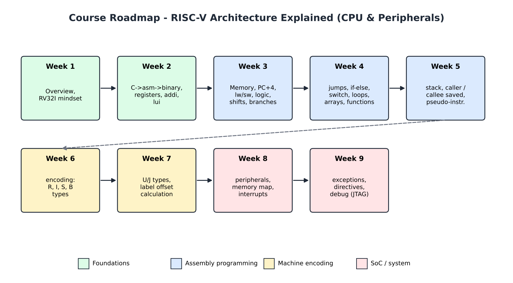
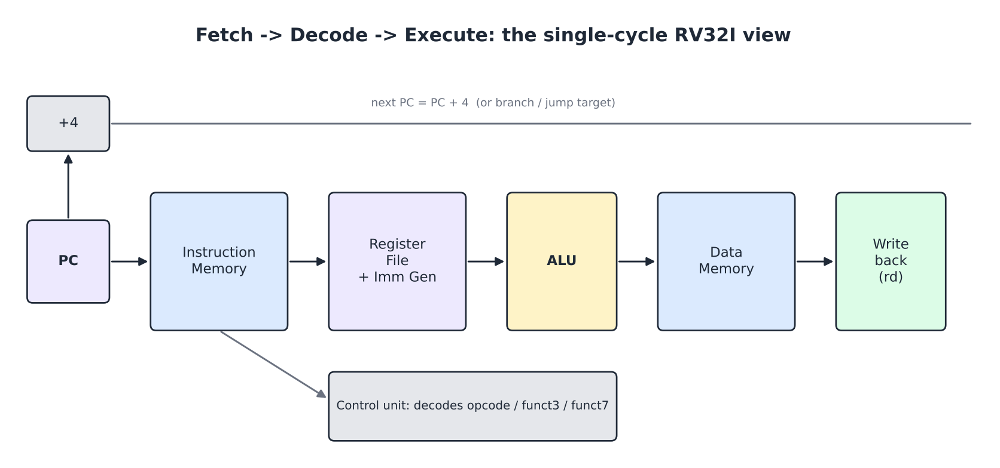

# RISC-V Architecture Notes — CPU and Peripherals 🧠⚙️

Day-by-day study notes for the YouTube course **"RISC-V Architecture Explained — CPU and Peripherals"** by *Chip Design with Rashid* (40 videos, 9 weeks), written by **Pavitinder Singh Bahia** (ECE, Thapar Institute of Engineering & Technology).

Each day (one per video) has detailed theory, diagrams, worked examples, runnable RV32I assembly and practice questions with answers.

> 📺 Course playlist: https://www.youtube.com/playlist?list=PL0-xus8sJBCRzZtmL_fLWaohRKuc4j5aH

> 📄 **Full notes as one PDF (Day 01–40, 135 pages):** [PDF/40 day Rashid Risc v.pdf](<PDF/40 day Rashid Risc v.pdf>)



---

## 📚 Day-by-day contents

One day = one video of the playlist (Day number = playlist number). The *Notes* column shows whether a day has been written from the lecture transcript or from the video topic (standard RV32I material), and **+ notes** marks days that also include a *From Rashid's weekly notes* section (extra points and examples from his members-only Week 1–7 notes, rewritten in my own words).

| Day | Course week · video | Topic | Notes |
|---|---|---|---|
| 01 | 1 · Video 1 | [Overview of the Training](Day-01-Overview-of-the-Training/README.md) | topic + notes |
| 02 | 1 · Video 2 | [Starting with 32-bit RV32I, the 'Just in Time' Fundamental Approach](Day-02-RV32I-Just-in-Time-Approach/README.md) | transcript |
| 03 | 2 · Video 1 | [C Language to Assembly to Machine Language](Day-03-C-to-Assembly-to-Machine-Language/README.md) | transcript + notes |
| 04 | 2 · Video 2 | [What is a Register?](Day-04-What-is-a-Register/README.md) | topic + notes |
| 05 | 2 · Video 3 | [Register File, Instruction Examples with Registers](Day-05-Register-File/README.md) | topic + notes |
| 06 | 2 · Video 4 | [Why Assembly? ADDI Instruction, 2's Complement, Sign Extension](Day-06-ADDI-2s-Complement-Sign-Extension/README.md) | topic + notes |
| 07 | 2 · Video 5 | [Assigning a Register a 32-bit Value with LUI and ADDI](Day-07-LUI-and-ADDI/README.md) | topic + notes |
| 08 | 2 · Recap | [Week 1 & 2 Recap](Day-08-Week-1-2-Recap/README.md) | transcript |
| 09 | 3 · Video 1 | [Memory Architecture - Why PC+4 Has the Next Word](Day-09-Memory-Architecture-PC-plus-4/README.md) | topic + notes |
| 10 | 3 · Video 2 | [Load Word and Store Word Instructions](Day-10-Load-Word-Store-Word/README.md) | topic + notes |
| 11 | 3 · Video 3 | [Logical AND, OR, XOR - All Register Based](Day-11-Logical-AND-OR-XOR/README.md) | topic + notes |
| 12 | 3 · Video 4 | [Logical Immediate Instructions](Day-12-Logical-Immediate-Instructions/README.md) | topic + notes |
| 13 | 3 · Video 5 | [Shift Instructions](Day-13-Shift-Instructions/README.md) | transcript + notes |
| 14 | 3 · Video 6 | [Branch Instructions - Conditional](Day-14-Conditional-Branches/README.md) | topic + notes |
| 15 | 3 · Recap | [Week 3 Recap](Day-15-Week-3-Recap/README.md) | transcript |
| 16 | 4 · Video 1 | [Unconditional Jump, If-Else and Switch-Case Implementation](Day-16-Jump-If-Else-Switch-Case/README.md) | topic + notes |
| 17 | 4 · Video 2 | [Loop Instructions](Day-17-Loops/README.md) | topic + notes |
| 18 | 4 · Video 3 | [Arrays, ASCII Characters, Load/Store Bytes and Half-Words](Day-18-Arrays-ASCII-Bytes-Halfwords/README.md) | topic + notes |
| 19 | 4 · Recap | [Week 4 Recap - If-Else, Case, For, While, Arrays, Function](Day-19-Week-4-Recap/README.md) | transcript |
| 20 | 5 · Video 1 | [Using the Stack to Back Up Registers During a Function Call](Day-20-Stack-Backup-Registers/README.md) | topic + notes |
| 21 | 5 · Video 3 | [Usage of the Stack by a Function that is Callee and Caller](Day-21-Stack-Callee-and-Caller/README.md) | topic + notes |
| 22 | 5 · Video 2 | [Who Saves Which Register - Callee or Caller, Preserved Registers](Day-22-Caller-vs-Callee-Saved/README.md) | transcript |
| 23 | 4 · Video 4 | [Functions - Case I, Case II (4 Arguments, One Return Value)](Day-23-Functions-Case-I-II/README.md) | transcript + notes |
| 24 | 5 · Video 4 | [Further Use of Stack, Pseudo-instructions](Day-24-Stack-and-Pseudo-instructions/README.md) | topic + notes |
| 25 | 5 · Video 5 | [Wrapping Up All 37/40 Base Instructions - Next Steps](Day-25-All-40-Base-Instructions/README.md) | topic + notes |
| 26 | 6 · Video 1 | [R-Type Instructions](Day-26-R-Type-Encoding/README.md) | topic + notes |
| 27 | 6 · Video 2 | [I-Type Instructions (Assembly to Machine Language)](Day-27-I-Type-Encoding/README.md) | topic + notes |
| 28 | 6 · Video 3 | [S/B-Type Instructions - Assembly to Binary](Day-28-S-B-Type-Encoding/README.md) | transcript + notes |
| 29 | 7 · Video 2 | [U/J-Type Instructions - Assembly to Machine Language](Day-29-U-J-Type-Encoding/README.md) | topic + notes |
| 30 | 7 · Video 3 | [Recap of Jumps and How LABEL Address is Calculated](Day-30-Label-Address-Calculation/README.md) | transcript |
| 31 | 7 · Video 1 | [Revision of R-Type, I-Type, S/B-Type Instructions](Day-31-Revision-R-I-S-B/README.md) | transcript |
| 32 | 6 · Video 4 | [An Example of BNE (B-Type) with Label Going Backward](Day-32-BNE-Backward-Label/README.md) | topic + notes |
| 33 | 8 · Video 1 | [RISC-V Interface to the Outside World, Peripherals](Day-33-Peripherals/README.md) | transcript |
| 34 | 8 · Video 2 | [Memory Address Space - Memory-Mapped Peripherals](Day-34-Memory-Mapped-IO/README.md) | transcript |
| 35 | 8 · Video 2 | [12-Step Interrupt Action Flow - Part 1/2](Day-35-Interrupt-Flow-Part-1/README.md) | topic |
| 36 | 8 · Video 3 | [12-Step Interrupt Action Flow - Part 2/2](Day-36-Interrupt-Flow-Part-2/README.md) | transcript |
| 37 | 9 · Video 1 | [What are CPU Exceptions? How are They Handled?](Day-37-CPU-Exceptions/README.md) | topic |
| 38 | 9 · Video 2 | [Assembler Directives and 4-Byte Boundary Alignment](Day-38-Assembler-Directives-Alignment/README.md) | transcript |
| 39 | 9 · Video 3 | [Adding Debug Features to our SoC - GDB, OpenOCD, JTAG, OCD](Day-39-Debug-GDB-OpenOCD-JTAG/README.md) | topic |
| 40 | 9 · Overview | [Complete Course Overview and Roadmap](Day-40-Course-Overview-Roadmap/README.md) | transcript |
| — | — | [RV32I one-page cheat-sheet](Cheatsheet/RV32I-Cheatsheet.md) | — |

## 🗂 Repository layout

```
riscv-architecture-notes/
├── README.md                     ← you are here
├── Day-01-Overview-of-the-Training/README.md
├── Day-02-RV32I-Just-in-Time-Approach/README.md
├── ...                           ← one folder per video (40 days)
├── Day-40-Course-Overview-Roadmap/README.md
├── Cheatsheet/RV32I-Cheatsheet.md
├── PDF/                          ← all notes in one PDF
├── code/                         ← runnable RV32I assembly examples
├── diagrams/                     ← all figures (PNG)
└── tools/
    ├── rv32i_encoder.py          ← encode any RV32I instruction & see its fields
    └── make_diagrams.py          ← regenerates every diagram
```

## 🛠 Running the examples

The `.s` files in `code/` are plain RV32I assembly.

- **Simulators (easiest):** open them in [RARS](https://github.com/TheThirdOne/rars), [Venus](https://venus.cs61c.org/) or [Ripes](https://github.com/mortbopet/Ripes) and single-step.
- **Toolchain:**
  ```bash
  riscv64-unknown-elf-as -march=rv32i -mabi=ilp32 file.s -o file.o
  riscv64-unknown-elf-objdump -d file.o
  # or with LLVM:
  llvm-mc -triple=riscv32 -mattr=-c -show-encoding file.s
  ```

- **Check a hand-encoding:**
  ```bash
  python3 tools/rv32i_encoder.py "bne t0, t1, -8"
  # bne t0, t1, -8  -> 0xFE629CE3   (B-type)
  ```

All examples in `code/` assemble cleanly, and every machine-code value quoted in the notes has been checked against the LLVM assembler.

## 🧭 The big picture



1. **Assembly programming** (Weeks 1–5) — what each instruction does.
2. **Machine encoding** (Weeks 6–7) — what the hardware decoder sees.
3. **System level** (Weeks 8–9) — how the CPU talks to peripherals, handles interrupts/exceptions and gets debugged.

## 📖 References

- *The RISC-V Instruction Set Manual, Volume I: Unprivileged ISA* and *Volume II: Privileged Architecture* — riscv.org
- *RISC-V External Debug Support* specification — riscv.org
- Patterson & Hennessy, *Computer Organization and Design — RISC-V Edition*
- Harris & Harris, *Digital Design and Computer Architecture — RISC-V Edition*

> These are personal study notes. Peripheral addresses in Weeks 8–9 follow the common SiFive/QEMU convention and are examples only — always check your SoC's datasheet.
